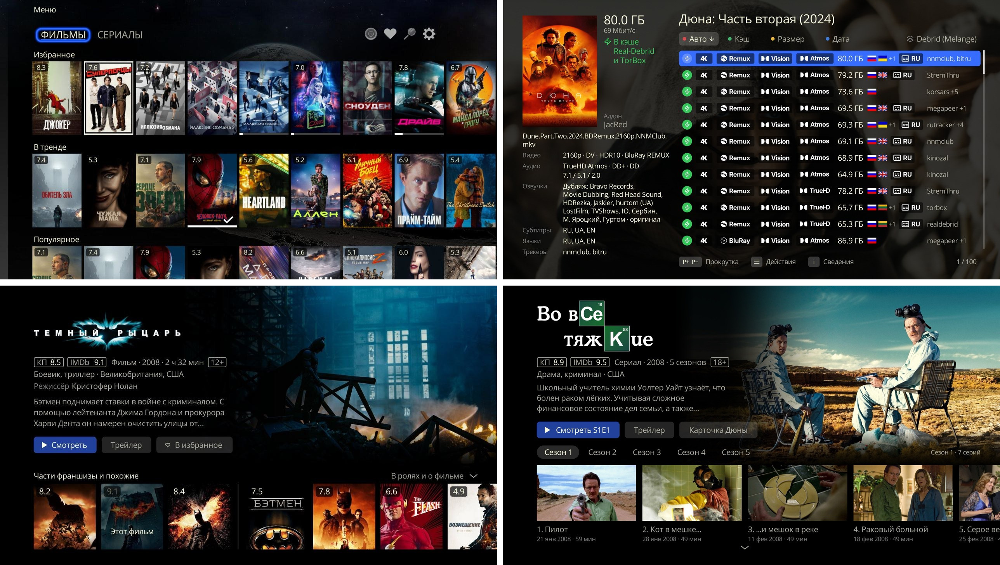

[Русский](README.md) | **English**

# Melange for Dune HD

Melange turns your Dune into an online cinema: a movie and series catalog with curated rows and search. Pick a movie, and Melange finds releases, shows their quality and dubs, and plays the movie in the Dune player. Stop anytime and resume from the same spot. You can also pick a movie in the Dune's own **Movies** catalog: the **Play...** menu of its card has two Melange items.

The [guide](docs/README.en.md) walks through every step with screenshots.

## Requirements

- A Dune HD on Android with firmware r22 or newer, r24 or r25 recommended. Melange does not work on Sigma / Linux Dunes and is not guaranteed to work on models with 1 GB of memory ([Known limitations](docs/limitations.en.md#devices-and-firmware)).
- One way to watch:
    - **Torrents via TorrServer**: free, needs the TorrServe app on the Dune ([Torrents and TorrServer](docs/torrserver.en.md)).
    - **Debrid** (Real-Debrid or TorBox): a paid subscription, movies start right away ([Debrid](docs/debrid.en.md)).

## Installation and quick start

[Quick start](docs/start.en.md) shows how to install and set up Melange. The zip is in [releases](https://github.com/a1d4r/dune-hd-melange/releases/latest).

## Troubleshooting

[Troubleshooting](docs/troubleshooting.en.md) lists on-screen messages and what to do about them. If that does not help, download the log on the settings page and open an [issue](https://github.com/a1d4r/dune-hd-melange/issues).

## License

MIT, see the `LICENSE` file.
