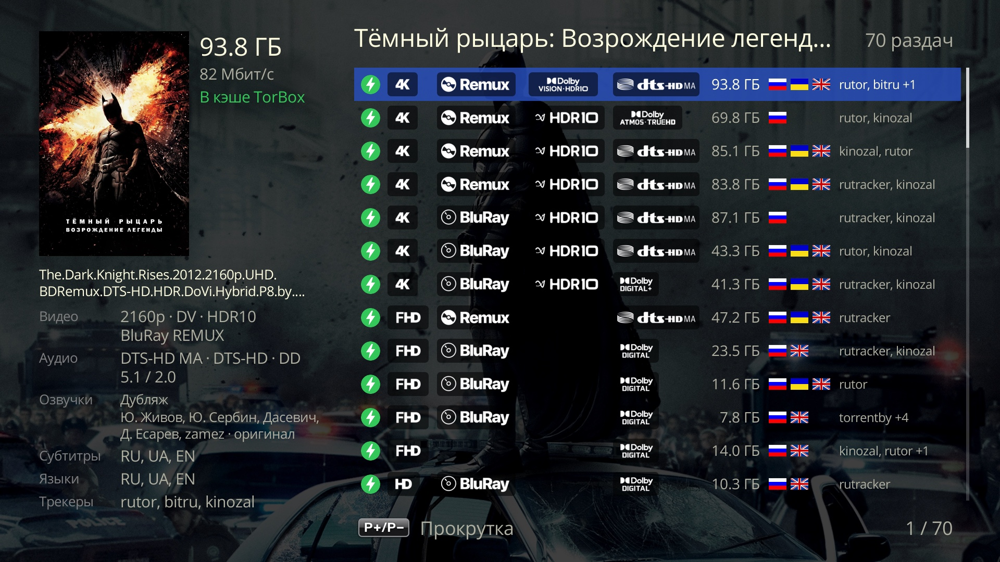
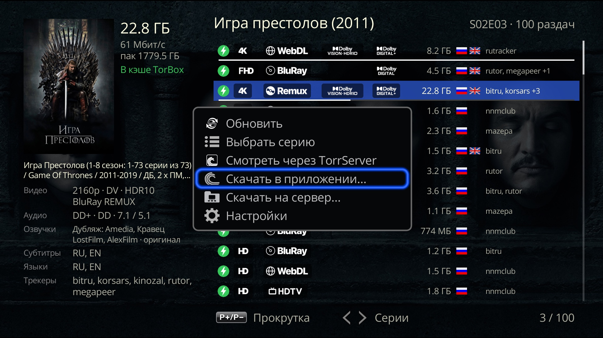

# Melange for Dune HD

[Русский](README.md) | **English**

## What it is
A Dune HD plugin that adds a **Melange** item to the **Play...** menu of a movie or series card in the Dune **Movies** catalog. The item opens a list of releases from **your** AIOStreams config, and the chosen release plays in the Dune's built-in player.

**Debrid (Real-Debrid or TorBox with a subscription) is optional.** With it, cached releases start at once; without it, the "Torrents" answer: Melange makes a config without a key, and releases play via TorrServer on the Dune. A ready AIOStreams config of your own works too (see "What you need").

What it does:
- a list of up to 100 releases in AIOStreams order: quality badges (resolution, source, HDR / Dolby Vision, audio), size, language flags, trackers; on the left, details of the selected release: whether it is cached, video, audio, voice-overs, subtitles, languages;
- playback with the Dune history: the percentage on the "Melange [NN%]" button in the card, the movie or episode in the Continue Watching row, resume from where you stopped;
- series: all episodes of a season play in a row in the player (P+ / P− and auto-advance) on the same release; flip episodes right in the list with ← / →;
- playback via TorrServer, without Debrid (P2P releases) or for an uncached release, with the same history;
- studio voice-overs from the release name and its tracks; optionally, tracks from JacRed;
- setup from a phone by a QR code; "Download the log" is there too.

 

## What you need
- **An Android-based Dune HD with firmware r22 or newer.** Tested only on Pro 8K Plus with firmware 260827_0003_r24. Other Android Dune models, ATV boxes with the Dune HD app (Homatics and others) and r22 should work, but this is not tested; if something goes wrong, send the log (see "Log").
- **Does not work** on Sigma / Linux Dunes (Solo 4K, Duo 4K, Base 3D, TV-303D and older: they have neither the Movies catalog with the Play... menu nor Android apps), and is not promised on models with 1 GB of memory (SmartBox 4K, SmartBox 4K Plus, Traveler, Neo 4K, 4K Neo, Neo 4K T2).
- **A Debrid key**, Real-Debrid or TorBox (with a subscription). With it Melange makes an AIOStreams config by itself on the chosen public server (or on your own AIOStreams server): releases are found by JacRed, Torrentio, MediaFusion, Comet and StremThru Torz and played via Debrid. Melange shows the config login and password so you can tune it in the AIOStreams web settings.
- Or **no Debrid**: the **"Torrents"** answer. Melange makes a config without a key (by default only JacRed finds releases, Russian trackers; the "Everywhere" template adds Torrentio, TorrentsDB, Comet and StremThru Torz), and releases play via TorrServer (the TorrServe app on the Dune). They start slower than from the Debrid cache, depending on the seeders.
- Or **your own AIOStreams config**, already set up (services, filters, limits); then no key is needed on the page. Without Debrid, with P2P releases, you need TorrServer (the TorrServe app on the Dune). Melange does not change your own config, it only reads the release list.
- A phone on the same home network as the Dune, for the settings page.
- **JacRed**: nothing to do. The default is `jacred.kompotik.com`, Melange's JacRed (the author runs it for plugin users); you can choose another built-in one or your own. In the Melange config JacRed searches for releases along with the other addons; if it does not answer the AIOStreams server, there will be fewer releases (in the "Russian trackers only" template, the default for "Torrents", and in configs made before 0.38.0 JacRed is the only source, so there will be none). With your own config JacRed is needed only for tracks and voice-overs: if it does not answer, there will be no tracks, everything else works.

## Install
1. Download the zip from the releases page https://github.com/a1d4r/dune-hd-melange/releases: the latest release, file `dune_plugin_melange_<version>.zip` under Assets. Copy it to a USB drive or to the Dune's internal storage.
2. On the Dune open **Sources**, find the zip and press ENTER.
3. In about half a minute the **Melange** item appears in the **Play...** menu of cards, no reboot needed. If a card was open during the install, leave it and open it again.

Updates: since 0.36.0 the Dune itself checks GitHub Pages for a new Melange version (after a reboot and when you open **Setup → Apps → Melange**) and offers to install it. Install 0.36.0 itself by hand, as before. If an update does not come, install the new zip over the old one the same way. The settings and the settings page link are kept on update. To remove the plugin, uninstall it in the Dune plugin list (its settings are erased with it).

## First setup (by QR code)
**Where to open the settings screen** (every way leads to the same screen):
- **Setup → Apps → Melange**;
- the **Melange** icon in **Apps → Dune HD**: ENTER opens the screen, and so does MENU → **Settings**;
- MENU on the release list screen → **Settings**;
- if there is no config yet, choosing Melange in a card shows **"No AIOStreams config — open Melange settings"** (with your own config but no link: "The link to your AIOStreams config is not set") with the buttons **Set up** and **Close**; **Set up** opens the settings screen.

**The settings screen.** A line **"AIOStreams - Melange config"** or **"AIOStreams - own config"** with the server address or **"not set"**; a **JacRed** line with the chosen JacRed (your own one is shown by its host); the buttons **Set up from a phone** and **Change the link**.

1. Press **Set up from a phone**: a QR code appears, with the page address as text under it and the hint "You can bookmark this page".
2. Scan the QR code with your phone: the **"Melange settings"** page opens.
The page is in the Dune's language (Russian or English; if the Dune's language cannot be read, in the browser's language), light or dark as the phone is set. **The main screen** shows the state and the list of sections: each line has the current value and a status dot; tap a line to open its section, and **"‹ Settings"** or the phone's Back goes back to the main screen (the section is the part of the address after `#`, so a bookmark opens it). Until anything is saved, the main screen first asks **"Where to get films"**: three cards and **"Start"**. The **"Check"** buttons are small, inside the field; the result is a line under the field; they never run by themselves.

3. **Where to get films**: one of three answers; only the fields of the chosen one are shown:
   - **Debrid**: needs a Real-Debrid or TorBox key; releases are found by JacRed (chosen in the "JacRed" section), Torrentio, MediaFusion, Comet and StremThru Torz and played via Debrid. Inside:
     - **"Real-Debrid key"** and **"TorBox key"**: at least one is needed, both are fine. While both are empty, a **Real-Debrid / TorBox** switch on top and one field; with one key entered, a **"+ Add TorBox"** (or **"+ Add Real-Debrid"**) link under it for the other; with both filled, both fields are shown. Get them at [real-debrid.com/apitoken](https://real-debrid.com/apitoken) and [torbox.app/settings](https://torbox.app/settings). **"Check"** in the field: the Dune asks the service and shows under the field "the key is valid, premium until <date>", "the key is valid, but no premium", "the key is not accepted" or "the key was not checked" (no connection to the service); nothing is saved.
     - **"Where to look for releases"**: the template the Melange config starts from, cards with an explanation under each: **"Everywhere"** (the default: JacRed, Torrentio, MediaFusion, Comet and StremThru Torz; more releases cached on Debrid, especially on Real-Debrid) or **"Russian trackers only"** (JacRed, faster reply; few releases with Real-Debrid alone). If the chosen server already has a Debrid config, the choice shows its template: Melange recognizes it by the config's addons on the server, on every "Save". If the set of addons was changed in the AIOStreams web settings, it shows "Custom set of addons (changed in AIOStreams)"; for a config made before 0.40.0 and not saved since, "Unknown - press "Save"". These are not cards but a line above them: no card is chosen then; choose a template to replace the config with it.
     While the chosen server has no config for this answer, the button is **"Save and create the config"** (shown even with no changes).
     **What is in the Melange config:** the addons JacRed, Torrentio, MediaFusion (cached releases only), Comet and StremThru Torz (in the "Russian trackers only" template and in configs made before 0.38.0, only JacRed; to get the others, use "Reset to the template" with the "Everywhere" template); uncached Real-Debrid and TorBox releases are shown as "Not cached" (in configs made before 0.42.0, uncached RD releases are hidden); 144p–576p, CAM / SCR / TS / TC, 3D, XviD / DivX are filtered out; Russian releases rank higher. If the next episode has no cached releases, AIOStreams may add its release to Debrid in advance.
     Saving changes only Melange's own parts of the config: the Debrid keys, the chosen JacRed (source `melange`; if you deleted it, it comes back; if you disabled it, it stays disabled), the TMDB key and title matching (without TMDB it is turned off, otherwise the server rejects the config). A Debrid or TMDB key you entered in the web settings yourself is not erased: Melange removes only the ones it set. Your other edits in the web settings stay too. Each server has its own config: choose another server and a new config is made there; come back and the old one is picked up again; old configs on servers are not deleted.
   - **"Torrents"**: no key is needed; releases play via TorrServer: its address is in the "TorrServer" section, and the link **"TorrServer address and check ›"** under the template leads there. **"Where to look for releases"** is a choice of its own, apart from Debrid: **"Russian trackers only"** (the default: JacRed only, a faster reply) or **"Everywhere"** (Torrentio, JacRed, TorrentsDB, Comet and StremThru Torz: more releases). As with Debrid, if the chosen server already has a "Torrents" config, the choice shows its template (configs made before 0.44.0: "Everywhere"), and another template with "Save" resets the config. Releases with more seeders come first, and a heavy release (high bit rate) needs more of them; releases with no seeder count ("?" in the list) count as 0 seeders and go last. With "Torrents" the Debrid keys are kept but not put in the config. On our server `aiostreams.kompotik.com` the server itself searches JacRed; on the other servers it is searched through the third-party Magnetio addon (`magnetio.peterdsp.dev`), and with "Torrents" the JacRed address and key are passed to that addon. A "Torrents" config made on `aiostreams.kompotik.com` with Magnetio keeps it until "Reset to the template". The answer is one for all servers, and a server keeps a config for Debrid and one for "Torrents". Switch between Debrid and "Torrents" and press "Save" (no confirmation is asked), and Melange switches to the config of that answer: it updates it or, if there is none yet, creates it; the config of the other answer stays as it was, with all your edits. If the config of the new answer could not be made (the server is unreachable or its limit is reached), go back to the previous one: its config is intact. The link, login, password and "Reset to the template" (the "Config in AIOStreams" section) are those of the config of the chosen answer.
   - **"Own AIOStreams config"**, with the **"Config link"** field: `https://<instance>/…/manifest.json` (`stremio://…` works too). Where to get it: on your AIOStreams config page, the **Save & Install** section, the **Stremio** block, the **Direct Manifest URL** field. **"Check"** in the field: the Dune requests the manifest and shows "OK: manifest … v…, with the stream resource" or the reason. Melange only reads this config: it makes and edits nothing, and no Debrid keys are needed for it. Without Debrid (P2P releases) you need TorrServer, see the "TorrServer" section.
   The keys, addresses and made configs of all three answers are kept whichever you choose: switch and come back, everything is in place. Your own manifest address from earlier versions moves over by itself, with "Own AIOStreams config" chosen.
4. **AIOStreams** (Debrid and "Torrents"): the server where Melange makes the config; on the main screen its line, right under "Where to get films", shows the host of the server (the dot is yellow while it has no config of this answer). The server is chosen by a card, as JacRed is. The default is `aiostreams.kompotik.com`, Melange's server (the "of Melange" badge; the author runs it for plugin users). It and `aiostreams.12312023.xyz` have their own TMDB key; the other servers in the list do not ("no TMDB" on the card). Without a key AIOStreams does not match titles and finds fewer series releases, so with such a server there is a **"TMDB key (optional)"** field under the list: [themoviedb.org](https://www.themoviedb.org/settings/api) → Settings → API, the v3 key. **"Check"** in the field works as for the Debrid keys. `jacred.stream` does not answer `aiostreams.fortheweak.cloud`: with this server choose another JacRed (if `jacred.stream` is chosen, the "JacRed" section shows a warning). The last card, **"Own server"**, is your own AIOStreams (for example, on a NAS): when it is chosen, the field **"AIOStreams server address"** (`http://host:port` or `https://host`, no path) is under it; choosing another card does not clear the address. **"Check"** in the field: the Dune asks the server for its version and whether it has its own TMDB. Melange makes and edits the config there by the same rules; the TMDB key field is always shown for it. If the server requires a password to create configs, saving shows its error.
   **Config in AIOStreams**, below on the same screen, for the experienced: while the chosen server has no config, "No config on this server yet: saving will create one." Once the config is made, it shows the link **"Open the AIOStreams settings"** and the config **login** and **password** (hidden; the eye button shows it, **"Copy"** copies it). Enter the password in the AIOStreams web settings to tune the config to your taste (filters, sorting, other addons). Do not change the config password in AIOStreams: Melange will not know the new one, will forget the config and make a new one on the next save. **"Reset to the template"** replaces the config on the server with the chosen template, with the keys and JacRed from Melange: the login, password and link stay the same, but edits made in the AIOStreams web settings are lost (including keys entered there by hand). Choosing a template other than the config's in "Where to look for releases" and pressing "Save" also resets it. With "Custom set of addons" or "Unknown" "Reset to the template" resets to the template for a new config; its name is shown in the question. The page asks for confirmation before the reset; a Debrid config is not reset without a Debrid key in Melange.
5. **JacRed**: with Debrid and "Torrents" the config searches for releases in it, and Melange takes tracks and voice-overs from it too (if the chosen server is one that `jacred.stream` does not answer, and JacRed is `jacred.stream`, there is a warning here); your own config finds releases by itself. Choose one: the built-in public `jacred.kompotik.com` (the default), `jacred.stream`, `jr.maxvol.pro`, `jac.stull.xyz`, `jac.red`, or your own, the last card **"Own JacRed"**: when it is chosen, the fields of its address (`http://host:port` or `https://host`) and key (optional, if your JacRed requires one) are under it. Choosing another card does not clear them: they are saved but used only when "Own JacRed" is chosen. When the release list opens, Melange asks the chosen JacRed; if it does not answer, `jacred.kompotik.com` (unless that is the chosen one), at most 8 seconds for both together. **"Compare speed"**: the Dune runs three searches for different movies and a series, 2 s apart, in each built-in JacRed and in your own (if the address is filled in: as entered, not yet saved), and writes into the line of each the mean reply time and the number of releases found ("0.6 s · 214" or "no answer"; errors under the button) to help you choose. **"Check"** in the address field of your own JacRed: the same three searches in it only, with the line "available · time · releases" under the field; no address or an address of the wrong form gives a format error. While one check runs, both buttons are disabled. Nothing is saved. `jac.red` answers frequent requests with an error, hence the pause.
   A public AIOStreams server cannot reach your own JacRed at a home network address (there is a hint under the field): to search for releases it needs an internet address. A home address is fine for tracks and voice-overs, or together with an "Own server" of AIOStreams in your home network.
   A JacRed address from 0.33 and earlier moves over by itself: a public one becomes the chosen one, your own one goes into the "Own JacRed" fields together with its key and is chosen; if there was no address, `jacred.kompotik.com` is chosen. An AIOStreams server and JacRed chosen and saved before `aiostreams.kompotik.com` and `jacred.kompotik.com` appeared do not change on update.
6. **TorrServer**, the **"TorrServer address"** field: with Debrid a fallback for releases not cached in Debrid; with "Torrents" nothing plays without it (the "Where to get films" screen links here). Empty means `127.0.0.1:8090`: install the TorrServe Android app (TorrServer MatriX) on the Dune and turn on its start when the Dune starts; it listens on this address. Your own: `http://host:port` reachable from the Dune. **"Login"** and **"Password"** under the address: if TorrServer asks for them (in TorrServe, "Local TorrServer with Authorization"; then with an empty address too); they can also go in the address, `login:password@host:port`, and move to their fields on saving. **"Check"** in the field: the Dune asks TorrServer (with the login and password, if set) and shows under the field "TorrServer MatriX.… is responding" or the reason ("No answer: connection refused: install and start the TorrServe app on the Dune", "No answer within 3 s", "Not a TorrServer MatriX (an old 1.1?)", "TorrServer asks for a login and password", "TorrServer did not accept the login or password"); nothing is saved. **"What to do with a release"**: **"Play"** (the default: TorrServer forgets the release after watching) or **"Add & Play"** (the release stays in the TorrServer list); it applies to every start via TorrServer.
7. **Download to your server** (optional): up to 5 qBittorrent or rdt-client servers for the "Download to server…" item. Each has a name, the web UI address (`http://host:port`), login and password (an empty login means no login), category (optional; the torrent goes into it), tags separated by commas (optional; qBittorrent creates missing ones itself) and "For the cache of" (Not from a cache / TorBox / Real-Debrid): in the "Download to server…" menu the cursor stops at the server for the service whose cache has the release; for an uncached release (or one cached on a service without its own server), at the first "Not from a cache" server. You can send to any server. The page shows only the filled-in blocks; **"Add a server"** opens the next empty one, and **"Duplicate"** copies a block (address, login, password, category, tags, "For the cache of") to the next empty one named "… (copy)", handy for a second server with the same address and another category or tag. When all 5 blocks are in use, both buttons are disabled. An empty block means no server; to delete a server, clear its fields. Servers are not checked on save; each block has its own **"Check"** button for that: the Dune logs in to the client with this login and password (qBittorrent 4.x and 5.x, rdt-client) and shows under the button "OK: logged in · version … · category … exists" or the reason (wrong login or password; qBittorrent has temporarily banned the Dune; no connection; the login answered but the API does not, so this is not qBittorrent or it is the wrong port). It also shows which categories and tags the server does not have yet: qBittorrent creates them on the first download (rdt-client does not keep tags). Nothing is saved. **Careful:** after several wrong passwords in a row (5 by default) qBittorrent bans the Dune for an hour, and downloads from it too.
8. **Log**: **"Download the log"** (see "Log" below).

9. **"Save"**: one button for the whole page, at the bottom of any screen; it appears when something is changed, with the number of changes ("2 changes"); put a value back and the number goes down, and the button goes. You can go to another section before saving: the changes are not lost. Press **"Save"**. Saving checks the form of addresses and keys; the Real-Debrid, TorBox and TMDB keys given for Debrid and "Torrents" are also checked with the services themselves (keys are not checked for your own config). If a service rejects a key, nothing is saved; if a service cannot be reached or there is no premium, the settings are saved and a warning appears above the button. The AIOStreams, JacRed, TorrServer and server addresses are not checked on save; use the **"Check"** buttons in the fields for that. If all is well, the page says "Saved. The Dune picks up the settings automatically." (plus the key check results, if keys are set), the QR window on the TV closes by itself (if a config is being made, once it is made, but no later than in 45 s), and the settings screen shows the server address and the chosen JacRed. The main screen of the page shows "All set to watch" (or what is left to do) and the dots of the sections: green - set up, yellow - action needed, grey - optional.
   While the chosen server has no Debrid config, Debrid without a key is not saved: "Debrid needs a Real-Debrid or TorBox key; without one, choose "Torrents""; your own config without a link: "Enter the config link, or choose Debrid or "Torrents"".
   Then (with Debrid and "Torrents") the Dune creates, updates or resets to the template the config on the chosen server. The button says "Creating the config…" / "Updating the config…" / "Resetting the config…", and the result appears above it: "The AIOStreams config was created on …", "… was updated", "… was reset to the template "…"", or the reason: the server's answer as is, "server … request limit reached, try again in a minute", no connection. The settings are already saved at this point; to retry, press "Save" again (if the reset failed, press "Reset to the template": the chosen template stays selected). If both Debrid keys are erased, a config already made is not changed ("The config on the AIOStreams server was not updated: at least one Debrid key is needed").

The eye button next to a field shows the hidden value.

**If something is wrong**, nothing is saved, and the reason appears above the "Save" button, the section of the field opens and the field is highlighted (what you typed stays in the fields; without JavaScript, the list of reasons is at the top of the main screen with links to the sections):
- "An address like https://…/manifest.json is needed: copy the config link from AIOStreams": the link has the wrong form (for example, no `manifest.json` at the end, spaces, or `?` / `#`);
- "Own JacRed: an address like http(s)://host[:port] is needed; the key - 8-200 characters without spaces, & and #": an address with a path or parameters (the key goes into its own field), longer than 300 characters, or a key shorter than 8 characters; or "Own" is chosen with no address; or the key of your own JacRed is filled in without an address (give the address or clear the key);
- "Real-Debrid key: …" / "TorBox key: …" / "TMDB key: …": the key has the wrong form; "…: the key is not accepted (HTTP 401)": the service rejected the key.

**About the page link.** The link is permanent, so you can bookmark it on your phone. Anyone who knows the link can see and change the settings, so do not share it. The **Change the link** button (confirmation "Old bookmarks will stop working" → **Change**) gives a new link and a new QR code, and the old link stops working. If the Dune's network address has changed, the bookmark will not open; open the QR code again.

If you change the password of your own config in AIOStreams, the config link changes; enter the new one on the same page.

## How to watch
1. Open a movie in the **Movies** catalog → **Play...** → **Melange**. For a series, choose an episode in the series card via **Seasons**, then **Melange** the same way.
2. The release list opens. At the top: the title, for an episode also the season and episode; at the bottom right, the number of the release under the cursor and of all releases ("5 / 60"). On the left: details of the selected release, including:
   - **"Cached in Real-Debrid"** (green): the release is already in your Debrid and starts at once; the service name is what AIOStreams sent;
   - **"Not cached"** (gray): the release is not in the Debrid cache;
   - **"unknown"**: AIOStreams did not say whether the release is cached;
   - **"P2P"**: a release without Debrid, it plays via TorrServer;
   - **"Voices"**: "Dub: <studios>", then the other studios; **"Video"**, **"Audio"**, **"Subtitles"**, **"Languages"**, **"Trackers"**.
3. Keys: up / down move through releases; P+ / P− turn the page ("Scroll"); ENTER plays.
   - **INFO**: "Release details". The first page has the main facts about the file, tracks and source; P+ / P− show the next pages with everything AIOStreams sent and Melange worked out (for troubleshooting).
   - For an episode, **← / →** open the list of the previous / next episode ("Episodes"); the cursor stops on the same release if it is there. Back from a flipped episode goes straight to the card.
   - **MENU** (≡, POP UP; "Actions" at the bottom of the screen) → **"Refresh"**: ask AIOStreams for the list again (for example, if JacRed did not answer at once); the cursor stays on the same release. If that fails, a "List not refreshed" window shows the reason, and the list stays as it was.
   - **MENU** → **"Choose episode"** (for an episode): the Dune's Seasons screen; the chosen episode opens its own release list (if that fails, "Episode … failed to load").
   - **MENU** → **"Watch via TorrServer"** (for a release with a hash): open the release via TorrServer instead of Debrid (P2P releases play this way on ENTER too). While TorrServer looks for the file list, an "Opening via TorrServer" window shows what TorrServer is doing ("Getting info", "Preloading"…) and the seconds, the peers and connected seeders, the download speed, and "Cancel"; then the built-in player starts. For a series, all episodes of the season from the same release are in the player's playlist. If it fails, "Could not open via TorrServer" shows the reason: TorrServer is not responding (install and start the TorrServe app), it asks for a login and password or did not accept them (set them in the Melange settings → TorrServer), it did not accept the release, no file list came within a minute (few seeders), or the release has no file for this episode.
   - **MENU** → **"Open in an app…"** (for a release with a hash): open its magnet link in an app of your choice. Android shows all installed apps that take magnet links (a torrent client, qBitController / Transdroid for your own server, TorrServe). TorrServe offers "Play", "Add & Play" and "Add": this is how a release gets into its list. Unlike "Watch via TorrServer", which opens the Dune player with the playlist of episodes, Continue Watching and the next episode, the app has none of these. Do not choose "Always" there if several apps open magnet links.
   - **MENU** → **"Download to server…"** (for a release with a hash, if a server is set in the settings): a list of servers, with the cursor on the server for the service whose cache has the release, otherwise on the first "Not from a cache" one. ENTER: Melange adds the magnet link to the client itself (with the category and tags, if set) and shows "Added to <server>". ENTER again sends the release to the server again (for example, if you deleted it in the client): the client does not add it twice, qBittorrent refuses it and rdt-client keeps the one it has. If it fails, "Not added to <server>" shows the reason: no connection to the server, wrong login or password, or the client did not accept the torrent (it may already have it).
4. **Episodes in a row.** If the release is cached or Debrid gave a file link at once, the player plays the whole season in order on this release (P+ / P− and auto-advance), and at the end of the season the first episode of the next one, if it is in the same release. If the release lacks the needed episode, the window "Episode S01E05 is not in this release" appears with the buttons **"Choose a release"** (the list for this episode) and **"Stop"**.
   - **"Skip intro" and "Next episode".** At the start of an episode the player shows a "Skip intro" button (ENTER jumps to the end of the intro or the recap), and over the credits "Next episode" with a countdown: at zero it starts the next episode itself. Melange asks the AIOStreams server the releases came from for the times of the intro and the credits, if the server can tell them (the public server of Melange, `aiostreams.kompotik.com`); with other servers episodes play without the buttons. The buttons are shown by the player of the r25 firmware.
5. **Continue Watching.** A movie or episode started on a **cached** release or via TorrServer appears in the Dune's Continue Watching row, and the button in the card shows "Melange [NN%]".
   - Before playing via Debrid, Melange asks once for the release link. If Debrid gives a file link, the movie plays with history even if the release was marked "Not cached". If Debrid gives a placeholder video instead of the movie (the release is still downloading, a limit, an error), the player does not start: Melange shows "Debrid has not downloaded the release yet, try again later", "Debrid limit reached", "Debrid blocked the release: copyright" or "Debrid returned a placeholder video" with the file name (for Comet, with the size of the clip), and the movie progress in the history is not spoiled. For the next episode in the player, the same "Episode … failed to load" window appears with a "Stop" button.
   - From Continue Watching you go straight to the same release at the same spot, without the list: via Debrid if it is cached or if Debrid gives a file link at once, otherwise via TorrServer if it answers. If AIOStreams no longer sends the release or TorrServer does not answer, the list opens.
   - The "Melange [NN%]" button in the card opens the list; choose the same release and the player itself offers "Resume playback" or "Play from the beginning".
   - In a series card (not via Seasons) Melange opens the list for the episode where you stopped, or for the next one if that episode is finished. Without history, the first episode of the first season.

## Log
Open the settings page (a bookmark, or the QR code via **Set up from a phone**) → **"Download the log"**. The file `melange-<date>-<time>.log` is downloaded; times in it are UTC.

What is in the log: Melange's actions since the Dune was last switched on: titles of the movies and episodes you opened, the number of releases, reply times, chosen releases, errors. The file starts with the plugin version, the AIOStreams server name (your own server is `own`) and whose config it is (`Melange config` / `own config`), the chosen JacRed (your own one as `<jacred>`), the number of "Download to server" servers and TorrServer (`127.0.0.1:8090` or your own one as `<ts>`), the Dune model, and the firmware and Dune HD app versions. After the Melange log comes the tail of the Dune shell log (`shell.log.old` and `shell.log`, up to 1 MB each). It hides the serial number, MAC and IP addresses (except `127.0.0.1` and `::1`), names of computers in the home network (`<host>`), and the values of keys, passwords, tokens and cookies; links keep only the server (`http://server:port/…`). A line that could not be checked is replaced with `(line hidden)`. **Hidden:** the address of your config (and its long parts, the ID and the encrypted password), passwords and addresses of configs made by Melange, the address and key of your own JacRed (even if it is not chosen; in log lines it is `<jacred>`), the address of your own AIOStreams server (`<aio>`), the addresses of "Download to server" servers (`<server>`) and of your own TorrServer (`<ts>`), Real-Debrid, TorBox and TMDB keys, server passwords, and playback links with Debrid tokens.

The log starts anew after the Dune reboots, so download it **before** a reboot. If there is no log, the file says "The log is empty: it starts over when the Dune restarts", but still has the Dune details and the shell log.

Where to send it: open an Issue on GitHub, https://github.com/a1d4r/dune-hd-melange/issues, describe what you did and what went wrong, and attach the log. Look through the file before attaching it: it has the titles of the movies and episodes you opened, and the shell log also has the names of your favorites shortcuts, the list of installed plugins and apps, and catalog movie IDs.

## Troubleshooting
- "AIOStreams is not responding" / "AIOStreams returned an error" / "Unexpected reply from AIOStreams": a problem with the instance or the network; try later. Details are in the log (see "Log").
- "AIOStreams found no streams": nothing was found for this movie. With the Melange config a common cause is that JacRed did not answer the AIOStreams server: choose another JacRed ("Compare speed" in the "JacRed" section) or another AIOStreams server. With your own config, check its filters and services.
- "Reply too large: lower the result limit in the AIOStreams settings".
- "This title has no IMDb ID": the card in the Dune catalog has no IMDb ID, so Melange cannot find the title.
- "The list is outdated, open it again": open the movie from the card again.
- "No AIOStreams config — open Melange settings" / "No AIOStreams config: Setup → Apps → Melange" (the second one in the player, for example on the next episode): the chosen server has no config. It was not made (a server limit, no connection), or another server is chosen. Open the settings page and press "Save and create the config". With your own config but no link: "The link to your AIOStreams config is not set" / "Set the config link: …".

## Known limitations
- Tested only on Dune HD Pro 8K Plus with r24 firmware. On r22 the Continue Watching row may not show movies from Melange (the firmware got such a row for online movies in r24); not tested.
- **Uncached** releases and releases with an unknown status started via Debrid have history only if Debrid gave a file link at once. If the reply is unclear (for example, the stream goes through the AIOStreams proxy), there is **no history**: no percentage on the button and no Continue Watching. Via TorrServer, with history.
- Melange recognizes the Comet placeholder by its short clip (Comet sends it at once as a video, without a redirect) and shows "Debrid returned a placeholder video" with the size of the clip: Comet does not say why it refused, for example, because of copyright.
- **Real-Debrid and "Not cached"** (with your own config and with the Melange config; in Melange configs made before 0.42.0 such RD releases are hidden). Each start of such a release adds a torrent to your RD account. RD does not serve releases with `WEB-DL` in the name (instead of the movie you get a "File was removed…" placeholder or an error), and after several new releases in a row it refuses all additions for a while. Do not start such releases more than 1–2 times in a row; wait a few minutes.
- Episodes play in a row only on the same release, and only if it is cached or Debrid gives a file link for the episode at once (via TorrServer, the episodes that are in the release). Melange does not try to switch to another release by itself; it shows a window with a choice.
- No more than 100 releases are shown, the rest are dropped; a too large AIOStreams reply (over 6 MB) does not open.
- Only movies and series with an IMDb ID in the Dune card.
- The settings page opens only from the home network, at the Dune's address.
- **TorrServer:** speed and time to start depend on the seeders of the release. After an episode switched in the player (P+ / auto-advance), "Stop" returns to the release list of the first episode.
- The plugin interface is in Russian and English, following the Dune language; the name is "Melange" in both.

## License
MIT, see the `LICENSE` file in the repository. Quality badges are from [github.com/kingsizew/badges](https://github.com/kingsizew/badges).
