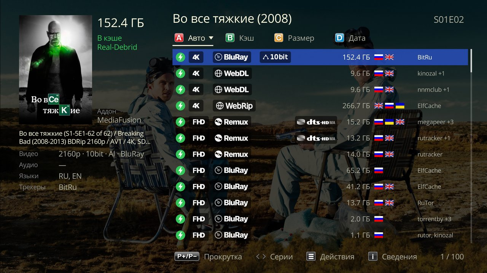

# Melange для Dune HD

**Русский** | [English](README.en.md)

Melange — плагин для Dune HD на Android. Он добавляет пункт «Melange» в меню «Смотреть…» карточки фильма или сериала в каталоге «Фильмы» Дюны. Пункт открывает список раздач из вашего конфига AIOStreams, а выбранная раздача играет во встроенном плеере Дюны — с историей просмотра. Ещё у Melange свой каталог с рядами подборок и поиском.

Что умеет:
- список до 100 раздач с подробностями: разрешение, источник, HDR / Dolby Vision, звук, размер, языки, озвучки, есть ли раздача в кэше Debrid; сортировка цветными кнопками пульта;
- история Дюны: процент на кнопке «Melange [NN%]», ряд «Продолжить просмотр», возврат с того же места;
- сериалы: серии сезона подряд в плеере на той же раздаче, листание серий прямо в списке клавишами ← / →;
- Debrid (Real-Debrid или TorBox) или, без подписки, торренты через TorrServer на Дюне;
- озвучки студий — по названию раздачи и её дорожкам, а также дорожки и озвучки из JacRed;
- свой каталог: ряды подборок (тренды, новинки, российское, жанры, стриминги и другие — какие показывать, выбираете сами) и поиск;
- настройка с телефона по QR-коду, там же — «Скачать лог».

 

## Что нужно

- **Dune HD на Android с прошивкой r22 или новее.** Проверено только на Pro 8K Plus с прошивкой 260827_0003_r24. На других Android-моделях Дюны, на ATV-приставках с приложением Dune HD (Homatics и др.) и на r22 должно работать, но не проверялось — если что-то не так, пришлите [лог](docs/troubleshooting.md#лог).
- **Не работает** на Дюнах на Sigma / Linux (Solo 4K, Duo 4K, Base 3D, TV-303D и старше): у них нет каталога «Фильмы» с пунктами «Смотреть…» и Android-приложений. На моделях с 1 ГБ памяти (SmartBox 4K, SmartBox 4K Plus, Traveler, Neo 4K, 4K Neo, Neo 4K T2) работа не обещается.
- **Телефон в той же домашней сети**, что и Дюна, — для страницы настроек.
- **Источник раздач** — один из трёх вариантов:

| | Debrid | Торренты | Свой конфиг AIOStreams |
|---|---|---|---|
| Кому | нужен быстрый старт и много раздач | попробовать без подписки | уже настроили AIOStreams под себя |
| Что нужно | подписка Real-Debrid или TorBox и её ключ | приложение TorrServe на Дюне | ссылка на свой конфиг |
| Цена | платная подписка | бесплатно | как у вашего конфига |
| Старт видео | раздачи из кэша — сразу | дольше, зависит от сидов | как у вашего конфига |
| Конфиг AIOStreams | создаёт Melange | создаёт Melange | ваш, Melange его только читает |
| Где ищутся раздачи | JacRed, Torrentio, MediaFusion, Comet, StremThru Torz | по умолчанию только JacRed (русские трекеры); шаблон «Везде» добавляет Torrentio, TorrentsDB, Comet, StremThru Torz | как настроено у вас |

Свой конфиг без Debrid (раздачи P2P) тоже играет через TorrServer. Подробнее о вариантах и о том, что Melange делает с конфигом, — [Источники раздач](docs/sources.md).

JacRed настраивать не нужно: по умолчанию стоит `jacred.kompotik.com` — JacRed Melange, его держит автор для пользователей плагина.

## Установка

1. Скачайте последний релиз со страницы https://github.com/a1d4r/dune-hd-melange/releases — файл `dune_plugin_melange_<версия>.zip` в разделе Assets. Скопируйте его на флешку или во внутреннюю память Дюны.
2. На Дюне откройте **«Источники»**, найдите zip и нажмите ENTER.
3. Примерно через полминуты в меню «Смотреть…» карточек появится пункт «Melange», перезагрузка не нужна. Если карточка была открыта во время установки — выйдите из неё и откройте снова.

**Обновление.** Дюна сама проверяет новую версию Melange на GitHub Pages — после перезагрузки и при входе в «Настройки» → «Приложения» → «Melange» — и предлагает её поставить. Если обновление не пришло, поставьте новый zip поверх старого тем же способом. Настройки и ссылка на страницу настроек сохраняются.

**Удаление** — в списке плагинов Дюны. Вместе с плагином стираются его настройки; чтобы их не потерять, сначала сохраните [резервную копию](docs/setup.md#резервная-копия).

## Быстрый старт

1. Если будете смотреть без Debrid — установите на Дюну приложение TorrServe (TorrServer MatriX) и включите в нём запуск при включении Дюны.
2. Откройте **«Приложения» → «Melange»**. Пока ничего не настроено, откроется экран настроек Melange.
3. Только торренты и нет телефона под рукой — нажмите **«Быстрая настройка: торренты»**: Melange сам создаст конфиг и откроет каталог. Переходите к шагу 6.
4. Иначе нажмите **«Настроить с телефона»** и отсканируйте QR-код — откроется страница настроек.
5. На странице выберите, **откуда брать фильмы** (Debrid, «Торренты» или свой конфиг), введите ключ Debrid или ссылку на конфиг и нажмите **«Сохранить и создать конфиг»** (у своего конфига — «Сохранить»). Окно с QR на телевизоре закроется само.
6. Откройте фильм в каталоге «Фильмы» Дюны → **«Смотреть…»** → **«Melange»**.
7. Выберите раздачу и нажмите ENTER.

Тот же путь подробно, с пояснениями к каждому шагу, — [Пошаговая настройка](docs/quick-start.md).

## Как смотреть

- **Фильм:** карточка в каталоге «Фильмы» → «Смотреть…» → «Melange». **Сериал:** в карточке через «Сезоны» выберите серию и так же «Melange». Можно начать и из [каталога Melange](docs/catalog.md).
- **В списке раздач:** вверх / вниз — по раздачам, P+ / P− — по страницам, ENTER — смотреть, INFO — сведения о раздаче, ← / → — соседняя серия. Цветные кнопки меняют порядок: Авто, Сиды (с Debrid — Кэш), Размер, Дата.
- **Статус раздачи** слева: «В кэше …» — начнёт играть сразу, «Нужно скачать» — в кэше Debrid её нет, «P2P» — играет через TorrServer.
- **MENU** — «Действия»: обновить список, выбрать серию, смотреть через TorrServer, открыть в другом приложении, скачать на свой сервер, настройки.
- **Продолжить просмотр:** начатый фильм или серия появляются в ряду «Продолжить просмотр» Дюны и открываются на той же раздаче с того же места.

Всё о списке, сериалах, TorrServer и истории — [Просмотр](docs/watching.md).

## Если что-то не так

- **«Нет конфига AIOStreams — откройте настройки Melange»** — конфиг не создался или выбран другой сервер. Откройте страницу настроек и нажмите «Сохранить и создать конфиг».
- **«AIOStreams не нашёл потоков»** — частая причина в конфиге Melange: JacRed не ответил серверу AIOStreams. Выберите другой JacRed (кнопка «Сравнить скорость» в разделе «JacRed») или другой сервер AIOStreams.
- **«AIOStreams не отвечает»** и другие ошибки сервера — попробуйте позже.
- **Не открывается через TorrServer** — установите и запустите на Дюне приложение TorrServe; проверить связь можно кнопкой «Проверить» в разделе «TorrServer» страницы настроек.
- Не помогло — скачайте лог на странице настроек («Скачать лог») и заведите Issue: https://github.com/a1d4r/dune-hd-melange/issues

Все сообщения и что с ними делать — [Решение проблем и лог](docs/troubleshooting.md).

## Документация

- [Пошаговая настройка](docs/quick-start.md) — от установки до первого просмотра.
- [Настройки](docs/setup.md) — экран настроек на Дюне и все разделы страницы с телефона.
- [Источники раздач и конфиг AIOStreams](docs/sources.md) — Debrid, торренты, свой конфиг, серверы AIOStreams, что Melange меняет в конфиге.
- [Просмотр](docs/watching.md) — список раздач, сортировка, сериалы, TorrServer, история.
- [Каталог](docs/catalog.md) — ряды подборок, поиск, откуда данные.
- [Решение проблем и лог](docs/troubleshooting.md) — сообщения об ошибках, лог, куда писать.
- [Известные ограничения](docs/limitations.md)

## Лицензия

MIT — см. файл `LICENSE` в репозитории. Значки качества — из [github.com/kingsizew/badges](https://github.com/kingsizew/badges). Источники рядов каталога — [Каталог](docs/catalog.md#откуда-данные).
