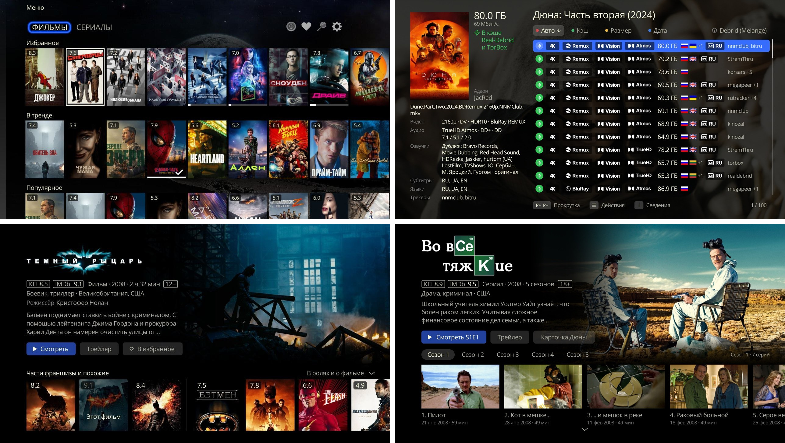

# Melange для Dune HD

**Русский** | [English](README.en.md)

Melange превращает Дюну в онлайн-кинотеатр: каталог фильмов и сериалов с подборками и поиском. Выберите фильм, и Melange найдёт раздачи, покажет качество и озвучки и включит фильм в плеере Дюны. Если остановились, продолжите с того же места. Фильм можно выбрать и в каталоге «Фильмы» самой Дюны: в карточке, в меню «Смотреть…», есть пункты Melange: карточка и список раздач.

Всё по шагам, со скриншотами, есть в [руководстве](docs/README.md) (оно же [на Telegraph](https://telegra.ph/Melange-dlya-Dune-HD-11-04)).

## Требования

- Dune HD на Android, прошивка r22 или новее, рекомендуется r24 или r25. На Дюнах на Sigma / Linux Melange не работает, на моделях с 1 ГБ памяти работа не обещается ([Известные ограничения](docs/limitations.md#устройства-и-прошивки)).
- Как смотреть, на выбор:
    - **Торренты через TorrServer** — бесплатно, нужно приложение TorrServe на Дюне ([Торренты и TorrServer](docs/torrserver.md)).
    - **Debrid** (Real-Debrid или TorBox) — платная подписка, фильмы включаются сразу ([Debrid](docs/debrid.md)).

## Установка и быстрый старт

Как поставить и настроить Melange — в [Быстром старте](docs/start.md) (он же [на Telegraph](https://telegra.ph/Bystryj-start-11-15)). Zip лежит в [релизах](https://github.com/a1d4r/dune-hd-melange/releases/latest).

## Если что-то не так

Сообщения на экране и что с ними делать — в главе [Решение проблем](docs/troubleshooting.md). Если не помогло, скачайте лог на странице настроек и заведите [Issue](https://github.com/a1d4r/dune-hd-melange/issues).

## Лицензия

MIT, см. файл `LICENSE`.
