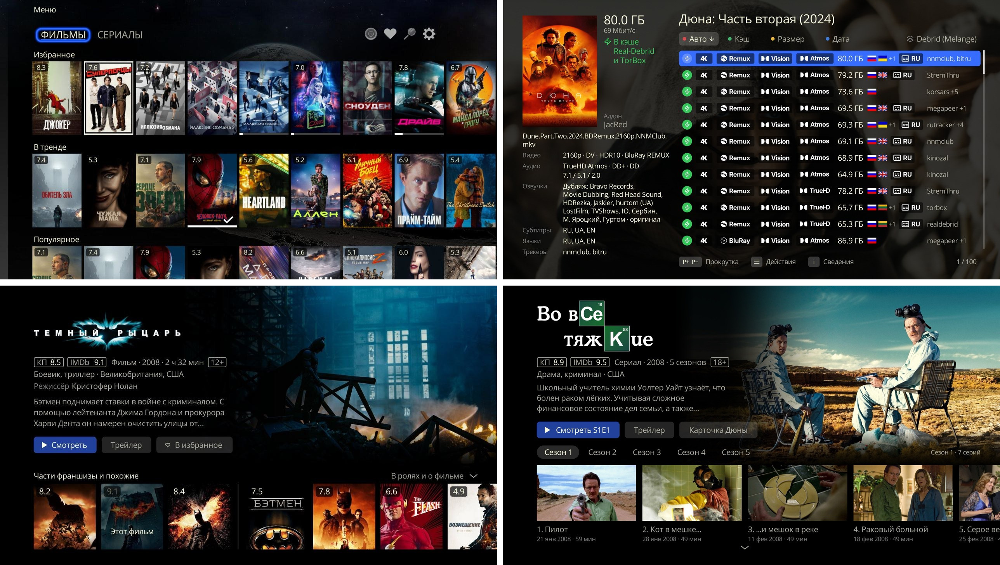

# Melange: guide

[← README](../README.en.md)

Melange turns your Dune into an online cinema: a movie and series catalog with curated rows and search. Pick a movie, and Melange finds releases, shows their quality and dubs, and plays the movie in the Dune player. Stop anytime and resume from the same spot. You can also pick a movie in the Dune's own **Movies** catalog: its card has a **Melange** item in the **Play...** menu.

Watch for free through TorrServer or with a paid Debrid service.

New here? Start with Quick start.

**Getting started**

1. [Quick start](start.en.md): install and first setup
2. [Watching](watch.en.md): play a movie and resume where you stopped
3. [Movies and series from your disk](library.en.md): play a file from your NAS or USB drive from the Melange card
4. [Search](search.en.md): find a movie by typing or by voice
5. [Continue Watching and Favorites](favorites.en.md): started and saved movies
6. [Your own catalog rows](catalog-rows.en.md): pick rows and their order, hide titles

**Settings**

- [Settings page on a phone](phone-page.en.md): set up Melange from a phone via QR code
- [Debrid](debrid.en.md): movies start right away, paid subscription
- [Torrents and TorrServer](torrserver.en.md): watch for free, no subscription; torrents already on TorrServer
- [JacRed](jacred.en.md): Russian tracker search and what to do if it stops responding
- [Sources](profiles.en.md): Debrid, torrents and your own configs, picked on the Dune
- [Your own torrent client](download-server.en.md): download a release to a NAS or computer
- [Appearance](appearance.en.md): logo, ratings on posters, custom movie card
- [Melange in the TV tab](tv-tab.en.md): Melange rows on the Dune home screen
- [Advanced](advanced-options.en.md): intro skipping, addon errors, menu without color buttons
- [Backup](backup.en.md): save settings and move them to another Dune

**For advanced users**

- [AIOStreams and your own config](aiostreams.en.md): how releases are found, your own config and server

**Reference**

- [Troubleshooting](troubleshooting.en.md): on-screen message and what to do
- [Known limitations](limitations.en.md): what Melange can't do

**Contact**

- Bugs: open an Issue with a log: https://github.com/a1d4r/dune-hd-melange/issues
