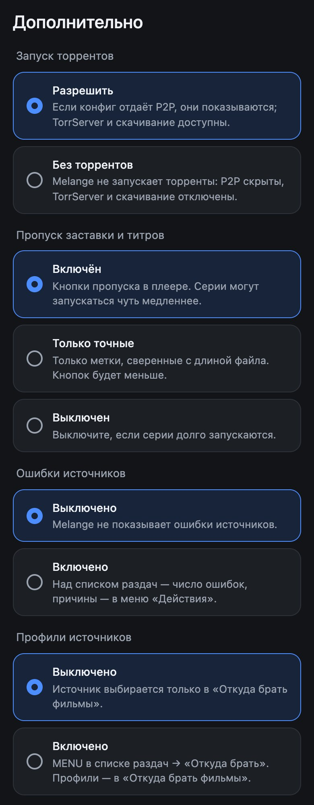
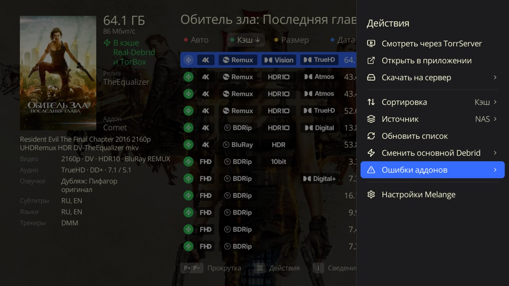
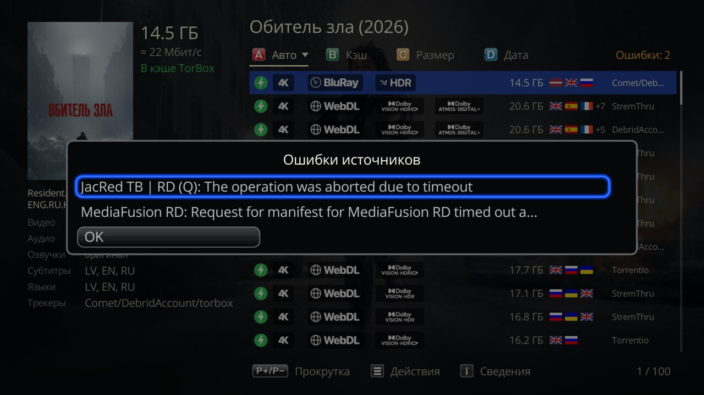
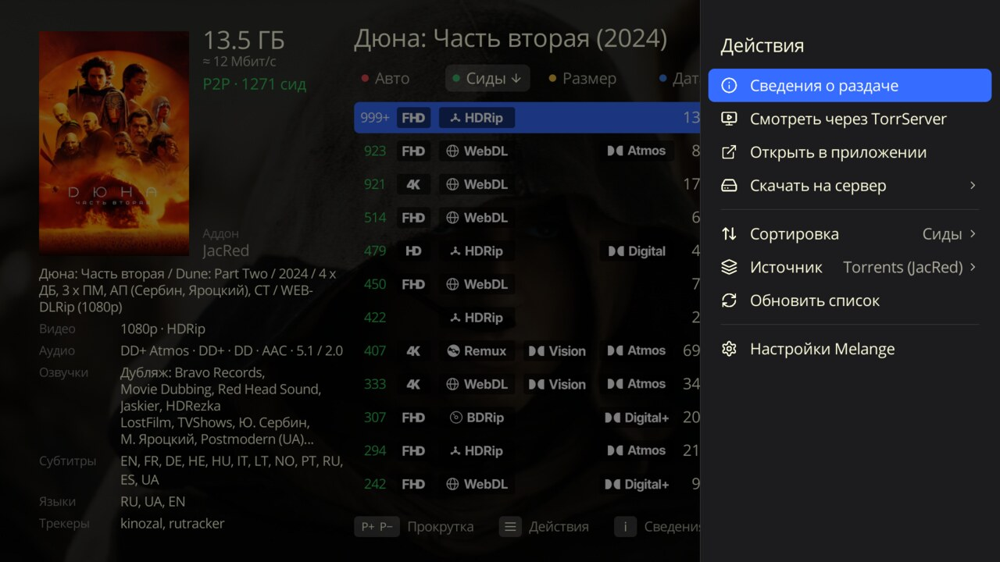

# Advanced

Choose whether Melange starts torrents, shows skip-intro buttons and reports addon errors. If your remote has no colour buttons, you can also add sorting and release details to the menu here. [← Contents](README.en.md)

1. On the settings page ([Settings page on a phone](phone-page.en.md)), open "Advanced".

   

2. "Running torrents": leave "Allow". Choose "No torrents" if you do not need torrents on the Dune at all ([Known limitations](limitations.en.md)).

3. "Skip intro and credits" (r25): leave it "On" (the default). The player gets a "Skip intro" button. If episodes take long to start, choose "Off".

   

   The button appears at the start of an episode, at the bottom left.

4. "Addon errors": turn it on if there are few releases or none. The number of errors appears above the release list; **POP UP** → "Addon errors" shows the reasons.

   

   

5. "Remote without colour buttons": turn it on if your remote has no colour buttons or INFO. Then the **POP UP** menu of the release list starts with "Release details" and "Sort". Choosing the current sort again reverses the order.

   

6. Press "Save".

   

## If it did not work

- Still few releases: see [Known limitations](limitations.en.md).

Next: [Backup](backup.en.md) · [Contents](README.en.md)
