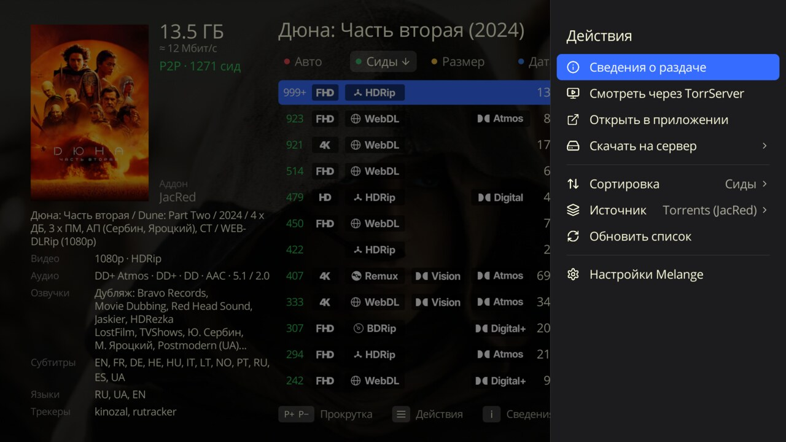

# Дополнительно

Решим, запускать ли торренты, нужны ли кнопки пропуска заставки и показывать ли ошибки аддонов. Если на пульте нет цветных кнопок, здесь же сортировку и сведения о раздаче можно добавить в меню. [← Оглавление](README.md)

1. На странице настроек ([Страница настроек с телефона](phone-page.md)) откройте «Дополнительно».

   

2. «Запуск торрентов»: оставьте «Разрешить». «Без торрентов» — если торренты на Дюне вам не нужны совсем ([Известные ограничения](limitations.md#без-торрентов)).

3. «Пропуск заставки и титров» (r25): оставьте «Включён» (по умолчанию). В плеере появится кнопка «Пропустить заставку». Если серии долго запускаются, выберите «Выключен».

   

   Кнопка появляется в начале серии, внизу слева.

4. «Ошибки аддонов»: включите, если раздач мало или нет совсем. Над списком раздач появится число ошибок, причины покажет **POP UP** → «Ошибки аддонов».

   

   

5. «Пульт без цветных кнопок»: включите, если на пульте нет цветных кнопок или INFO. Тогда в меню **POP UP** списка раздач первыми будут «Сведения о раздаче» и «Сортировка». Если выбрать текущую сортировку ещё раз, порядок сменится на обратный.

   

6. Нажмите «Сохранить».

   

## Если не получилось

- Раздач всё равно мало — см. [Известные ограничения](limitations.md).

Дальше: [Резервная копия](backup.md) · [Оглавление](README.md)
