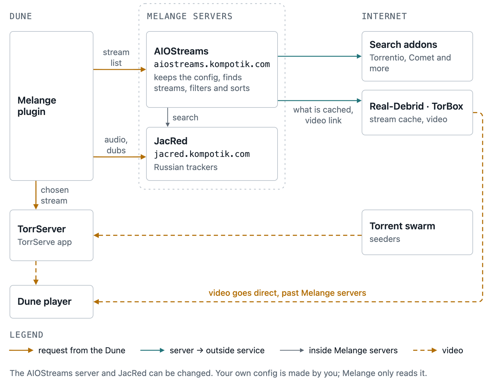
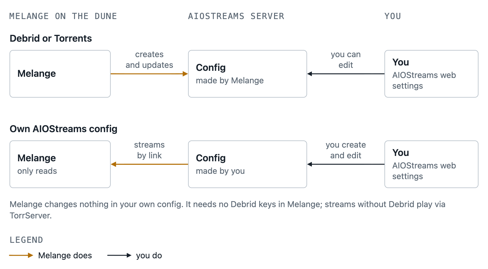
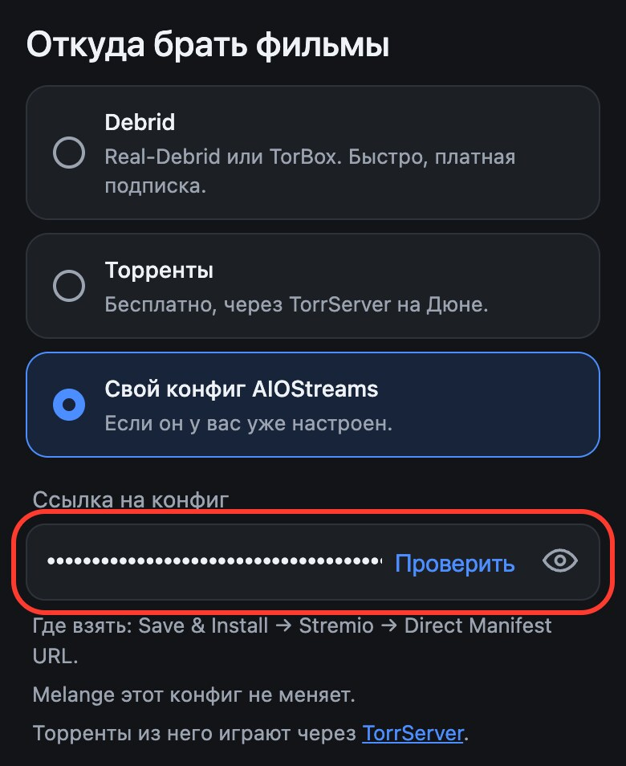
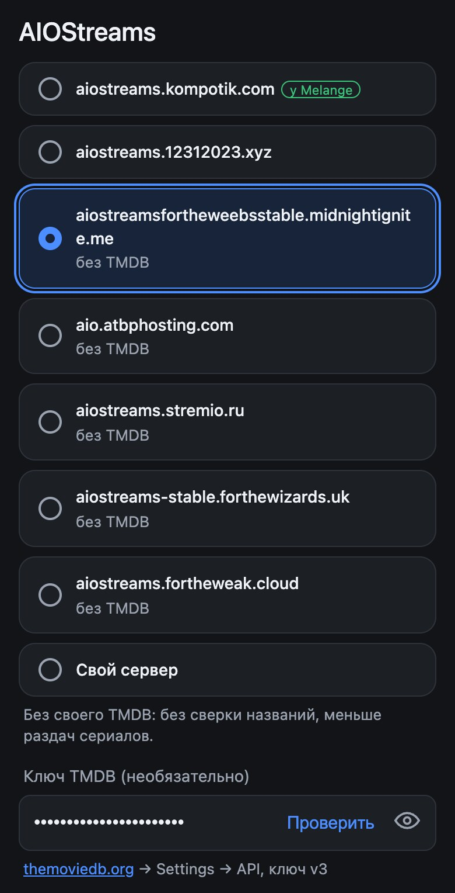
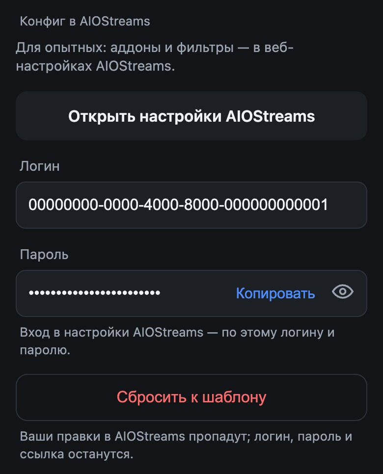
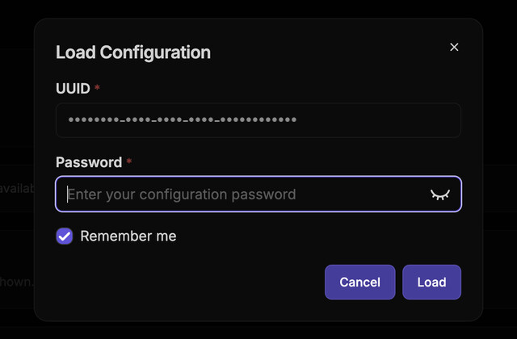
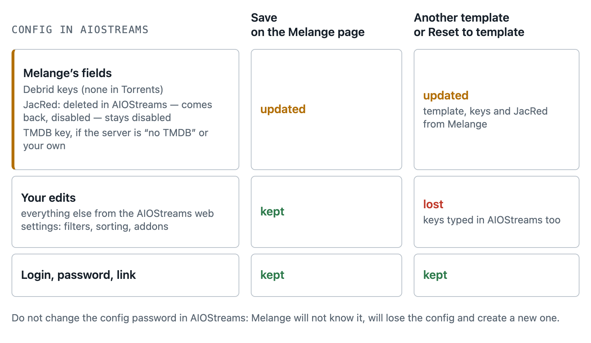
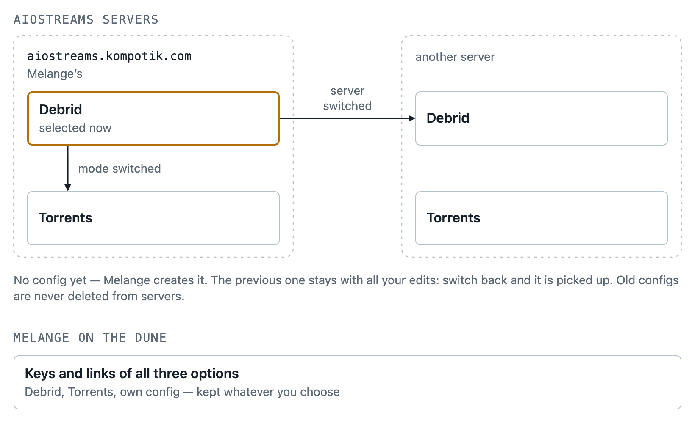
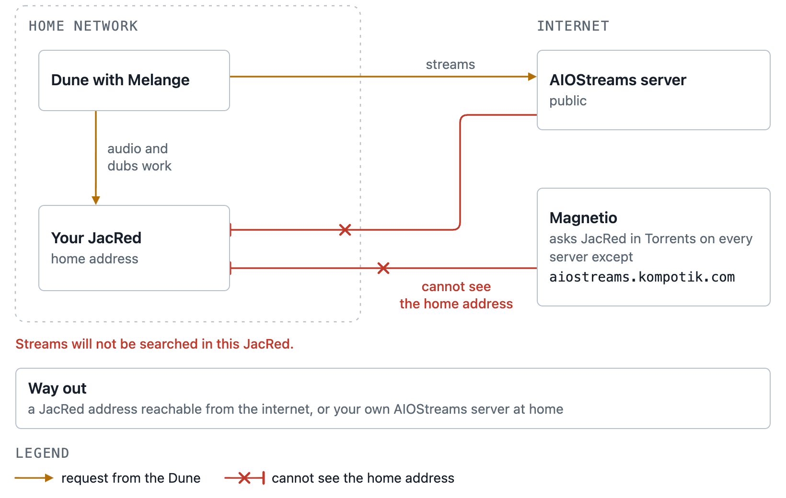
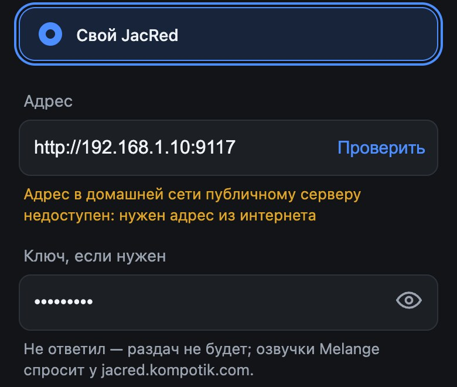

# AIOStreams and your own config

How Melange gets releases, how to tune the AIOStreams config for yourself, and how to connect your own config, server and JacRed. [← Contents](README.en.md)

- [How it works](#how-it-works)
- [Templates](#templates)
- [Your own AIOStreams config](#your-own-aiostreams-config)
- [AIOStreams server](#aiostreams-server)
- [Config in AIOStreams: tuning it for yourself](#config-in-aiostreams-tuning-it-for-yourself)
- [What Melange changes in the config](#what-melange-changes-in-the-config)
- [Switching between Debrid and "Torrents"](#switching-between-debrid-and-torrents)
- [Your own JacRed](#your-own-jacred)

## How it works

## Templates

"Where to look for releases" in the "Where to get films" section picks the config template, that is, a set of addons.

| Mode | Template | Addons | When |
|---|---|---|---|
| Debrid | **"Everywhere"** (default) | JacRed, Comet, StremThru Torz, MediaFusion, Torrentio | more cached releases, especially with Real-Debrid |
| Debrid | **"Russian trackers only"** | JacRed | faster answer, but few releases with Real-Debrid alone |
| "Torrents" | **"Russian trackers only"** (default) | JacRed | faster answer |
| "Torrents" | **"Everywhere"** | Torrentio, JacRed, TorrentsDB, Comet, StremThru Torz | more releases |

Choosing another template and saving [resets the config](#what-melange-changes-in-the-config) to it: the page asks you to confirm first. Other saves, such as a new key or JacRed, [keep your edits](#what-melange-changes-in-the-config).

If you changed the addons in AIOStreams, "Where to look for releases" shows "Custom set of addons (changed in AIOStreams)".

## Your own AIOStreams config

When you need it: you already have a tuned AIOStreams config (your services, filters, limits), and Melange should take releases from it. Melange reaches the config through the link to its `manifest.json`.

1. In AIOStreams, open your config, the "Save & Install" section, the Stremio block, and copy the "Direct Manifest URL". The link looks like `https://<server>/…/manifest.json`; `stremio://…` works too.

2. Open the settings page ([Settings page on a phone](phone-page.en.md)), the "Where to get films" section, and choose "Own AIOStreams config".

3. Paste the link into "Config link" and press "Check".

   

4. Press "Save". You will see "Saved. The Dune picks up the settings automatically."

Keep in mind:

- it does not need Debrid keys in Melange;
- releases without Debrid (P2P) play through [TorrServer](torrserver.en.md);
- JacRed is needed here only for audio tracks and dubs: if it does not answer, there are no tracks, everything else works;
- if you changed the config password in AIOStreams, the link changed too: paste the new one.

## AIOStreams server

When you need it: the Melange server does not answer, or you have your own AIOStreams, for example on a NAS. The server is chosen for Debrid and "Torrents"; with your own config it is set by the link.

The default is `aiostreams.kompotik.com` (marked "of Melange"). It also provides the intro and credits times for the "Skip intro" and "Next episode" buttons ([Advanced](advanced-options.en.md)); other servers may not have them.

1. On the settings page, open "AIOStreams" and choose a server.

   

2. A server marked "no TMDB" has no TMDB key of its own, and without it AIOStreams does not match titles and finds fewer series releases. Enter your key in "TMDB key": [themoviedb.org](https://www.themoviedb.org/settings/api) → Settings → API, the v3 key.

3. Your own server: choose "Own server" and enter the address `http://host:port` or `https://host`, without a path. If the server requires a password to create configs, saving shows its error.

4. Press "Save". Melange creates a config on the chosen server.

Each server has its own config; more in [Switching between Debrid and "Torrents"](#switching-between-debrid-and-torrents).

## Config in AIOStreams: tuning it for yourself

When you need it: you want to change filters or sorting, or add addons to the config Melange created.

1. On the settings page, open "AIOStreams". At the bottom, in the "Config in AIOStreams" block, are the config login and password. If there is no config yet, press "Save": it gets created.

   

2. Press "Copy" next to the password, then "Open the AIOStreams settings".

3. In the "Load Configuration" window the UUID (login) is already filled in: paste the password into "Password" and press "Load". Change the config and save it in AIOStreams.

   

> Do not change the config password in AIOStreams: Melange will not know it, will lose the config and will create a new one on the next save.

## What Melange changes in the config

What the Melange config has: 144p–576p, CAM / SCR / TS / TC, 3D and XviD / DivX are filtered out; releases in Russian rank higher.

## Switching between Debrid and "Torrents"

When you need it: you move from Debrid to "Torrents" or back.

If the config of the new mode could not be created (the server is unreachable, a limit), go back to the previous one: its config is intact.

Different servers, configs and JacRed can be saved as profiles and switched with the remote: [Source profiles](profiles.en.md).

## Your own JacRed

When you need it: you have your own JacRed, or another one that is not in the list.

In "Torrents", on all servers except `aiostreams.kompotik.com`, JacRed is queried by the third-party Magnetio addon (`magnetio.peterdsp.dev`), and it receives the address and key of the chosen JacRed. If the chosen JacRed does not answer, Melange asks `jacred.kompotik.com` for audio tracks and dubs.

1. On the settings page, open "JacRed" and choose "Own JacRed" at the bottom of the list.

2. Enter the address `http://host:port` or `https://host` and press "Check".

3. If your JacRed requires a key, enter it in "Key, if needed".

   

4. Press "Save". Melange adds the JacRed to the config, and in "Torrents" on servers with Magnetio, to the Magnetio settings.

In "Torrents" the key must not contain `|`. More in [Known limitations](limitations.en.md).

## If it did not work

- Saving shows an error about the link, the address or the server limit: see [Troubleshooting](troubleshooting.en.md).
- Few releases: choose "Everywhere" in "Where to look for releases" or check whether JacRed answers ([JacRed](jacred.en.md)); the rest is in [Known limitations](limitations.en.md).

Next: [Troubleshooting](troubleshooting.en.md) · [Contents](README.en.md)
