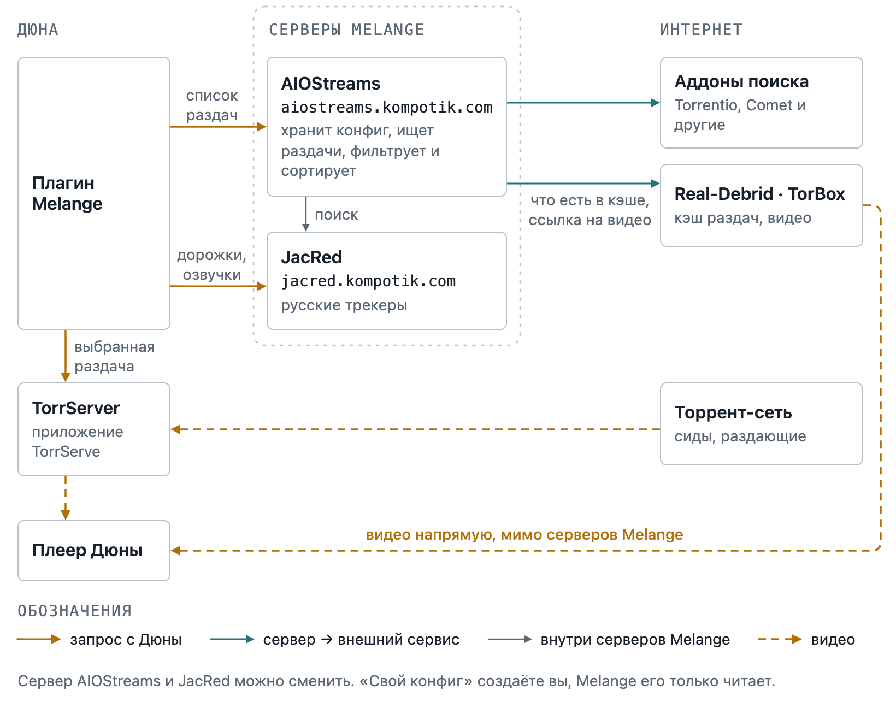
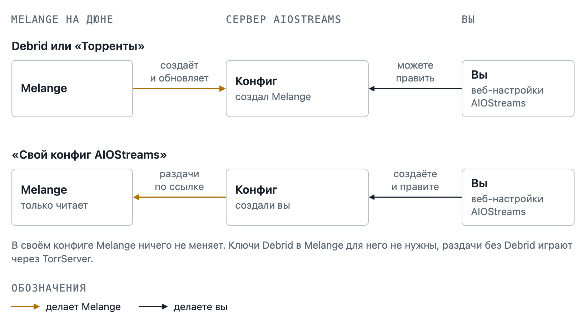
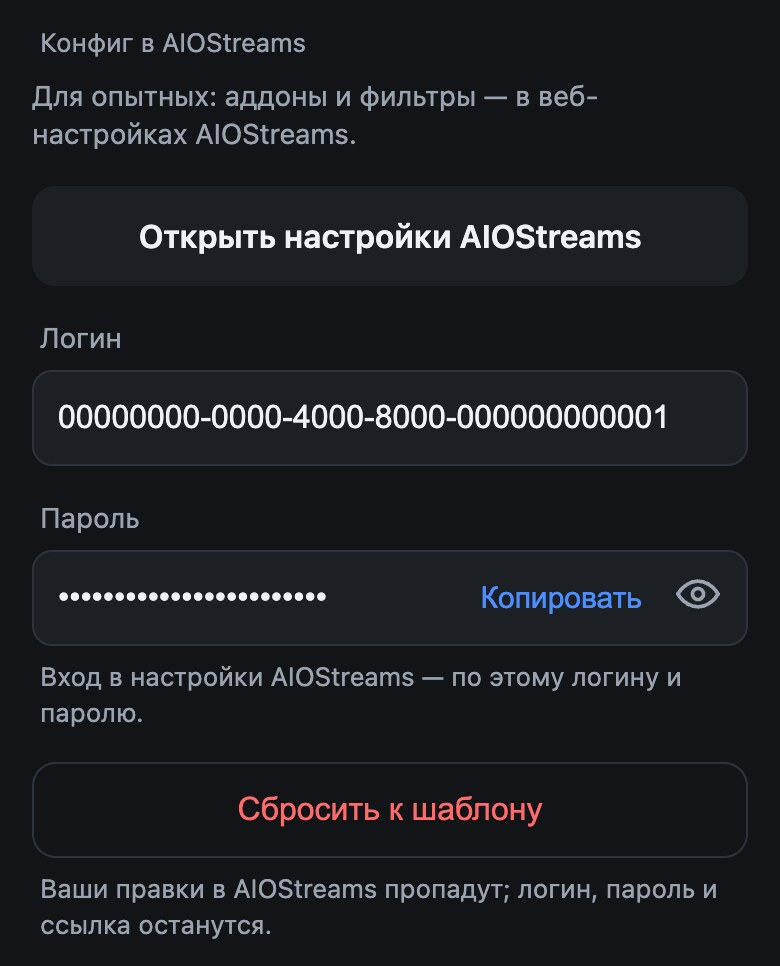
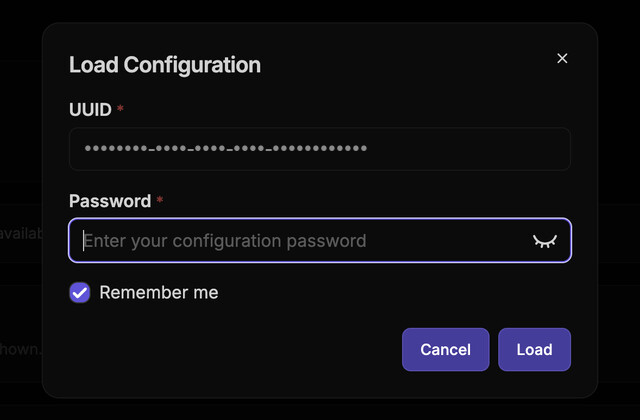
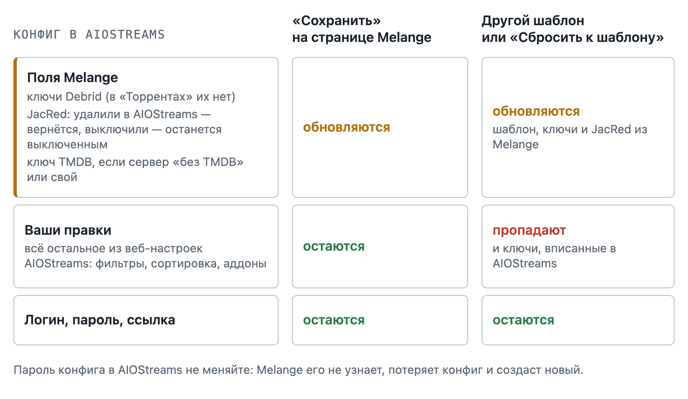
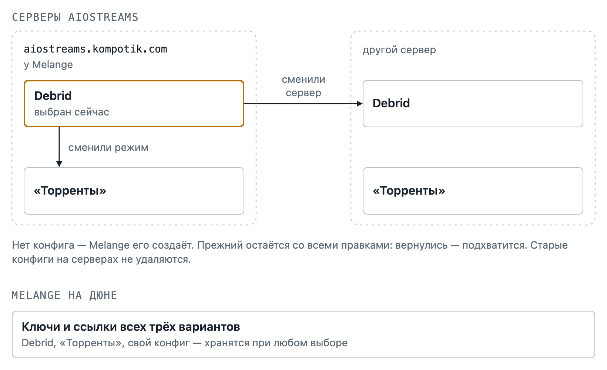
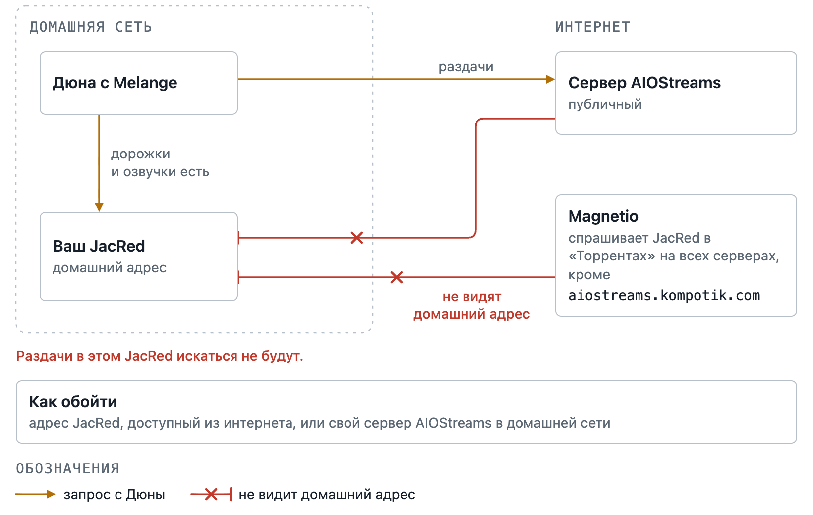
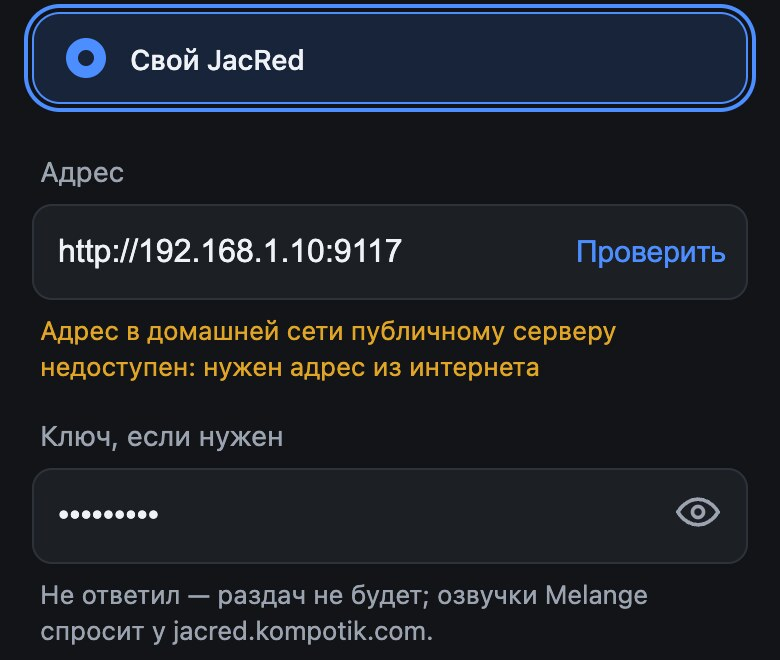

# AIOStreams и свой конфиг

Как Melange получает раздачи и как настроить конфиг AIOStreams под себя или подключить свой конфиг, сервер и JacRed. [← Оглавление](README.md)

- [Как это устроено](#как-это-устроено)
- [Шаблоны](#шаблоны)
- [Свой конфиг AIOStreams](#свой-конфиг-aiostreams)
- [Сервер AIOStreams](#сервер-aiostreams)
- [Конфиг в AIOStreams: настройка под себя](#конфиг-в-aiostreams-настройка-под-себя)
- [Что Melange меняет в конфиге](#что-melange-меняет-в-конфиге)
- [Переключение между Debrid и «Торрентами»](#переключение-между-debrid-и-торрентами)
- [Свой JacRed](#свой-jacred)

## Как это устроено

Melange обращается к конфигу по ссылке на его `manifest.json`. Если выбранный JacRed не ответил, дорожки и озвучки Melange спросит у `jacred.kompotik.com`.

## Шаблоны

«Где искать раздачи» в разделе «Откуда брать фильмы» выбирает шаблон конфига, то есть набор аддонов.

| Режим | Шаблон | Аддоны | Когда |
|---|---|---|---|
| Debrid | **«Везде»** (по умолчанию) | JacRed, Comet, StremThru Torz, MediaFusion, Torrentio | больше раздач в кэше, особенно у Real-Debrid |
| Debrid | **«Только русские трекеры»** | JacRed | ответ быстрее, но с одним Real-Debrid раздач мало |
| «Торренты» | **«Только русские трекеры»** (по умолчанию) | JacRed | ответ быстрее |
| «Торренты» | **«Везде»** | Torrentio, JacRed, TorrentsDB, Comet, StremThru Torz | больше раздач |

В «Торрентах» на всех серверах, кроме `aiostreams.kompotik.com`, JacRed спрашивает сторонний аддон Magnetio (`magnetio.peterdsp.dev`), и ему передаются адрес и ключ выбранного JacRed.

Выбрать другой шаблон и сохранить — значит [сбросить конфиг](#сброс-к-шаблону) к нему: страница сначала спросит подтверждение. Остальные сохранения, например нового ключа или JacRed, ваших правок [не трогают](#что-melange-меняет-в-конфиге).

Если вы поменяли аддоны в AIOStreams, в «Где искать раздачи» будет «Свой набор аддонов (изменён в AIOStreams)».

## Свой конфиг AIOStreams

Когда нужно: у вас уже есть настроенный конфиг AIOStreams (свои сервисы, фильтры, лимиты), и Melange должен брать раздачи из него.

1. В AIOStreams откройте свой конфиг, раздел «Save & Install», блок Stremio, и скопируйте «Direct Manifest URL». Ссылка вида `https://<сервер>/…/manifest.json`, подойдёт и `stremio://…`.

2. Откройте страницу настроек ([Страница настроек с телефона](phone-page.md)), раздел «Откуда брать фильмы», и выберите «Свой конфиг AIOStreams».

3. Вставьте ссылку в «Ссылка на конфиг» и нажмите «Проверить».

   

4. Нажмите «Сохранить». Появится «Сохранено. Дюна подхватит настройки сама.»

Что учесть:

- ключи Debrid в Melange для него не нужны;
- раздачи без Debrid (P2P) играют через [TorrServer](torrserver.md);
- JacRed здесь нужен только для дорожек и озвучек: не ответил — дорожек не будет, остальное работает;
- сменили пароль конфига в AIOStreams — сменилась и ссылка, вставьте новую.

## Сервер AIOStreams

Когда нужно: сервер Melange не отвечает или у вас свой AIOStreams, например на NAS. Сервер выбирается для Debrid и «Торрентов»; при своём конфиге он задан ссылкой.

По умолчанию выбран `aiostreams.kompotik.com` (пометка «у Melange»). Он же отдаёт время заставки и титров для кнопок «Пропустить заставку» и «Следующий эпизод» ([Просмотр](watch.md)); на других серверах их может не быть.

1. На странице настроек откройте «AIOStreams» и выберите сервер.

   

2. У сервера с пометкой «без TMDB» нет своего ключа TMDB, и без него AIOStreams не сверяет названия и находит меньше раздач сериалов. Впишите свой ключ в «Ключ TMDB»: [themoviedb.org](https://www.themoviedb.org/settings/api) → Settings → API, ключ v3.

3. Свой сервер: выберите «Свой сервер» и впишите адрес `http://хост:порт` или `https://хост`, без пути. Если сервер требует пароль на создание конфигов, при сохранении будет его ошибка.

4. Нажмите «Сохранить». Melange создаст конфиг на выбранном сервере.

У каждого сервера свой конфиг, подробнее в разделе [Переключение между Debrid и «Торрентами»](#переключение-между-debrid-и-торрентами).

## Конфиг в AIOStreams: настройка под себя

Когда нужно: хотите поменять фильтры, сортировку или добавить аддоны в конфиг, который создал Melange.

1. На странице настроек откройте «AIOStreams». Внизу, в блоке «Конфиг в AIOStreams», — логин и пароль конфига. Если конфига ещё нет, нажмите «Сохранить»: он создастся.

   

2. Нажмите «Копировать» у пароля, затем «Открыть настройки AIOStreams».

3. В окне «Load Configuration» UUID (логин) уже подставлен: вставьте пароль в «Password» и нажмите «Load». Поменяйте конфиг и сохраните его в AIOStreams.

   

> Пароль конфига в AIOStreams не меняйте: Melange его не узнает, потеряет конфиг и при следующем сохранении создаст новый.

### Сброс к шаблону

Что «Сбросить к шаблону» стирает и что оставляет, видно на схеме в разделе [Что Melange меняет в конфиге](#что-melange-меняет-в-конфиге).

## Что Melange меняет в конфиге

Что в конфиге Melange: отфильтрованы 144p–576p, CAM / SCR / TS / TC, 3D, XviD / DivX; раздачи на русском — выше.

## Переключение между Debrid и «Торрентами»

Когда нужно: переходите с Debrid на «Торренты» или обратно.

Не удалось создать конфиг нового режима (сервер недоступен, лимит) — вернитесь к прежнему: его конфиг цел.

Разные серверы, конфиги и JacRed можно сохранить профилями и переключать с пульта: [Профили источников](profiles.md).

## Свой JacRed

Когда нужно: у вас свой JacRed или другой, которого нет в списке.

1. На странице настроек откройте «JacRed» и выберите «Свой JacRed» внизу списка.

2. Впишите адрес `http://хост:порт` или `https://хост` и нажмите «Проверить».

3. Если ваш JacRed требует ключ, впишите его в «Ключ, если нужен».

   

4. Нажмите «Сохранить». Melange впишет JacRed в конфиг, а в «Торрентах» на серверах с Magnetio — в настройки Magnetio.

В «Торрентах» ключ не должен содержать `|`. Подробнее — в [Известных ограничениях](limitations.md).

## Если не получилось

- Сохранение пишет ошибку про ссылку, адрес или лимит сервера — см. [Решение проблем](troubleshooting.md).
- Раздач мало — выберите «Везде» в «Где искать раздачи» или проверьте, отвечает ли JacRed ([JacRed](jacred.md)); остальное — в [Известных ограничениях](limitations.md).

Дальше: [Оглавление](README.md)
