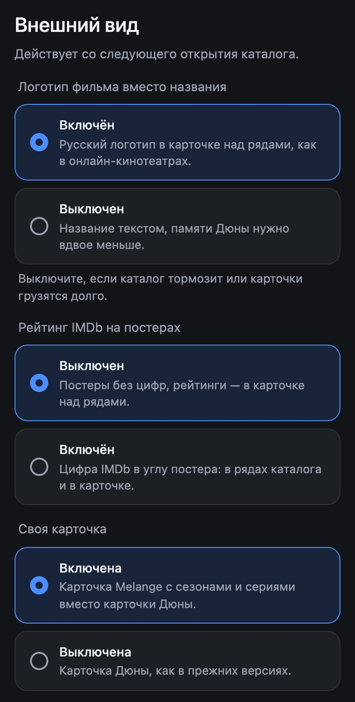
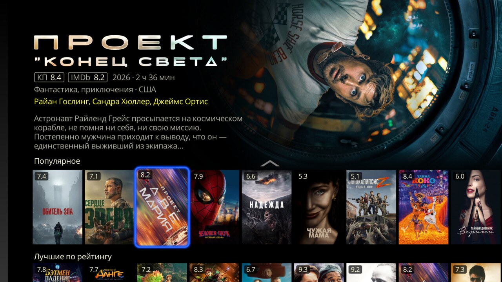
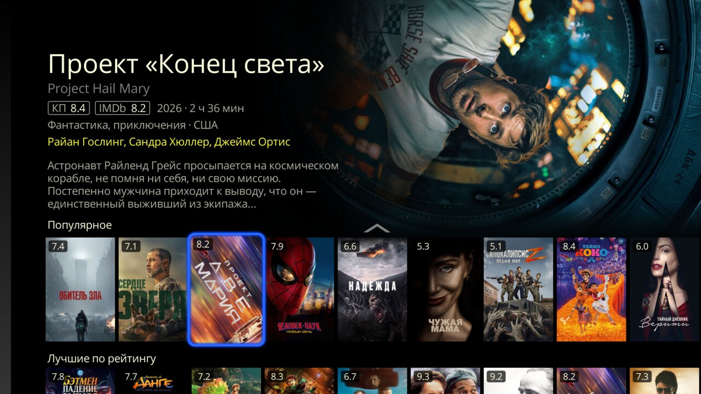
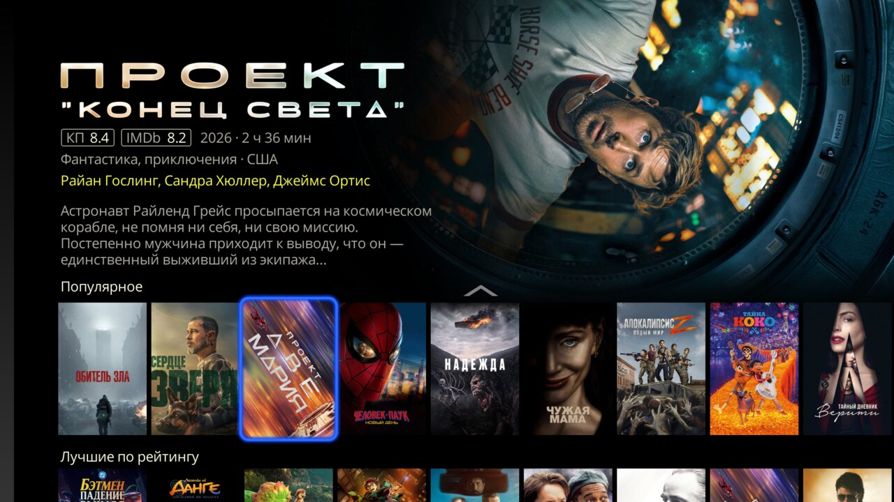
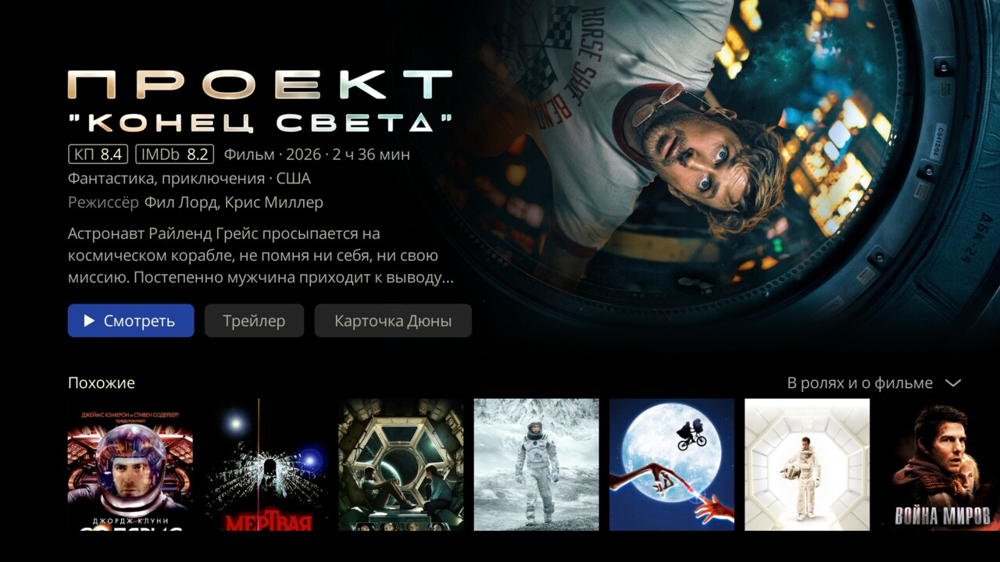
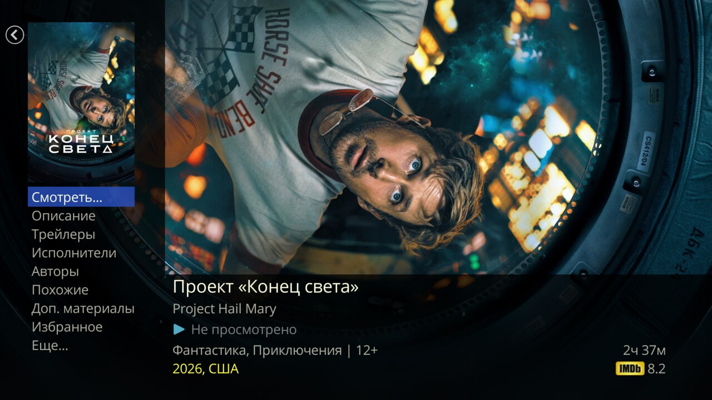

# Appearance

Turn on the movie logo in place of the title, ratings on posters and the own movie card. [← Contents](README.en.md)

1. On the settings page ([Settings page on a phone](phone-page.en.md)), open "Appearance".

   

2. "Film logo in place of the title" (r25): leave it "On". If the catalog is slow or cards take long to load, choose "Off". The logo shows in the panel at the top when you are on a poster.

   On:

   

   The poster and the logo may show different Russian titles of the same movie: this is normal, not a bug.

   Off:

   

3. "IMDb rating on posters": choose "On". The IMDb score appears in the corner of posters in the catalog rows and in the card.

   On:

   

   Off:

   

4. "Own card": leave it "On". ENTER on a poster opens the Melange card with seasons and episodes. With "Off", the Dune card opens, as in earlier versions. From the own card, open it with **MENU** → "Dune card".

   On:

   

   Off:

   

5. Press "Save". The catalog shows the changes the next time you open it.

   

## If it did not work

- No logo although it is on, or the own card does not turn on: see [Known limitations](limitations.en.md).

Next: [Melange in the TV tab](tv-tab.en.md) · [Contents](README.en.md)
