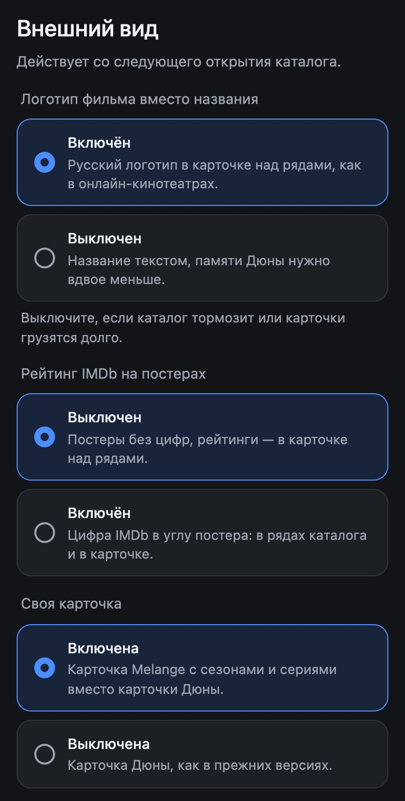
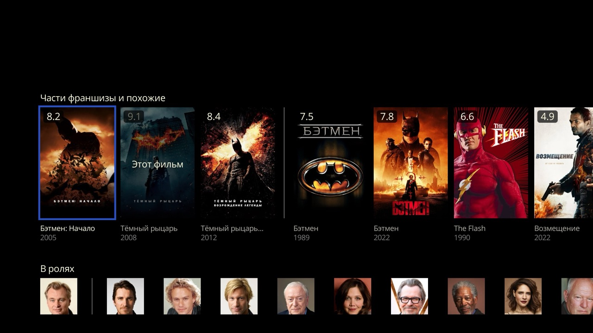

# Внешний вид

Включим логотип вместо названия, рейтинг на постерах и свою карточку фильма. [← Оглавление](README.md)

1. На странице настроек ([Страница настроек с телефона](phone-page.md)) откройте «Внешний вид».

   

2. «Логотип фильма вместо названия»: оставьте «Включён». Если каталог тормозит или карточки грузятся долго, выберите «Выключен».

3. «Рейтинг IMDb на постерах»: выберите «Включён». Цифра IMDb появится в углу постеров в рядах каталога и в карточке.

   

4. «Своя карточка»: оставьте «Включена». ENTER на постере откроет карточку Melange с сезонами и сериями. С «Выключена» откроется карточка Дюны, как в прежних версиях.

5. Нажмите «Сохранить». Каталог покажет изменения, когда вы откроете его снова.

   

## Если не получилось

- Логотипа нет, хотя он включён, или своя карточка не включается — см. [Известные ограничения](limitations.md).

Дальше: [Melange во вкладке «ТВ»](tv-tab.md) · [Оглавление](README.md)
