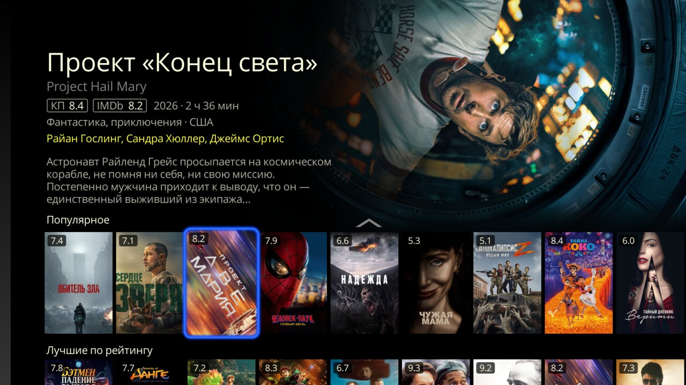

# Внешний вид

Включим логотип вместо названия и рейтинг на постерах. [← Оглавление](README.md)

1. На странице настроек ([Страница настроек с телефона](phone-page.md)) откройте «Внешний вид».

   

2. «Логотип фильма вместо названия» (r25): оставьте «Включён». Если каталог тормозит или карточки грузятся долго, выберите «Выключен». Логотип виден на панели сверху, когда вы стоите на постере.

   Включён:

   

   Выключен:

   

3. «Рейтинг IMDb на постерах»: выберите «Включён». Цифра IMDb появится в углу постеров в рядах каталога и в карточке.

   Включён:

   

   Выключен:

   

4. Нажмите «Сохранить». Каталог покажет изменения, когда вы откроете его снова.

   

## Если не получилось

- Логотипа нет, хотя он включён, — см. [Известные ограничения](limitations.md).

Дальше: [Melange во вкладке «ТВ»](tv-tab.md) · [Оглавление](README.md)
