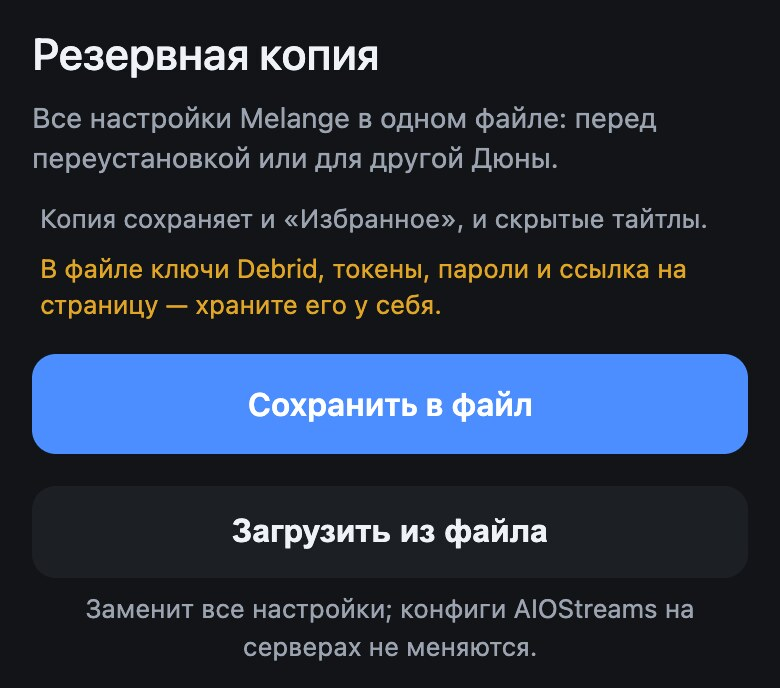

# Backup

Save Melange settings to a file, to bring them back after a reinstall or move them to another Dune. [← Contents](README.en.md)

Removing Melange erases all its settings, so save the file before you remove it.

1. On the settings page ([Settings page on a phone](phone-page.en.md)), open "Backup" in the "More" section.

   

2. Press "Save to a file". The phone downloads a `melange-settings-….json` file. It holds what you entered in Melange: the Debrid keys and the key of your own JacRed, the TorrServer and download server passwords, Favorites and hidden titles. Do not share it publicly.

3. On the new Dune or after a reinstall, install Melange, press "Set up from a phone" on the settings screen and scan the QR code. On the page, open "Backup", press "Load from a file" and choose the saved file. It replaces all Melange settings, Favorites and hidden titles. The file does not change AIOStreams configs on the servers.

4. The page opens again with the line "Settings loaded from the file. The Dune picks them up automatically." The page link from the file comes back too: on the same Dune the old bookmark works again, on another one add the bookmark again.

   

## If it did not work

- "No settings yet: save them first.": save the settings at least once, then save the file.
- "The file is from a newer version of Melange: update the plugin": update Melange and load the file again.
- Other messages: [Troubleshooting](troubleshooting.en.md).

Next: [AIOStreams and your own config](aiostreams.en.md) · [Contents](README.en.md)
