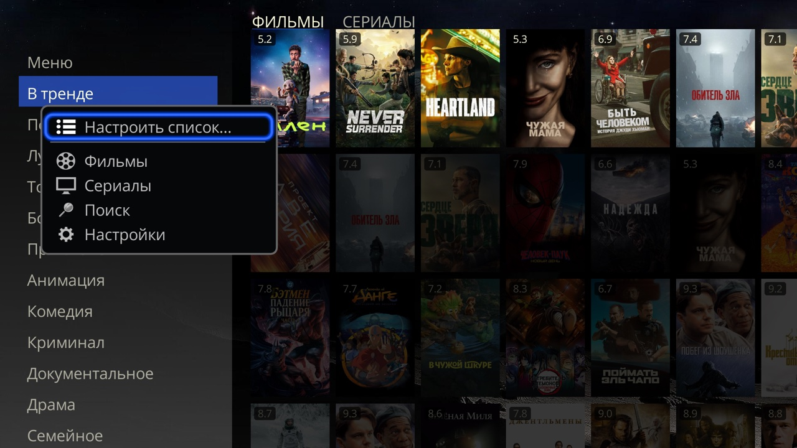
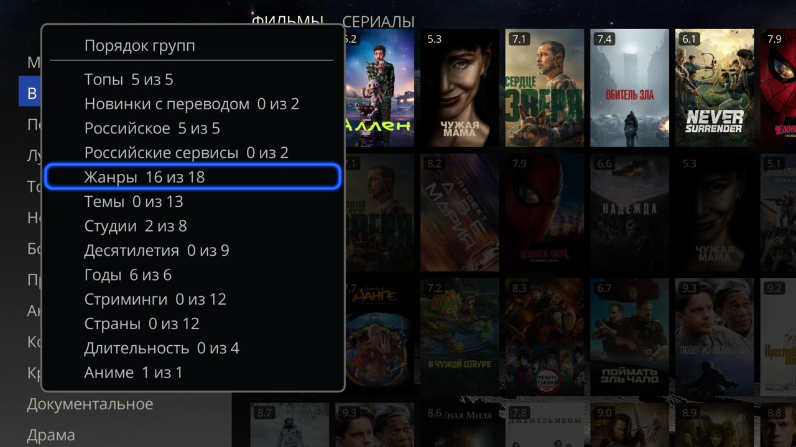
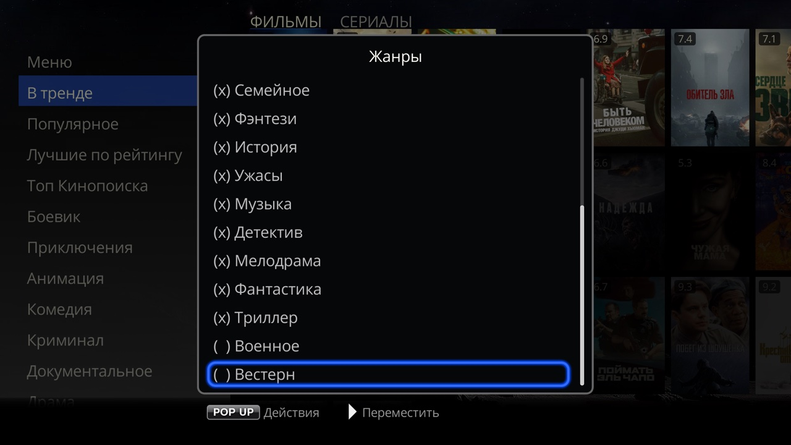
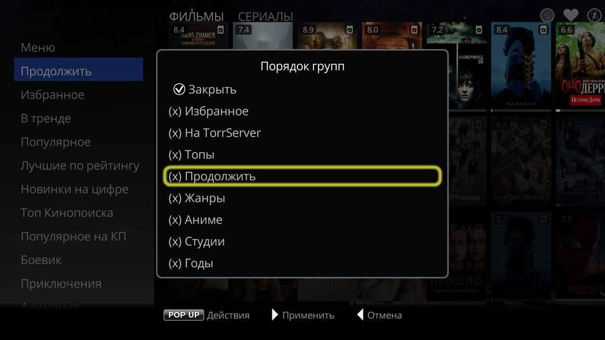
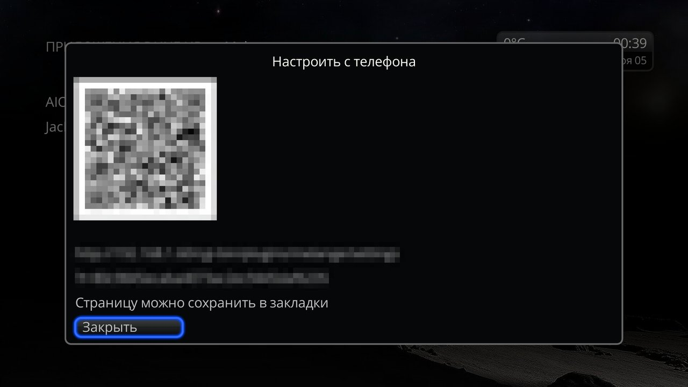
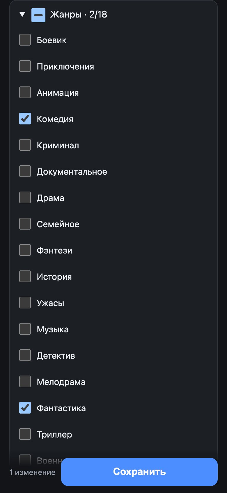

# Your own catalog rows

Keep the collections you need in the catalog and put them in order. [← Contents](README.en.md)

## On the Dune

1. In the catalog, press **RETURN**: focus moves to the row name in the left panel. Press **POP UP** and choose "Configure List...".

   

2. Choose a group, for example "Genres".

   

3. Tick the rows you want to see: **ENTER** sets and clears (x). New ones go to the end of the tab.

   

4. To change the order, open "Row order", move to a row and press **▶** ("Move"). Put the row in its new place with the arrows and press **▶** ("Apply").

   

5. Close the window with "Close" at the top of the list, and the catalog shows the new set at once.

Series rows are set up the same way, on the "Series" tab.

## From a phone

1. In the catalog, open the plugin settings (the gear on the bar at the top) and choose "Set up from a phone". Scan the QR code with your phone.

   

2. On the page, open "Catalog rows".

   

3. At the top, choose "Movies" or "Series" (the switch is visible in the step 4 frame). Open a group and tick rows.

   

4. Arrange the rows with the arrows and press "Save".
   The new set appears the next time you open the catalog.

   

## If it didn't work

- "The Dune firmware does not support this dialog": set up the rows from a phone.
- Row names on the left can't be selected: "Left navigation panel" is off in the Dune settings. Turn it on or set up the rows from a phone.

Next: [Settings page on a phone](phone-page.en.md) · [Contents](README.en.md)
