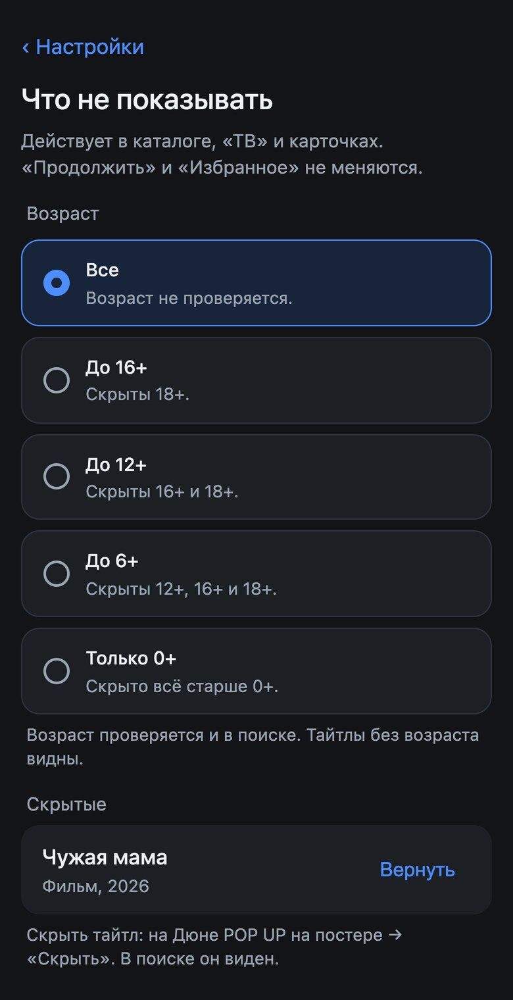

# Your own catalog rows

Keep the collections you need in the catalog, put them in order and hide the titles you don't want. [← Contents](README.en.md)

## On the Dune

1. In the catalog, press **RETURN**: focus moves to the row name in the left panel. Press **POP UP** and choose "Configure List...".

   

2. Choose a group, for example "Genres".

   

3. Tick the rows you want to see: **ENTER** sets and clears (x). New ones go to the end of the group.
   The order of the rows in the group is set here too: move to a row and press **▶** ("Move"). Put the row in its new place with the arrows and press **▶** ("Apply").

   

4. To rearrange the groups, open "Group order" and move a group the same way. Clear the (x) of a group to remove all its rows.
   The same list has Continue Watching, Favorites and On TorrServer: you can move or hide them too.

   

5. Close the window with "Close" at the top of the list, and the catalog shows the new set at once.

Series rows are set up the same way, on the "Series" tab.

## From a phone

1. In the catalog, open the plugin settings (the gear on the bar at the top) and choose "Set up from a phone". Scan the QR code with your phone.

   

2. On the page, open "Catalog rows". Continue Watching, Favorites and On TorrServer are in the "Melange rows" group, the first one in "All rows".

   

3. At the top, choose "Movies" or "Series" (the switch is visible in the step 4 frame). Open a group and tick rows.

   

4. Use the buttons next to a group name to move groups, and the buttons next to a row to move it within its group. Press "Save".
   The new set appears the next time you open the catalog.

   

## Hide a title and limit the age rating

1. On a poster, press **POP UP** and choose "Hide". The title disappears from the catalog; search still shows it.

   

2. To hide everything above an age rating, open "Hide from the catalog" on the settings page, choose a limit in "Age rating", for example "Up to 12+", and press "Save". Titles above it disappear from the same places and from search. Titles with no age rating stay visible.

3. "Hidden" on the same screen lists everything you hid on this Dune. "Unhide" brings a title back to the catalog.

   

Continue Watching and Favorites come first by default. A hidden row only leaves the screen: the clock and the heart on the top bar, the **POP UP** items and the **Fav** buttons still work. At least one row must stay on a tab. The On TorrServer row is off by default; see [Torrents and TorrServer](torrserver.en.md#on-torrserver-row).

## If it didn't work

- "The Dune firmware does not support this dialog": set up the rows from a phone.
- Row names on the left can't be selected: "Left navigation panel" is off in the Dune settings. Turn it on or set up the rows from a phone.

Next: [Settings page on a phone](phone-page.en.md) · [Contents](README.en.md)
