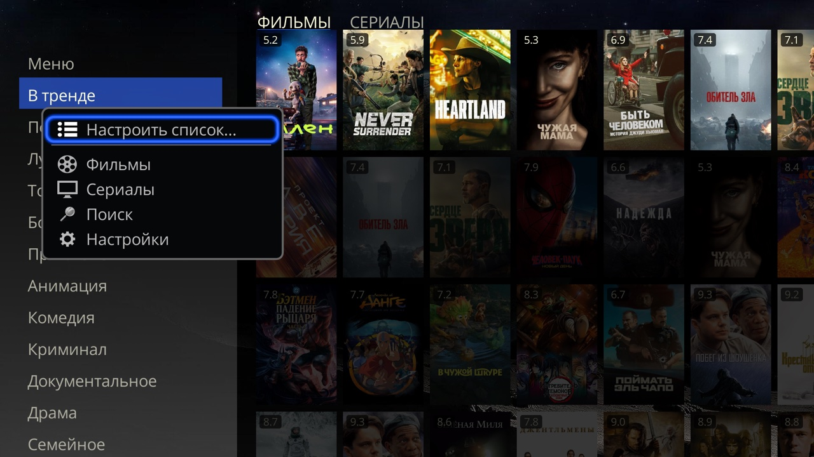
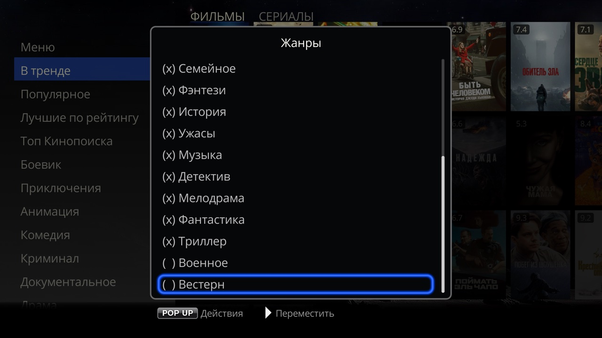
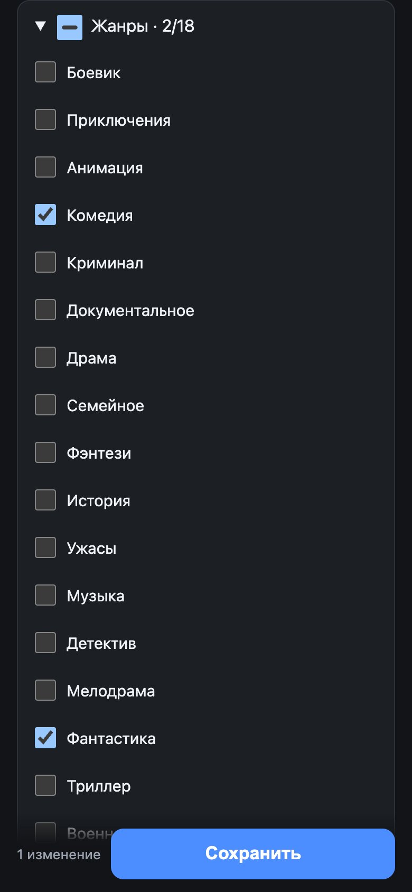
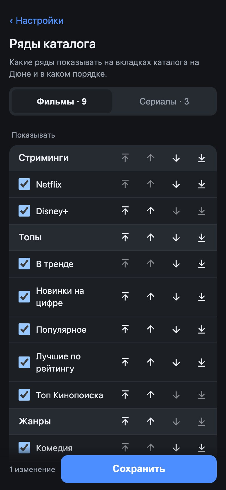
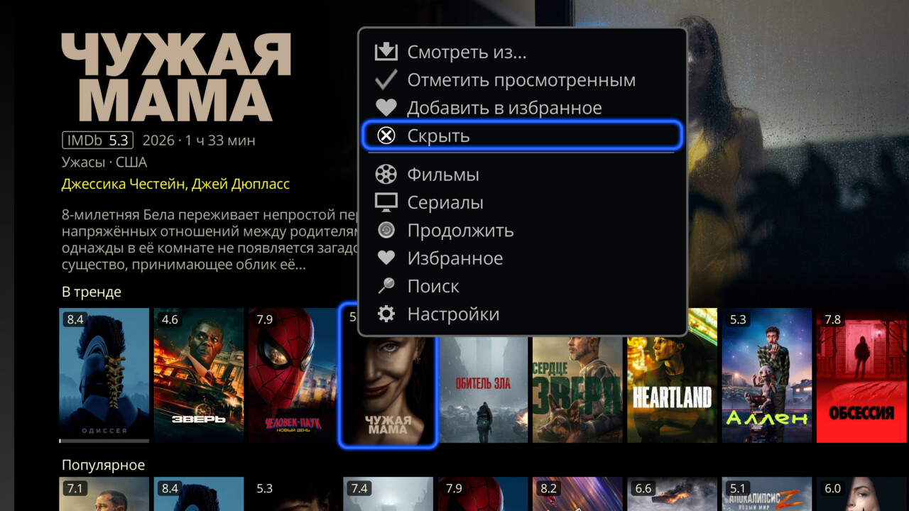

# Свои ряды каталога

Оставим в каталоге нужные подборки, расставим их по порядку и уберём лишние фильмы и сериалы. [← Оглавление](README.md)

## На Дюне

1. В каталоге нажмите **RETURN**: фокус перейдёт на название ряда в панели слева. Нажмите **POP UP** и выберите «Настроить список...».

   

2. Выберите группу, например «Жанры».

   

3. Отметьте ряды, которые хотите видеть: **ENTER** ставит и снимает (x). Новые встанут в конец группы.
   Здесь же задаётся порядок рядов группы: встаньте на ряд и нажмите **▶** («Переместить»). Стрелками поставьте ряд на новое место и нажмите **▶** («Применить»).

   

4. Чтобы переставить группы, откройте «Порядок групп» и переместите группу так же. Если снять с группы (x), уберутся все её ряды.

   

5. Закройте окно пунктом «Закрыть» вверху списка, и каталог сразу покажет новый набор.

Ряды сериалов настраиваются так же, на вкладке «Сериалы».

## С телефона

1. В каталоге откройте настройки плагина (шестерёнка на полосе сверху) и выберите «Настроить с телефона». Отсканируйте QR-код телефоном.

   

2. На странице откройте «Ряды каталога».

   

3. Вверху выберите «Фильмы» или «Сериалы» (переключатель виден на кадре шага 4). Откройте группу и отметьте ряды.

   

4. Кнопками у названия группы переставьте группы, кнопками у ряда — ряды внутри группы. Нажмите «Сохранить».
   Новый набор появится, когда вы снова откроете каталог.

   

## Скрыть фильм или сериал и ограничить возраст

1. Встаньте на постер, нажмите **POP UP** и выберите «Скрыть». Фильм или сериал пропадёт из каталога; в поиске он останется.

   

2. Чтобы скрыть всё старше нужного возраста, на странице настроек откройте «Фильтр каталога» и в списке «Возраст» выберите, например, «До 12+ (скрыты 16+ и 18+)». Нажмите «Сохранить». Фильмы и сериалы старше пропадут там же. Без возраста они видны.

3. Чтобы не видеть фильмы и сериалы с низким рейтингом IMDb, там же выберите порог в «Рейтинг IMDb: фильмы» и «Рейтинг IMDb: сериалы», например «От 6.5». Нажмите «Сохранить». Всё, что ниже порога, пропадёт там же. Без рейтинга IMDb фильмы и сериалы видны.

4. В списке «Скрытые» на том же экране видно всё, что вы скрыли на этой Дюне. «Вернуть» возвращает фильм или сериал в каталог.

   

Поиск показывает всё, что нашёл. «Продолжить» и «Избранное» не меняются.

## Если не получилось

- «Прошивка Дюны не поддерживает этот диалог» — настройте ряды с телефона.
- Названия рядов слева не выбираются — в настройках Дюны выключена «Навигационная панель слева». Включите её или настройте ряды с телефона.

Дальше: [Страница настроек с телефона](phone-page.md) · [Оглавление](README.md)
