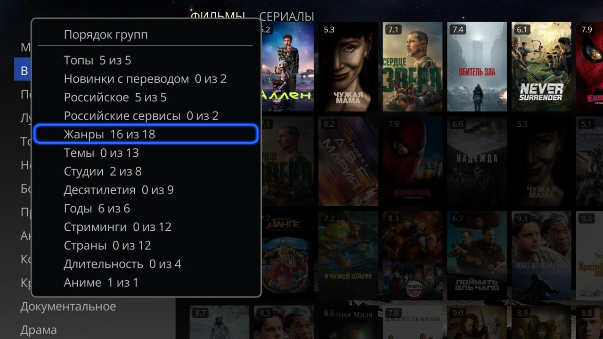
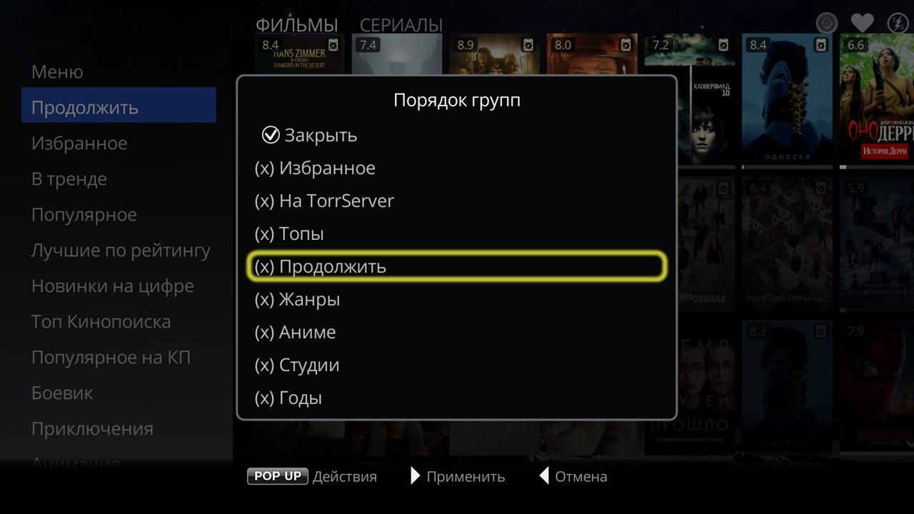

# Свои ряды каталога

Оставим в каталоге нужные подборки и расставим их по порядку. [← Оглавление](README.md)

## На Дюне

1. В каталоге нажмите **RETURN**: фокус перейдёт на название ряда в панели слева. Нажмите **POP UP** и выберите «Настроить список...».

   

2. Выберите группу, например «Жанры».

   

3. Отметьте ряды, которые хотите видеть: **ENTER** ставит и снимает (x). Новые встанут в конец вкладки.

   

4. Чтобы поменять порядок, откройте «Порядок рядов», встаньте на ряд и нажмите **▶** («Переместить»). Стрелками поставьте ряд на новое место и нажмите **▶** («Применить»).

   

5. Закройте окно пунктом «Закрыть» вверху списка, и каталог сразу покажет новый набор.

Ряды сериалов настраиваются так же, на вкладке «Сериалы».

## С телефона

1. В каталоге откройте настройки плагина (шестерёнка на полосе сверху) и выберите «Настроить с телефона». Отсканируйте QR-код телефоном.

   

2. На странице откройте «Ряды каталога».

   

3. Вверху выберите «Фильмы» или «Сериалы» (переключатель виден на кадре шага 4). Откройте группу и отметьте ряды.

   

4. Расставьте ряды стрелками и нажмите «Сохранить».
   Новый набор появится, когда вы снова откроете каталог.

   

## Если не получилось

- «Прошивка Дюны не поддерживает этот диалог» — настройте ряды с телефона.
- Названия рядов слева не выбираются — в настройках Дюны выключена «Навигационная панель слева». Включите её или настройте ряды с телефона.

Дальше: [Страница настроек с телефона](phone-page.md) · [Оглавление](README.md)
