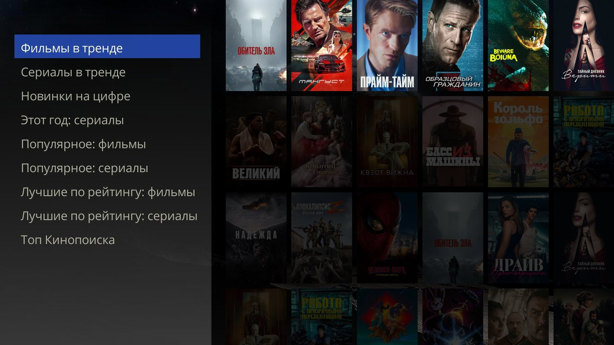
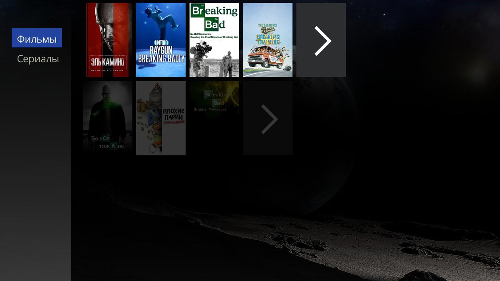

# Catalog

Melange's own catalog: rows of collections, search and where the data comes from. [← README](../README.en.md)

## How to open

**Apps → Melange** opens the catalog. While AIOStreams is not set up, the settings screen opens instead (see [Getting started](quick-start.en.md)).

On top of the catalog is a strip: the **Movies** and **Series** tabs and, on the right, a magnifier (search) and a gear (settings); press UP from the first row to get there. The catalog opens on Movies.

Settings from the catalog: the gear on the strip or MENU → **Settings**.

## Rows

The catalog has rows of collections with up to 20 posters each; the last tile, **Show all**, opens the whole row (up to 1000 posters, loaded as you scroll).

**Start rows:** trending movies and series, new digital releases, this year's series, popular and top rated, and Kinopoisk top ("Топ Кинопоиска"). Row names come from the catalog server in Russian.

### Your own set of rows

On the settings page on your phone, in the **Catalog rows** section, there are about 180 rows in two parts, switched at the top (Movies | Series), each in groups (top, fresh releases, Russian, Russian services, genres, themes, studios, decades, years, streaming, countries, runtime, anime): tick the ones you want (the checkbox in the title of a group turns all its rows on or off at once) and order them with **Up** / **Down**; at least one row must stay in each part. The parts are the tabs of the catalog: rows of movies show on the Movies tab, rows of series and anime on Series. Rows are saved together with the other settings, so set up where to get films first. The new set shows the next time the catalog opens.

## Logo in place of the title

Above the rows, a movie with a Russian logo shows the logo instead of its title, as streaming services do. If the catalog lags or the cards take long to load, turn it off on the settings page: **Appearance** → **Film logo in place of the title**. The title is then shown as text and the Dune needs half the memory; it takes effect the next time the catalog opens.

## Search

The magnifier on the strip on top or MENU → **Search** (or the search key, if your remote has one). Results come in the **Movies** and **Series** rows; **Show all** at the end of a row lists everything found.

## ENTER on a poster

- If the title has a card in the Dune **Movies** catalog, that card opens: **Play...** → **Melange**, with watch history as usual.
- If there is no card, for a movie Melange creates its own Dune card, and the rest is as usual: **Play...**, watch history. For a series Melange offers to open the release list right away, from the first episode, but without watch history: no percentage, no **Continue Watching**.
- With neither a card nor an IMDb ID, releases cannot be found.

## Catalog server

Rows, search and posters come from Melange's shared AIOMetadata server `aiometadata.kompotik.com`; no keys or sign-up needed. If the server does not answer, the catalog shows saved copies of the rows, and a row without a copy can be reloaded.

## Data sources

Movies, series and posters come from [TMDB](https://www.themoviedb.org/), streaming service rows from [JustWatch](https://www.justwatch.com/) data. Thanks to the authors of the collections:
- the parameters of most rows (genres, themes, studios, decades, streaming, countries, runtime) are from the AIOMetadata template [luckynumb3rs/stremio-perfect-setup](https://github.com/luckynumb3rs/stremio-perfect-setup); the Russian rows and new releases were put together for Melange;
- Kinopoisk top is an unofficial mirror of the Kinopoisk Top 250, the public list by [lotist on Letterboxd](https://letterboxd.com/lotist/list/250/); it is not Kinopoisk's own rating, and the row has the first 200 movies;
- "Новинки в качестве" and "Новинки в 4K" follow the open list of [KinoTrend](https://kino-trend.ru/), "Свежие серии с переводом" follows [Kinou](https://kinou.ru/); a movie or series without an IMDb ID does not get into these rows;
- the "on AniList" anime rows are from [AniList](https://anilist.co/);
- the catalog server is [AIOMetadata](https://github.com/cedya77/aiometadata).
