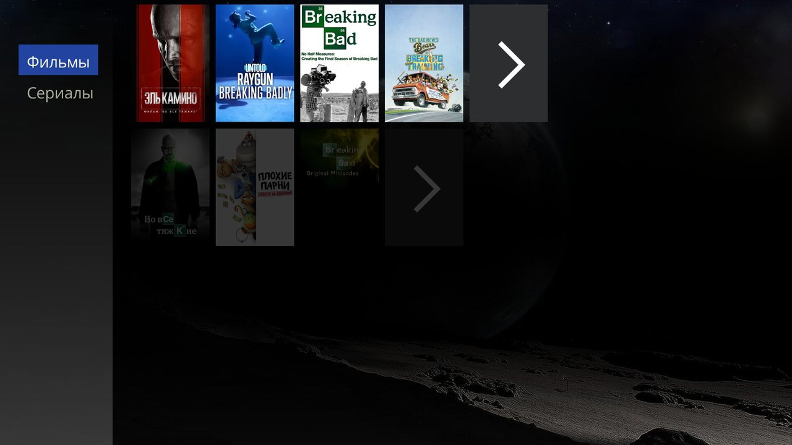

# Каталог

Свой каталог Melange: ряды подборок, поиск и откуда берутся данные. [← README](../README.md)

## Как открыть

**«Приложения» → «Melange»** открывает каталог. Пока AIOStreams не настроен, вместо каталога открывается экран настроек (см. [Пошаговую настройку](quick-start.md)).

Настройки из каталога — MENU → **«Настройки»**.

## Ряды

В каталоге — ряды подборок, в ряду до 20 постеров. Последняя плитка — **«Показать все»**: весь ряд, как раскрытый ряд Дюны — по 9 постеров в ряд с инфопанелью сверху, дальше подгружается при прокрутке, до 1000. На прошивке r24 — сеткой.

**Стартовые ряды** — 9: фильмы и сериалы в тренде, новинки на цифре, сериалы этого года, популярное и лучшее по рейтингу — фильмы и сериалы, «Топ Кинопоиска».

### Свой набор рядов

На странице настроек с телефона, раздел **«Ряды каталога»**:
- около 180 рядов по группам: топы, российское, российские сервисы, жанры, темы, студии, декады, годы, стриминги, страны, длительность, аниме;
- флажок показывает ряд, **«Выше»** / **«Ниже»** меняют порядок;
- пустой набор сохранить нельзя: последний ряд не снимается («Должен остаться хотя бы один ряд: сначала включите другой»).

Ряды сохраняются общей кнопкой «Сохранить» вместе с остальными настройками, поэтому сначала настройте, откуда брать фильмы.

**Когда появится новый набор.** Если настройки открыты из каталога (MENU → «Настройки») и сохранены, пока на телевизоре открыт QR-код, — по Back каталог покажет новый набор. Иначе — при следующем открытии каталога.

## Поиск

MENU → **«Поиск»** (или клавиша поиска, если она есть на пульте). Введите название — результаты придут рядами «Фильмы» и «Сериалы», в конце ряда «Показать все» — все найденные, как у рядов каталога. Не нашлось — «Ничего не найдено».

## ENTER на постере

| Что есть у фильма | Что откроется |
|---|---|
| карточка в каталоге «Фильмы» Дюны | она: «Смотреть…» → «Melange», с историей просмотра, как обычно |
| карточки нет, но есть IMDb-id | окно «Без карточки Дюны: История просмотра не сохранится»; **«Показать раздачи»** сразу открывает список раздач Melange, у сериала — с первой серии первого сезона. Ни процента на кнопке, ни «Продолжить просмотр» у такого просмотра не будет |
| ни карточки, ни IMDb-id | «Раздачи не найти: нет карточки Дюны и IMDb-id» |

## Сервер каталога

Ряды и поиск идут с общего сервера AIOMetadata Melange `aiometadata.kompotik.com` (его держит автор для пользователей плагина); ключи и регистрация не нужны. Постеры тоже идут через кэш этого сервера.

Если сервер не ответил:
- ряд с сохранённой копией показан с пометкой «сохранённая копия»;
- ряд без копии — плиткой «Не загрузилось», ENTER на ней — повторить (на прошивке r24 такой ряд не показан);
- «Каталог не загрузился. Проверьте сеть и повторите» с кнопкой **«Повторить»** — только когда показать нечего: нет сохранённого списка рядов (например, при первом открытии), а на r24 — и когда не загрузился ни один ряд.

## Откуда данные

Фильмы, сериалы и постеры — из [TMDB](https://www.themoviedb.org/), ряды по стриминговым сервисам — по данным [JustWatch](https://www.justwatch.com/). Спасибо авторам подборок:
- параметры большинства рядов (жанры, темы, студии, декады, стриминги, страны, длительность) — из шаблона AIOMetadata [luckynumb3rs/stremio-perfect-setup](https://github.com/luckynumb3rs/stremio-perfect-setup); российские ряды и новинки собраны для Melange;
- «Топ Кинопоиска» — неофициальное зеркало топ-250 Кинопоиска, публичный список [lotist на Letterboxd](https://letterboxd.com/lotist/list/250/); это не рейтинг самого Кинопоиска, в ряду первые 200 фильмов;
- ряды аниме «на AniList» — из [AniList](https://anilist.co/);
- сервер каталога — [AIOMetadata](https://github.com/cedya77/aiometadata).
