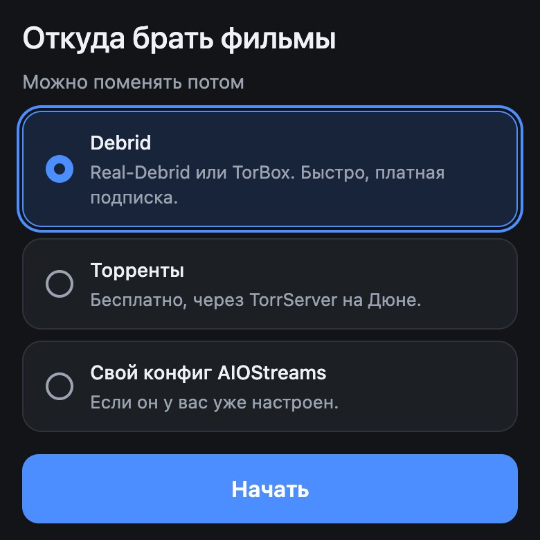
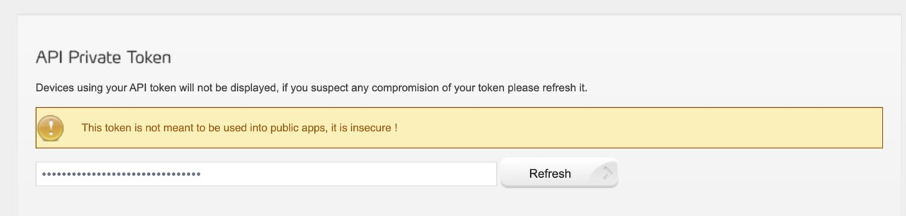
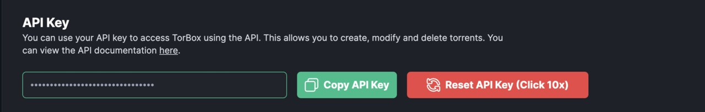
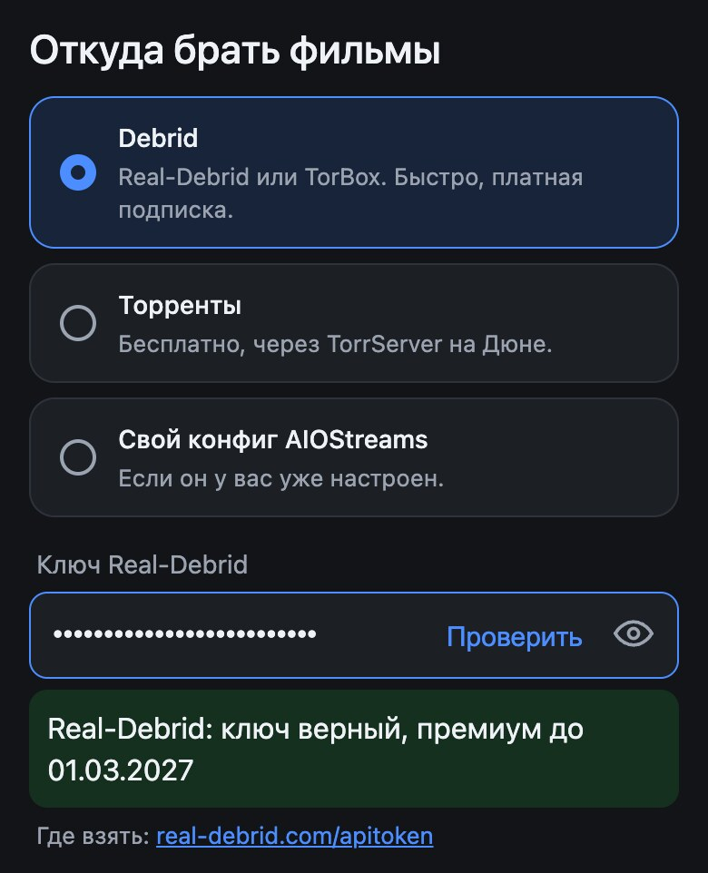
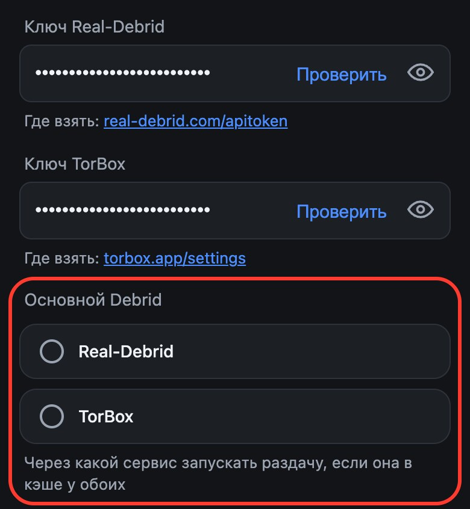
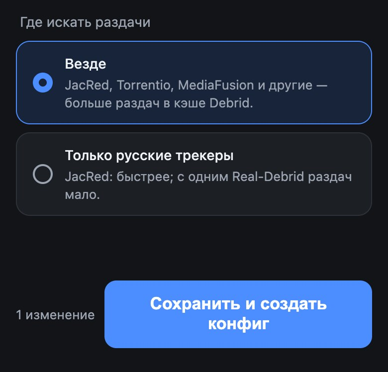
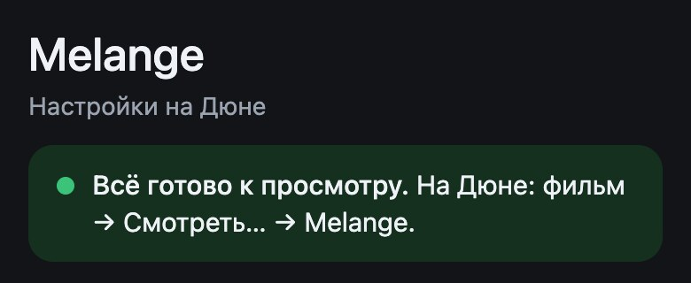
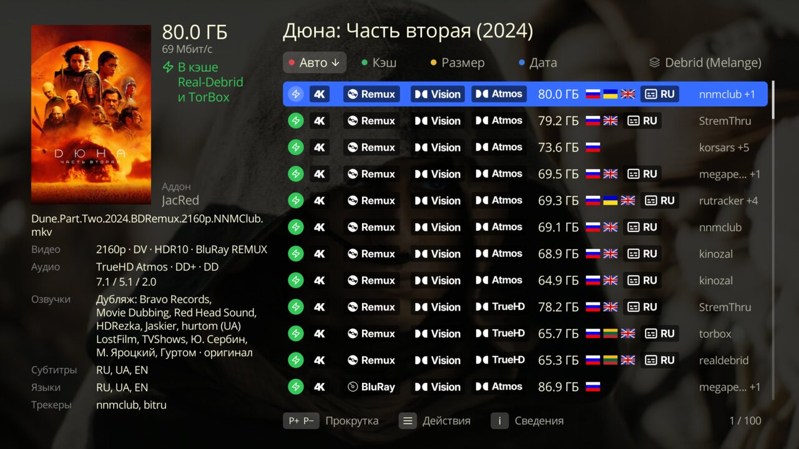
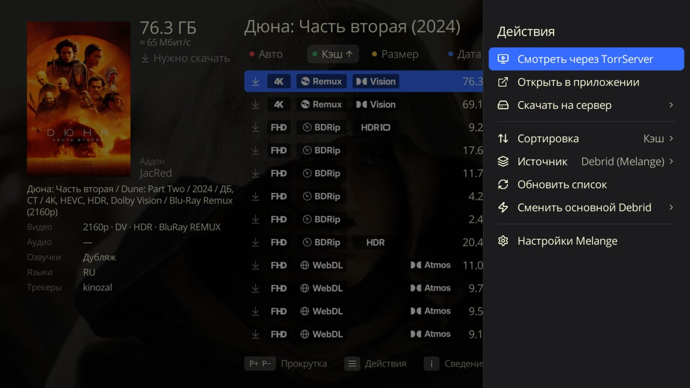

# Debrid

Connect Real-Debrid or TorBox so that movies start right away, with no wait for downloading. [← Contents](README.en.md)

You need: a Real-Debrid or TorBox subscription and a phone on the same network as the Dune.

No subscription yet? Get one through the author's link to support Melange: [Real-Debrid](https://real-debrid.com/?id=20188550), [TorBox](https://torbox.app/subscription?referral=2339fa70-a03e-41f0-a414-9c96f0791bb1).

1. In the Melange catalog, open the plugin settings (the gear on the bar at the top) and choose "Set up from a phone". Scan the QR code with your phone. On the first Melange launch, press "Set up from a phone" on the settings screen (not "Quick setup: torrents"). More about the page: [Settings page on a phone](phone-page.en.md).

   

2. On the page, choose "Debrid" and press "Start".

   

3. Open the service website on the phone, sign in and copy the key. Real-Debrid: https://real-debrid.com/apitoken; TorBox: https://torbox.app/settings.

   

   

4. At the top, choose your service, Real-Debrid or TorBox, paste the key into the field and press "Check". A green line "the key is valid, premium" should appear.

   

5. If you have both subscriptions, press "+ Add TorBox" (or "+ Add Real-Debrid") and paste the second key. In "Main Debrid", choose the service to start a release through when both have it.

   

6. In "Where to look for releases", leave "Everywhere" and press "Save and create the config".

   

   "All set to watch" appears, the QR code window on the Dune closes by itself, and the Melange catalog opens.

   

7. Open a movie on the Dune. A lightning bolt on a release means it is cached (already downloaded by the Debrid service) and starts right away.

   

8. A release without a lightning bolt can play via TorrServer: move to it, press **POP UP** and choose "Watch via TorrServer". This needs TorrServe on the Dune. To install it, see [Quick start](start.en.md#via-dune-backup), step 5; to set it up, [First setup](start.en.md#first-setup), step 1.

   

## If it didn't work

- "the key is not accepted": copy the key again, in full, without spaces.
- "the key is valid, but no premium": renew the subscription on the service website.
- A release doesn't start or says "Not cached": see [Known limitations](limitations.en.md) and [Troubleshooting](troubleshooting.en.md).

Next: [Torrents and TorrServer](torrserver.en.md) · [Contents](README.en.md)
