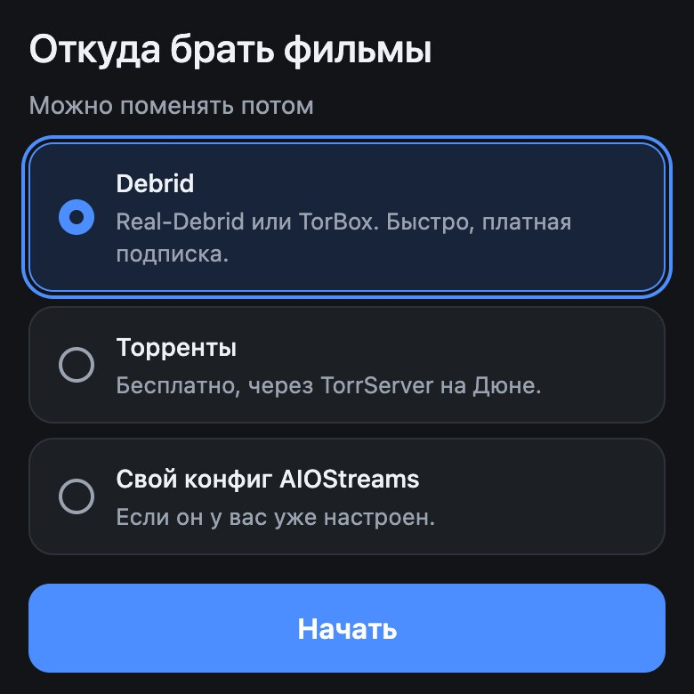
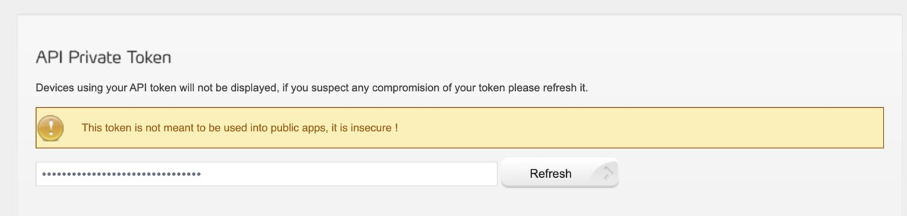
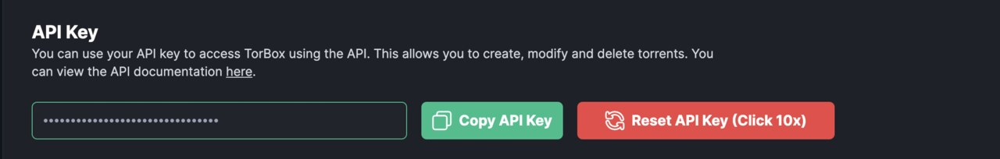
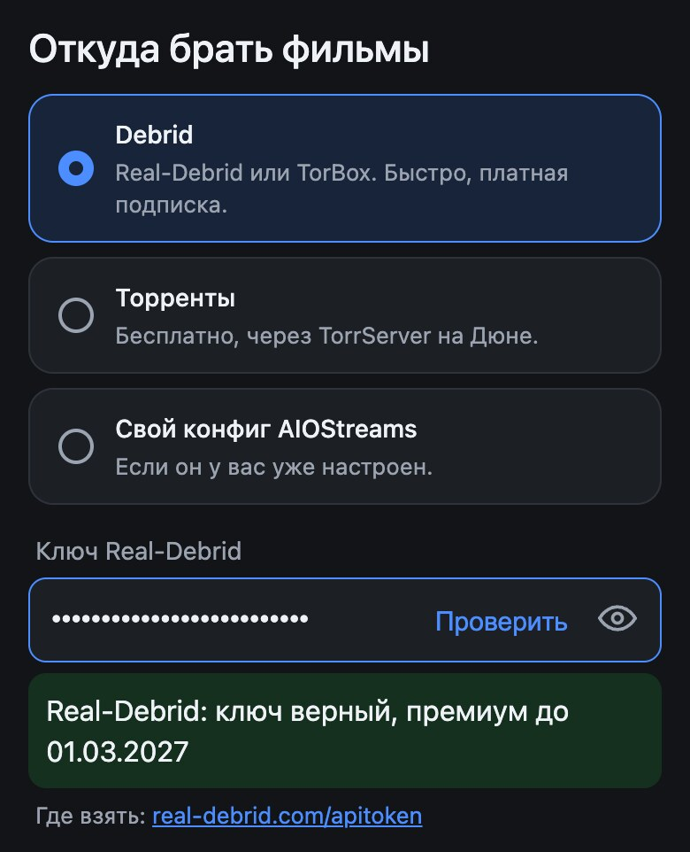
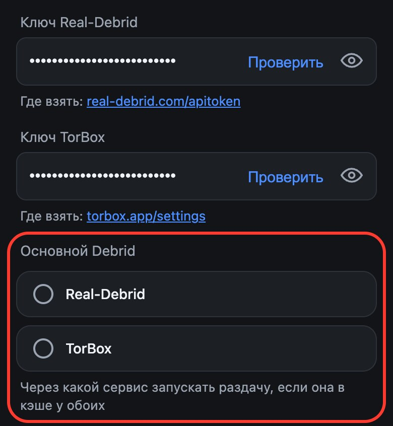
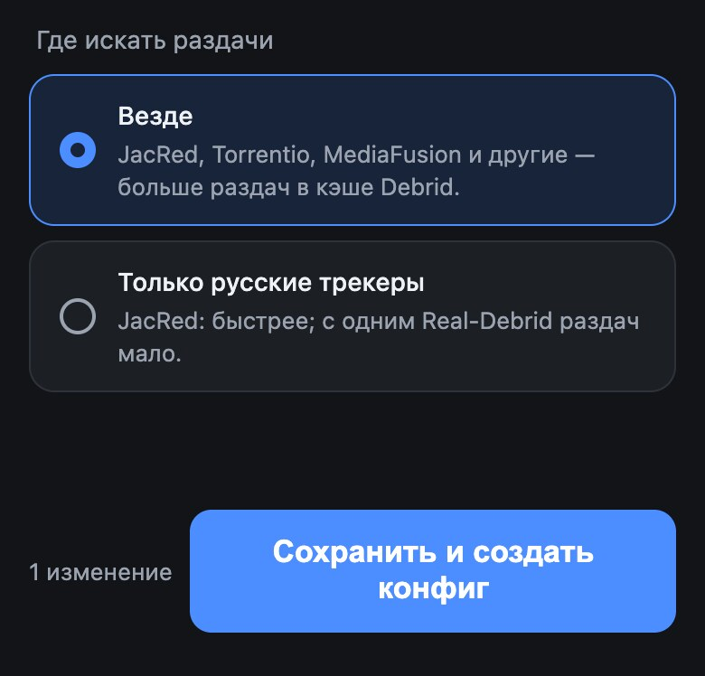
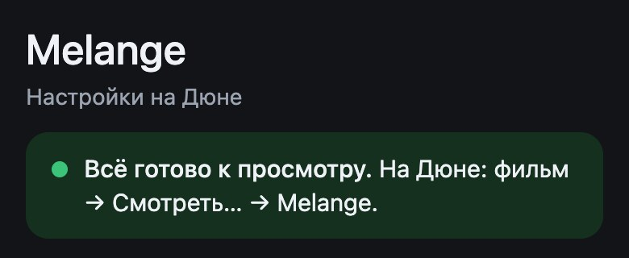
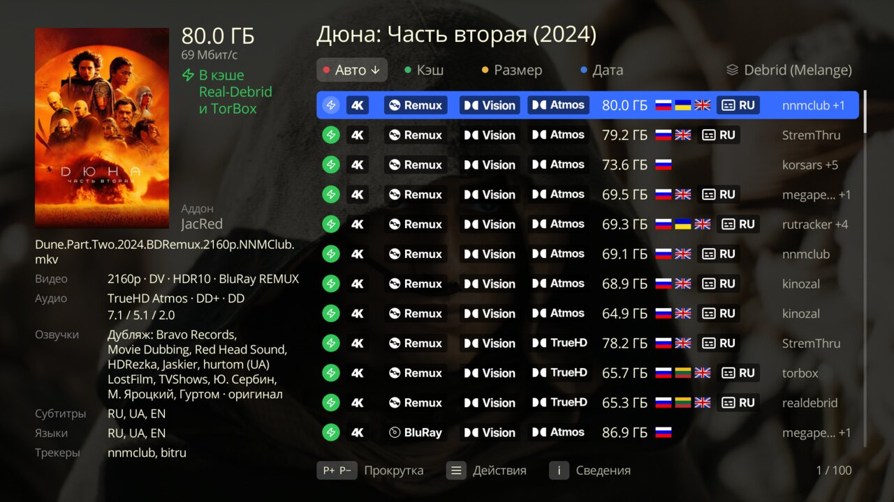

# Debrid

Подключим Real-Debrid или TorBox, чтобы фильмы включались сразу, без ожидания загрузки. [← Оглавление](README.md)

Нужно заранее: подписка Real-Debrid или TorBox и телефон в той же сети, что и Дюна.

1. В каталоге Melange откройте настройки плагина (шестерёнка на полосе сверху) и выберите «Настроить с телефона». Отсканируйте QR-код телефоном. При первом запуске Melange этот экран открывается сам. О странице подробнее в главе [Страница настроек с телефона](phone-page.md).

   

2. На странице выберите «Debrid» и нажмите «Начать».

   

3. Скопируйте ключ на сайте сервиса: Real-Debrid — https://real-debrid.com/apitoken, TorBox — https://torbox.app/settings.

   

   

4. Вставьте ключ в поле и нажмите «Проверить». Должна появиться зелёная строка «ключ верный, премиум».

   

5. Если подписки две, нажмите «+ Добавить TorBox» (или «+ Добавить Real-Debrid») и вставьте второй ключ. В «Основной Debrid» выберите сервис, через который запускать раздачу, если она есть у обоих.

   

6. В «Где искать раздачи» оставьте «Везде» и нажмите «Сохранить и создать конфиг».

   

   Появится «Всё готово к просмотру», окно с QR-кодом на Дюне закроется само.

   

7. Откройте фильм на Дюне. Молния у раздачи значит, что она в кэше (уже скачана сервисом Debrid) и включится сразу.

   

8. Раздачу без молнии можно включить через TorrServer: встаньте на неё, нажмите **MENU** и выберите «Смотреть через TorrServer». Для этого нужен TorrServe на Дюне ([Быстрый старт](start.md)).

   <!-- TODO скриншот: список раздач, меню MENU открыто, фокус на «Смотреть через TorrServer» -->

## Если не получилось

- «ключ не принят» — скопируйте ключ заново, целиком, без пробелов.
- «ключ верный, но премиума нет» — продлите подписку на сайте сервиса.
- Раздача не включается или пишет «Нужно скачать» — см. [Известные ограничения](limitations.md) и [Решение проблем](troubleshooting.md).

Дальше: [Просмотр](watch.md) · [Оглавление](README.md)
