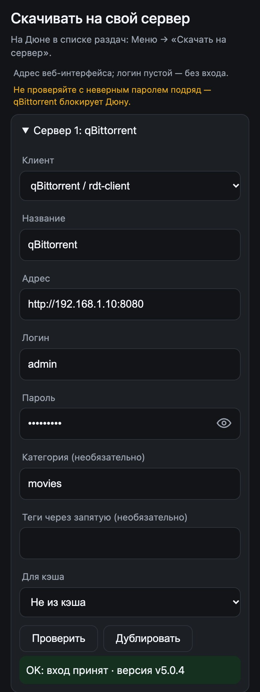
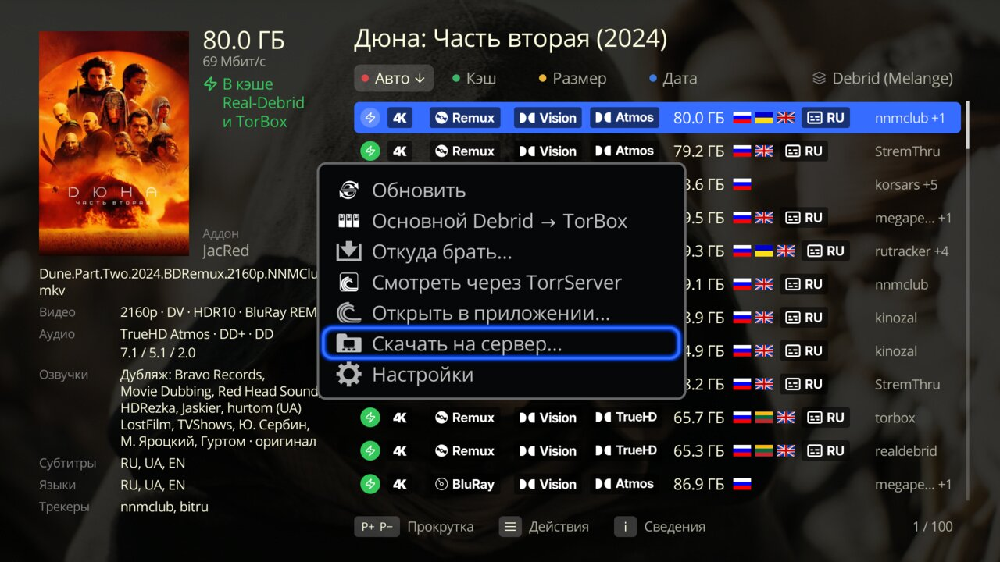
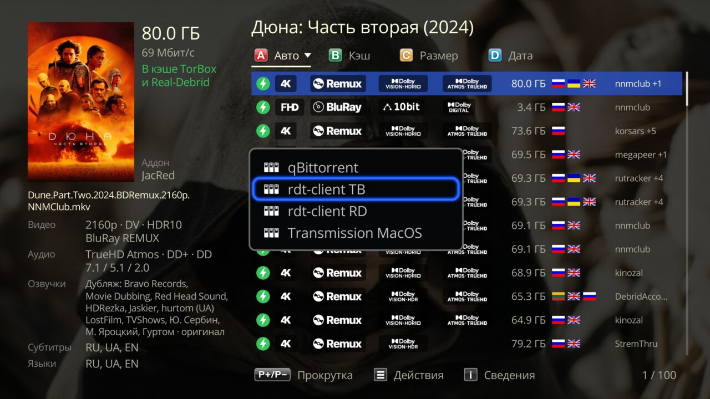
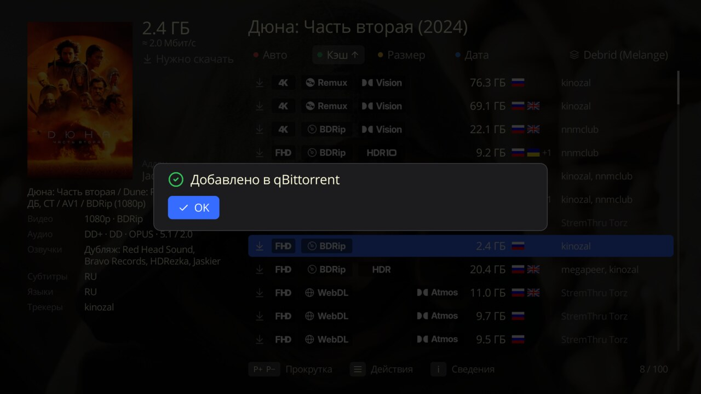

# Your own torrent client

Send a release from the Dune to qBittorrent, Transmission, Synology Download Station or rdt-client on a NAS or a computer. [← Contents](README.en.md)

You need: a torrent client with its web UI turned on.

1. On the settings page ([Settings page on a phone](phone-page.en.md)), open "Download to your server". Choose the client, enter a name, the web UI address (`http://host:port`; Transmission usually uses port 9091), the login and the password. Press "Check": a green line "OK: logged in · version …" should appear.

   For Synology Download Station the address is `http://NAS:5000`; https with the factory Synology certificate will not work. In "Download folder: shared folder/subfolder" you can enter a folder that already exists on the NAS, for example `video/Torrents`. If you leave the field empty, downloads go to the default folder of Download Station.

   

2. Press "Save". You will see "Saved. The Dune picks up the settings automatically."

   

3. On the Dune, in the release list, move to a release and press **POP UP** → "Download to server…".

   

4. Choose the server. You will see "Added to <name>".

   

   

If you have several servers, choose in "For the cache of" which one to use for releases from the Debrid cache.

You may not need a separate client. The built-in torrent client of Keenetic routers is Transmission, usually on port 8090. On a TerraMaster NAS you can install qBittorrent or Transmission from the app center.

## If it did not work

- "Check" shows a red line: see [Troubleshooting](troubleshooting.en.md).
- A download was added to Download Station but stays waiting: set the default folder for that user in Download Station ([Troubleshooting](troubleshooting.en.md)).
- The POP UP menu has no "Download to server…": not every release has it, only those where the source sent a torrent. With "No torrents" it is not there at all ([Advanced](advanced-options.en.md)).

Next: [Appearance](appearance.en.md) · [Contents](README.en.md)
