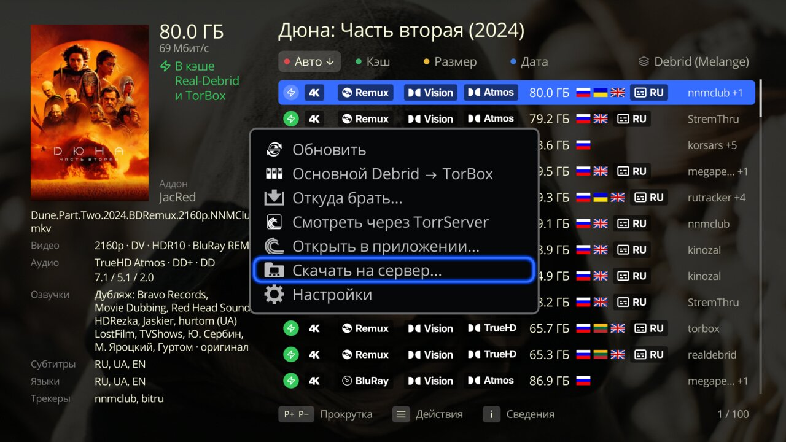
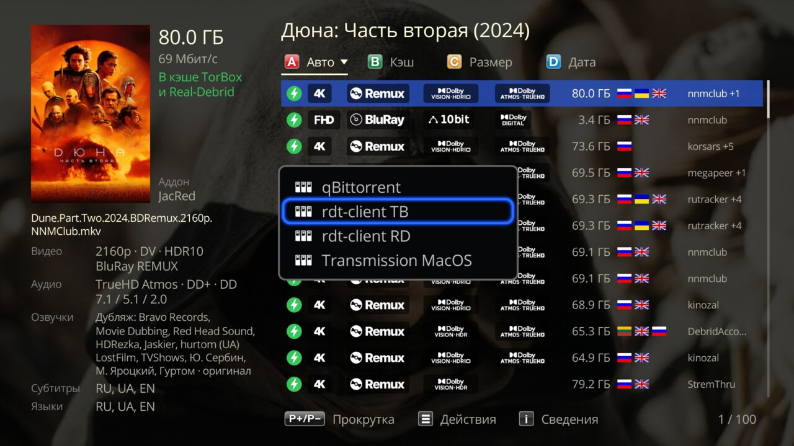

# Свой торрент-клиент

Отправим раздачу с Дюны в qBittorrent, Transmission или rdt-client на NAS или компьютере. [← Оглавление](README.md)

Нужно заранее: торрент-клиент с включённым веб-интерфейсом.

1. На странице настроек ([Страница настроек с телефона](phone-page.md)) откройте «Скачивать на свой сервер». Выберите клиент, впишите название, адрес веб-интерфейса (`http://хост:порт`, у Transmission обычно порт 9091), логин и пароль. Нажмите «Проверить»: должна появиться зелёная строка «OK: вход принят · версия …».

   

2. Нажмите «Сохранить». Появится «Сохранено. Дюна подхватит настройки сама.»

   

3. На Дюне в списке раздач встаньте на раздачу и нажмите **POP UP** → «Скачать на сервер».

   

4. Выберите сервер. Появится «Добавлено в <название>».

   

   

Серверов несколько — в «Для кэша» выберите, какой брать для раздач из кэша Debrid.

## Если не получилось

- «Проверить» пишет красным — см. [Решение проблем](troubleshooting.md).
- В меню POP UP нет «Скачать на сервер» — пункт есть не у всех раздач: только где источник прислал торрент; с «Без торрентов» его нет ([Дополнительно](advanced-options.md)).

Дальше: [Внешний вид](appearance.md) · [Оглавление](README.md)
