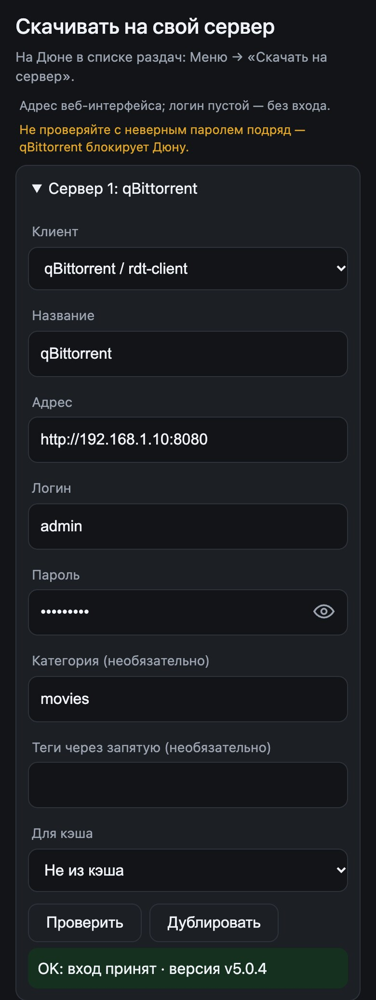

# Свой торрент-клиент

Отправим раздачу с Дюны в qBittorrent, Transmission или rdt-client на NAS или компьютере. [← Оглавление](README.md)

Нужно заранее: торрент-клиент с включённым веб-интерфейсом.

1. На странице настроек ([Страница настроек с телефона](phone-page.md)) откройте «Скачивать на свой сервер». Выберите клиент, впишите название, адрес веб-интерфейса (`http://хост:порт`), логин и пароль. Нажмите «Проверить»: должна появиться зелёная строка «OK: вход принят · версия …».

   

2. Нажмите «Сохранить». Появится «Сохранено. Дюна подхватит настройки сама.»

   

3. На Дюне в списке раздач встаньте на раздачу и нажмите **MENU** → «Скачать на сервер…».

   <!-- TODO скриншот: список раздач на Дюне, открыто MENU, фокус на «Скачать на сервер…» -->

4. Выберите сервер. Появится «Добавлено в <название>».

   <!-- TODO скриншот: меню выбора сервера на Дюне -->
   <!-- TODO скриншот: сообщение «Добавлено в qBittorrent» -->

Если серверов несколько, в «Для кэша» укажите, какой брать для раздач из кэша Debrid (например, «Real-Debrid» у rdt-client), и Melange будет выделять его в меню.

**Transmission.** Адрес — тот же, что у веб-интерфейса, обычно `http://хост:9091`. Вместо категории поле «Папка загрузки на сервере», вместо тегов — «Метки» (Transmission хранит их с версии 4.0).

## Если не получилось

- «Проверить» пишет красным — см. [Решение проблем](troubleshooting.md).
- В MENU нет «Скачать на сервер…» — пункт есть только у торрент-раздач и не появляется с «Без торрентов» ([Дополнительно](advanced-options.md)).

Дальше: [Дополнительно](advanced-options.md) · [Оглавление](README.md)
