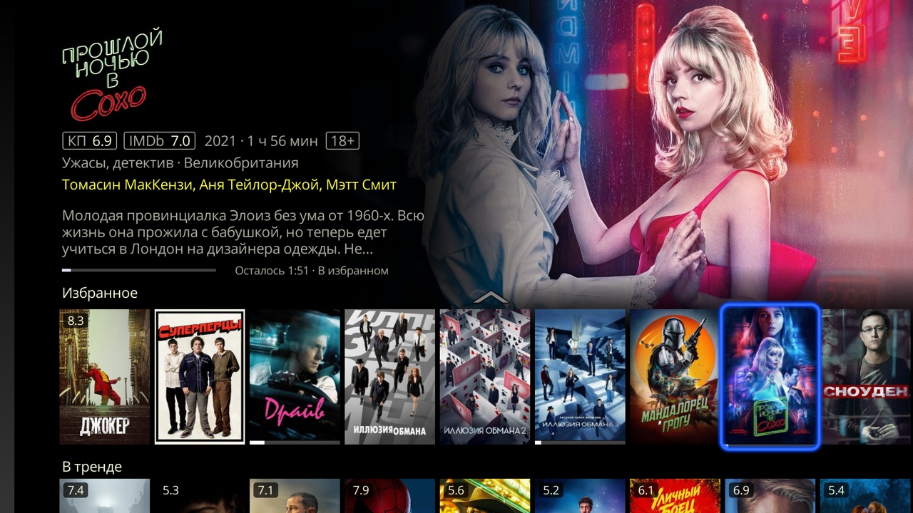
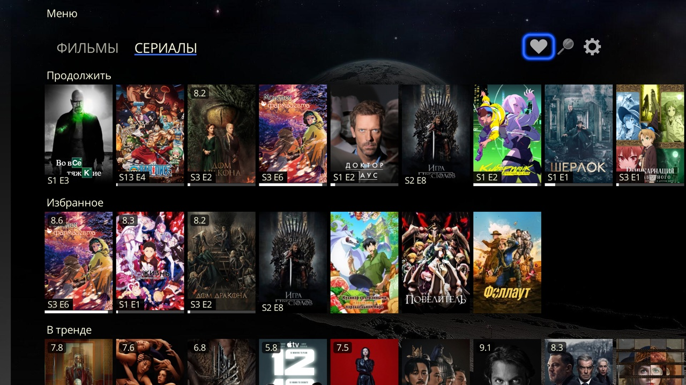

# Continue Watching and Favorites

Melange keeps what you started and what you saved for later in the first catalog rows. [← Contents](README.en.md)

1. The first catalog row is "Continue Watching": movies you started, and the next episode of a show. The second row is "Favorites". The "Movies" tab shows movies in them, the "Series" tab shows series. An empty row is hidden.

   

2. Badges on a poster show how much you watched: the bar at the bottom is how far you got, ✓ means finished. On a show, a badge like "S1 E3" is the episode you stopped at or the one that comes next.

   

3. Move to a poster: at the top of the screen, under the description, you see the time left, "Watched" or the next episode.

   

4. To save a movie for later, open its card (**ENTER** on the poster) and press "Favorites". The button turns into "In Favorites". Press it again to remove the movie.

   

   With **MENU** on a movie card you can mark it as watched ("Mark as watched" or "Mark as unwatched") or open its "Dune card".

   

5. The heart on the top bar, next to the magnifier and the gear, opens all of Favorites. If your remote has **Fav** buttons, **Fav 2** (the heart) opens Favorites too, and **Fav 1** opens everything you started. **ENTER** on a row's name opens the whole row.

   

   The Favorites screen opens with all your movies and series.

   

6. On a poster, press **POP UP** to add it to Favorites or remove it, mark it as watched or unwatched, or, in Continue Watching, remove it from the row. Marking a show marks all its released episodes.

   

7. Melange Favorites is separate from Dune Favorites. To bring movies and series over from Dune Favorites, on the Favorites screen press **POP UP** on a tile (on the empty screen, the heart tile) and choose "Add from Dune Favorites". Melange adds only what is missing and removes nothing.

   

## If something goes wrong

- A started title is not in Continue Watching: Melange counts a title as started after 2 minutes of watching. Clips shorter than 10 minutes (trailers) never get there.
- "Nothing new in Dune Favorites": everything from Dune Favorites is already here.

Next: [Your own catalog rows](catalog-rows.en.md) · [Contents](README.en.md)
