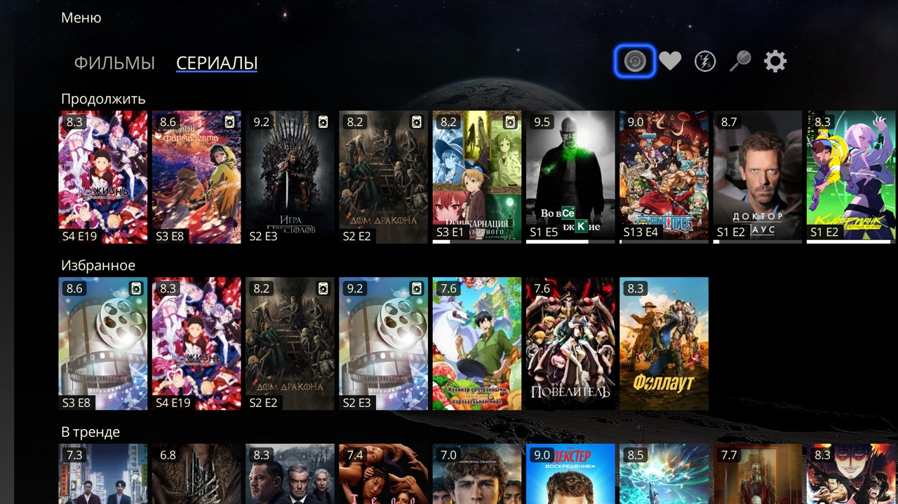
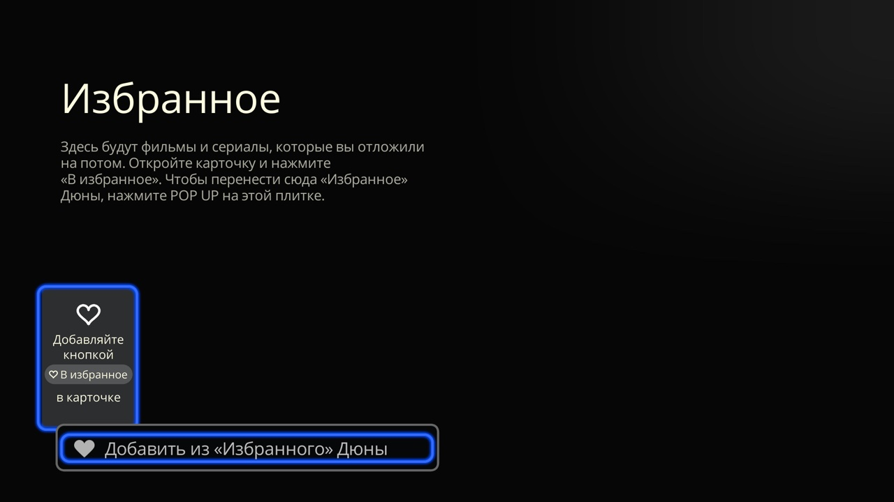

# Continue Watching and Favorites

Melange keeps what you started and what you saved for later in the first catalog rows. [← Contents](README.en.md)

1. The first catalog row is "Continue Watching": movies you started, and the next episode of a series. The second row is "Favorites". The "Movies" tab shows movies in them, the "Series" tab shows series. An empty row is hidden. It also gets what you started in the Dune's own Movies.

   

2. Badges on a poster show how much you watched.

   

3. To save a movie for later, open its card (**ENTER** on the poster) and press "Favorites". The button turns into "In Favorites". Press it again to remove the movie.

   

4. With **MENU** on a movie card you can mark it as watched ("Mark as watched" or "Mark as unwatched") or open its "Dune card".

   

5. The clock on the top bar of the catalog opens everything you started, movies and series together. "Continue Watching" in **POP UP** opens it too.

   

6. The heart on the top bar, between the clock and the TorrServer icon, opens the Favorites screen. If your remote has **Fav** buttons, **Fav 2** (the heart) opens Favorites too, and **Fav 1** opens everything you started. **ENTER** on a row's name opens the whole row.

   

   The Favorites screen opens with all your movies and series.

   

7. On a poster, press **POP UP** to add it to Favorites or remove it, mark it as watched or unwatched, or, in Continue Watching, remove it from the row. To bring everything removed back at once, choose "Restore removed" in **POP UP** on the Continue Watching screen (the clock on the top bar opens it).

   

8. Melange Favorites is separate from Dune Favorites. To bring movies and series over from Dune Favorites, on the Favorites screen press **POP UP** on a tile (on the empty screen, the heart tile) and choose "Add from Dune Favorites". You see "Added from Dune Favorites: N".

   

## If something goes wrong

- A started title is not in Continue Watching: Melange counts a title as started after 2 minutes of watching. Videos under 10 minutes without an episode number (trailers) never get there; short episodes do.
- A title you started long ago is missing from Continue Watching right after the update: Melange pulls in the old history bit by bit and needs a connection to the server.
- "Nothing new in Dune Favorites": everything from Dune Favorites is already here.

Next: [Your own catalog rows](catalog-rows.en.md) · [Contents](README.en.md)
