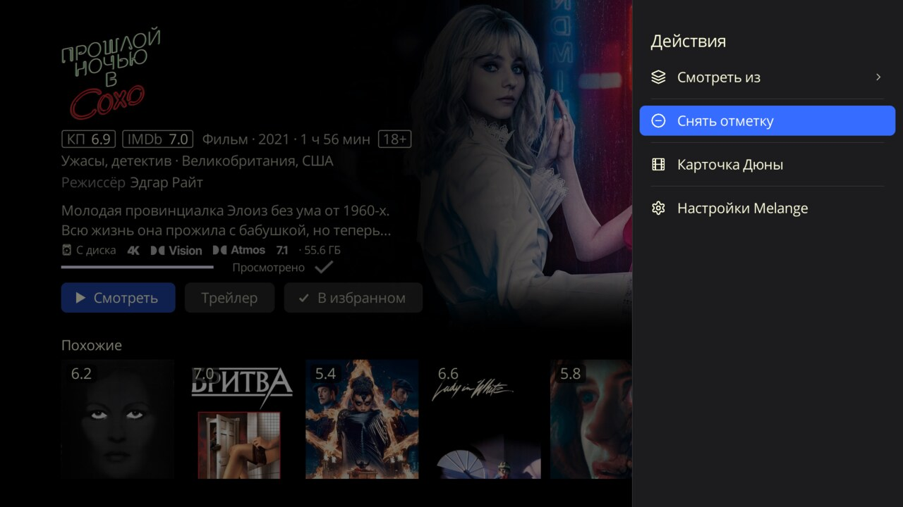

# «Продолжить» и «Избранное»

Начатые и отложенные фильмы Melange показывает в первых рядах каталога. [← Оглавление](README.md)

1. Первый ряд каталога — «Продолжить»: начатые фильмы, а у сериала — следующая серия. Второй ряд — «Избранное». На вкладке «Фильмы» в них фильмы, на вкладке «Сериалы» — сериалы. Пока ряд пуст, его нет. Сюда попадает и начатое в родных «Фильмах» Дюны.

   

2. Значки на постере показывают, что вы уже смотрели.

   

3. Чтобы отложить фильм на потом, откройте его карточку (**ENTER** на постере) и нажмите «В избранное». Кнопка сменится на «В избранном». Нажмите её ещё раз, чтобы убрать.

   

4. В **MENU** карточки фильма можно отметить его просмотренным («Отметить просмотренным» или «Снять отметку») и открыть «Карточку Дюны».

   

5. Часы на полосе сверху каталога открывают всё начатое: фильмы и сериалы вместе. То же открывает пункт «Продолжить» в **POP UP**.

   

6. Экран «Избранное» открывает сердечко на полосе сверху, между часами и лупой. Если на пульте есть кнопки **Fav**, то **Fav 2** (сердечко) тоже откроет «Избранное», а **Fav 1** — все начатые. Полный список ряда открывает и **ENTER** на его названии.

   

   Откроется экран «Избранное» со всеми фильмами и сериалами.

   

7. На постере нажмите **POP UP**: в меню можно добавить в «Избранное» или убрать оттуда, отметить просмотренным или снять отметку, а в ряду «Продолжить» — убрать из него. Чтобы вернуть всё убранное разом, выберите «Вернуть убранные» в **POP UP** на экране «Продолжить» (его открывают часы на полосе).

   

8. «Избранное» Melange своё, оно не связано с «Избранным» Дюны. Чтобы перенести туда фильмы и сериалы из «Избранного» Дюны, на экране «Избранное» нажмите **POP UP** на плитке (в пустом — на плитке с сердечком) и выберите «Добавить из «Избранного» Дюны». Появится «Добавлено из «Избранного» Дюны: N».

   

## Если не получилось

- Начатого нет в «Продолжить» — Melange считает начатым то, что смотрели хотя бы 2 минуты. Ролики короче 10 минут без номера серии (трейлеры) туда не попадают, короткие серии попадают.
- Давно начатого нет в «Продолжить» сразу после обновления — Melange подтягивает старую историю понемногу, и для этого нужна связь с сервером.
- «В «Избранном» Дюны нет нового» — всё из «Избранного» Дюны уже перенесено.

Дальше: [Свои ряды каталога](catalog-rows.md) · [Оглавление](README.md)
