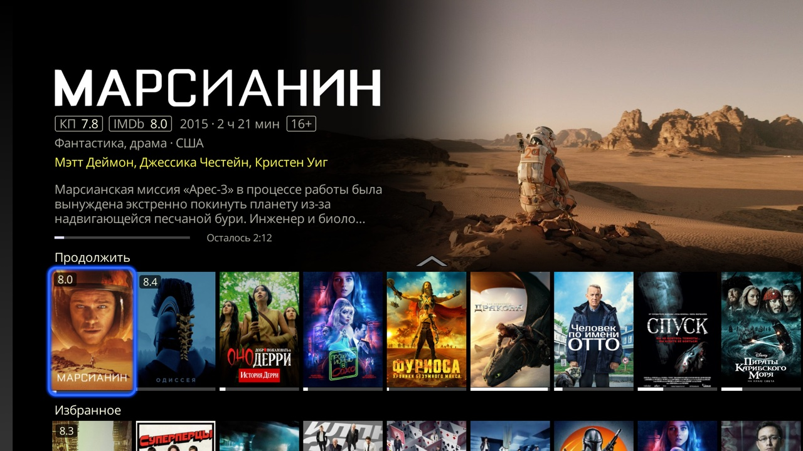
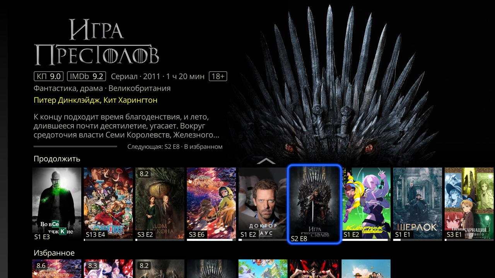
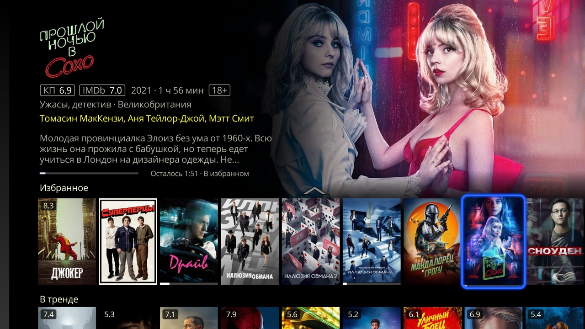
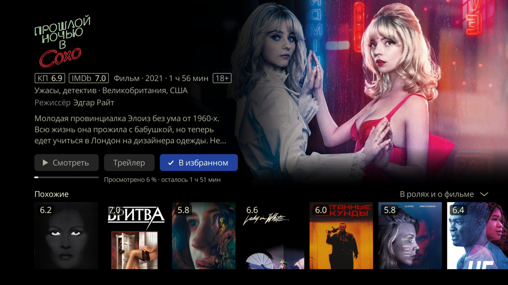
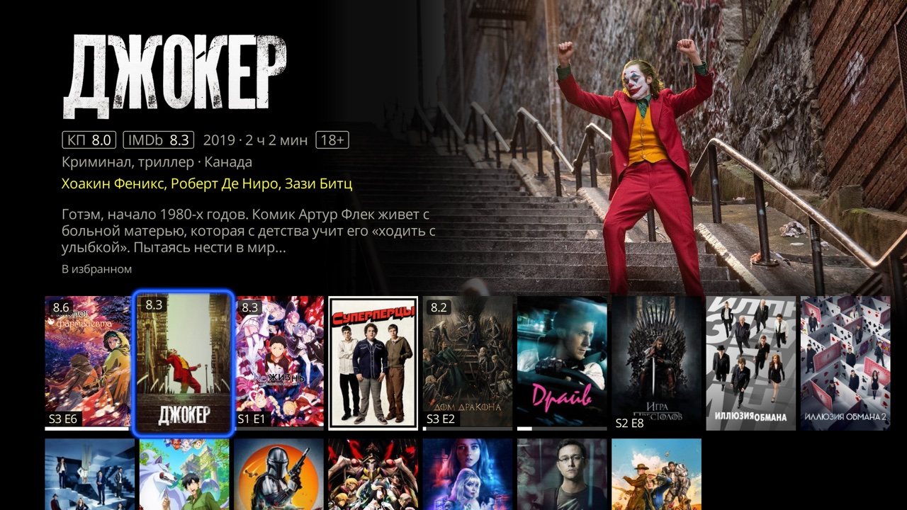
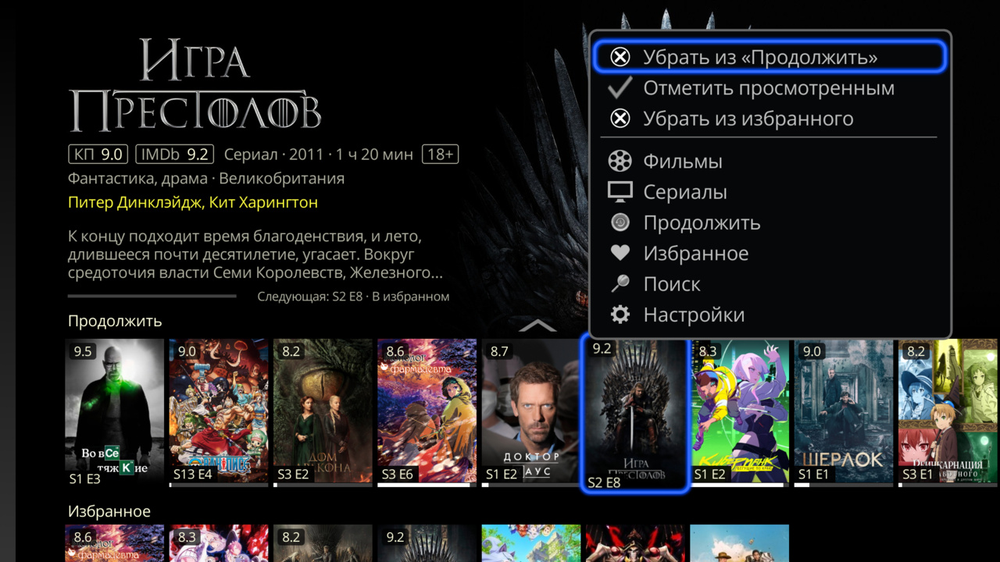
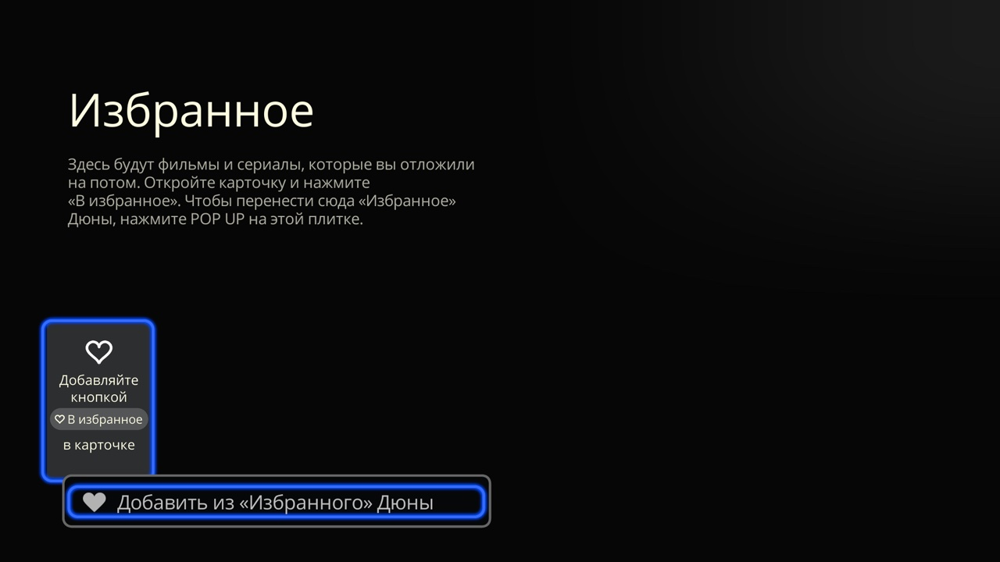

# «Продолжить» и «Избранное»

Начатые и отложенные фильмы Melange показывает в первых рядах каталога. [← Оглавление](README.md)

1. Первый ряд каталога — «Продолжить»: начатые фильмы, а у сериала — следующая серия. Второй ряд — «Избранное». На вкладке «Фильмы» в них фильмы, на вкладке «Сериалы» — сериалы. Пока ряд пуст, его нет.

   

2. Значки на постере показывают, что вы уже смотрели: полоса внизу — сколько просмотрено, ✓ — досмотрено. У сериала плашка «S1 E3» — серия, на которой вы остановились или которая идёт следующей.

   

3. Встаньте на постер: вверху экрана под описанием видно «Осталось 0:40», «Просмотрено» или следующую серию.

   

4. Чтобы отложить фильм на потом, откройте его карточку (**ENTER** на постере) и нажмите «В избранное». Кнопка сменится на «В избранном». Нажмите её ещё раз, чтобы убрать. В **MENU** карточки фильма можно отметить его просмотренным («Отметить просмотренным» или «Снять отметку») и открыть «Карточку Дюны».

   

5. Всё «Избранное» целиком открывает сердечко на полосе сверху, рядом с лупой и шестерёнкой. Если на пульте есть кнопки **Fav**, то **Fav 2** (сердечко) тоже откроет «Избранное», а **Fav 1** — все начатые. Полный список ряда открывает и **ENTER** на его названии.

   

6. На постере нажмите **POP UP**: в меню можно добавить в «Избранное» или убрать оттуда, отметить просмотренным или снять отметку, а в ряду «Продолжить» — убрать из него. У сериала отметка ставится на все вышедшие серии.

   

7. «Избранное» Melange своё, оно не связано с «Избранным» Дюны. Чтобы перенести туда фильмы и сериалы из «Избранного» Дюны, откройте пустое «Избранное», встаньте на плитку с сердечком, нажмите **POP UP** и выберите «Добавить из «Избранного» Дюны». Melange добавит только то, чего ещё нет, и ничего не удалит.

   

## Если не получилось

- Начатого нет в «Продолжить» — Melange считает начатым то, что смотрели хотя бы 2 минуты. Ролики короче 10 минут (трейлеры) туда не попадают.
- «В «Избранном» Дюны нет нового» — всё из «Избранного» Дюны уже перенесено.

Дальше: [Свои ряды каталога](catalog-rows.md) · [Оглавление](README.md)
