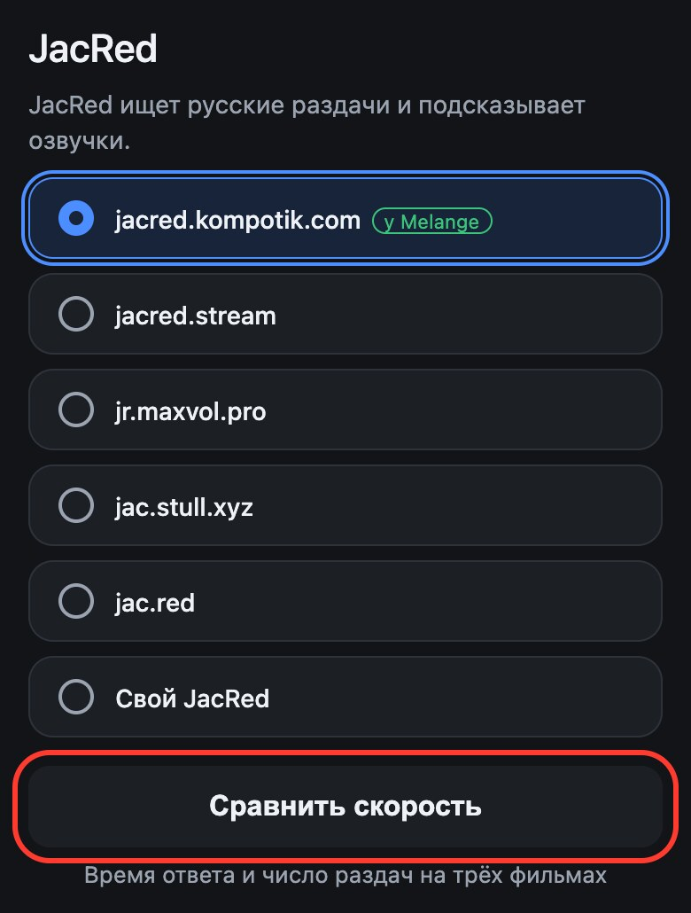
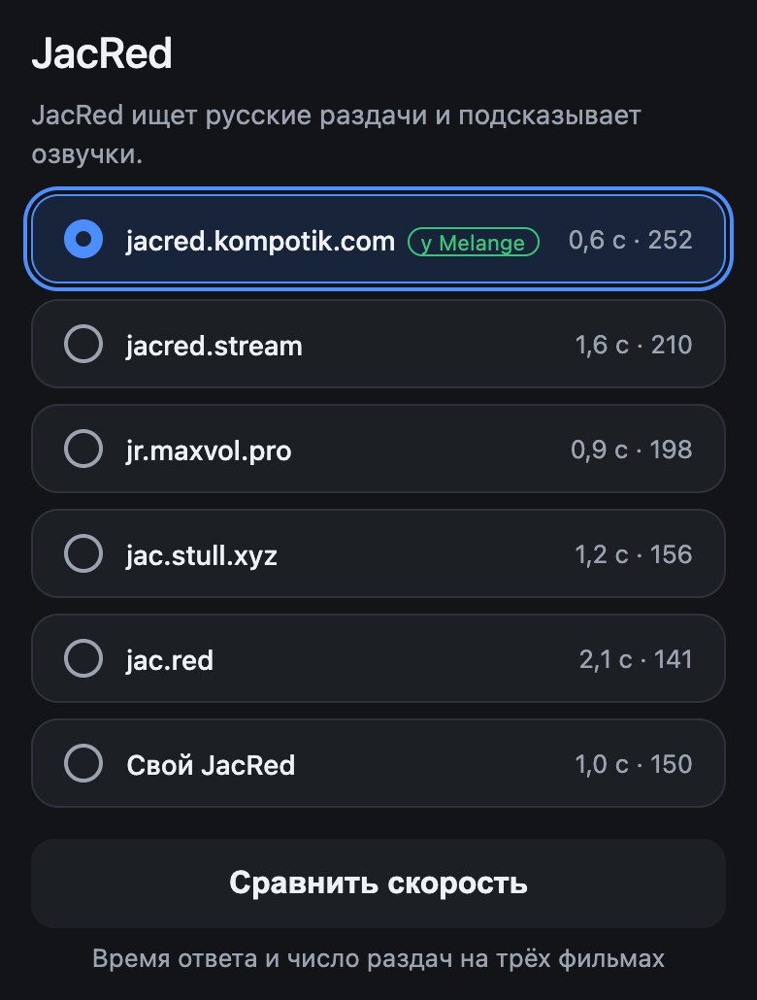

# JacRed

Check that JacRed (the service that searches Russian trackers for releases) answers. We recommend the Melange server: it is selected by default and gets the fixes. You need another JacRed only if the Melange server doesn't answer. [← Contents](README.en.md)

1. On the settings page ([Settings page on a phone](phone-page.en.md)), open "JacRed" and press "Compare speed" at the bottom of the screen.

   

2. Wait up to a minute. Each JacRed shows its response time and the number of releases for three movies. If the server marked "of Melange" has numbers, change nothing.

   

3. If the Melange server shows "no answer", choose the JacRed that answered fastest and press "Save". When the Melange server works again, switch back to it.

   

Your own JacRed is covered in [AIOStreams and your own config](aiostreams.en.md).

## If it didn't work

- "no answer" for all servers: check the internet on the Dune and press "Compare speed" again.
- The JacRed server answers, but there are few releases: see [Known limitations](limitations.en.md).

Next: [Sources](profiles.en.md) · [Contents](README.en.md)
