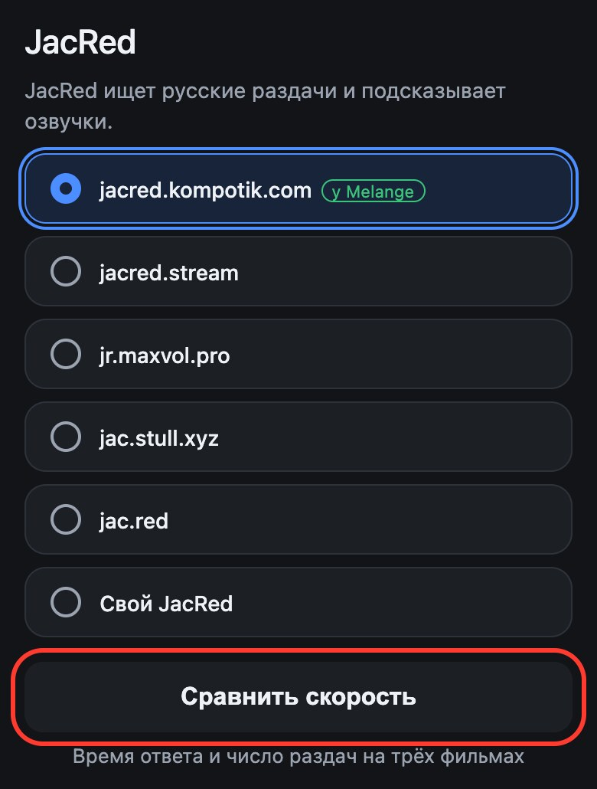
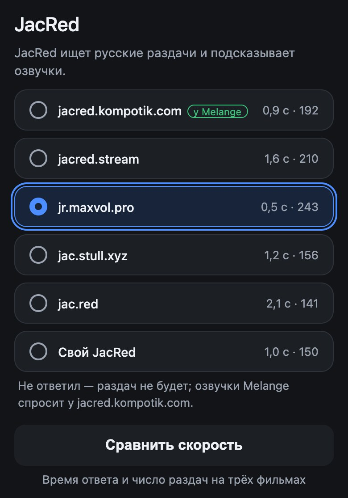

# JacRed

Если раздач мало, выберем JacRed (сервис, который ищет раздачи на русских трекерах), который отвечает быстрее и находит больше. [← Оглавление](README.md)

1. На странице настроек ([Страница настроек с телефона](phone-page.md)) откройте «JacRed» и нажмите «Сравнить скорость» внизу экрана.

   

2. Подождите около минуты. У каждого JacRed появятся время ответа и число раздач, найденных на трёх фильмах. Выберите быстрый, у которого больше раздач.

   

3. Нажмите «Сохранить». Появится «Сохранено. Дюна подхватит настройки сама.»

   

Свой JacRed описан в главе [AIOStreams и свой конфиг](aiostreams.md).

## Если не получилось

- У JacRed написано «нет ответа» — не выбирайте его: раздач с ним не будет.
- Раздач по-прежнему мало — см. [Известные ограничения](limitations.md).

Дальше: [Оглавление](README.md)
