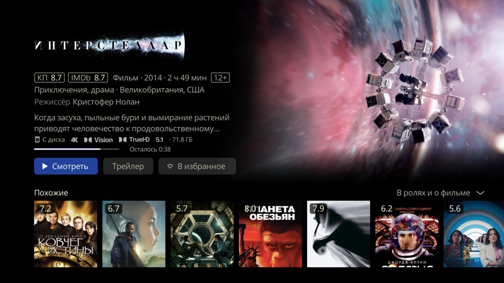
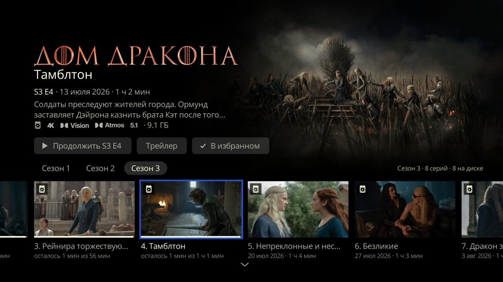
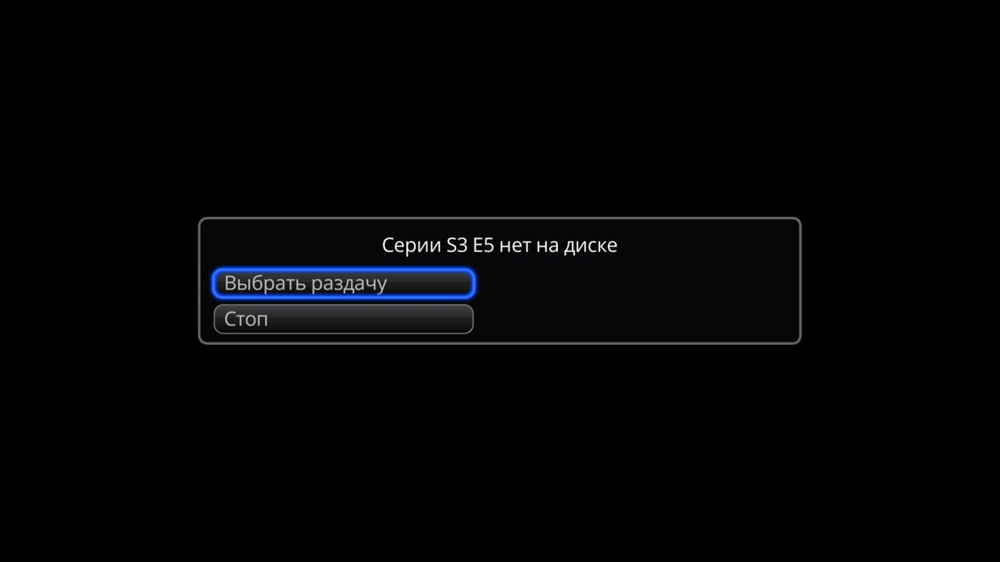

# Movies and series from your disk

If a movie or an episode is already on a NAS, a computer on your network, a USB drive or the Dune's internal disk, Melange plays it straight from there. [← Contents](README.en.md)

Before you start: the Dune media library with your folders on the network, a USB drive or the internal disk (home screen → Movies or Series: your files show up there) and "Own card" turned on in [Appearance](appearance.en.md) (it is on by default).

In the catalog, movies and series on the disk have a disk icon in the top right corner of the poster. A series gets it if at least one episode is on the disk.

## Movie

1. Open the movie card in Melange. If the file is on the disk, a "From disk" line with the quality and file size appears under the description. If you've started the movie, the time left is shown below it.

   

2. Press "Watch". The movie plays from the disk, from where you stopped.

3. Releases from the internet are under **MENU** → "Watch from…".

If the disk has several copies of the movie, the line ends with "· 2 copies — MENU". Melange asks "Which copy to watch?" the first time, and you can switch copies with **MENU** → "Copy on disk…".

## Series

1. Open the series card. Episodes that are on the disk have a disk icon on their thumbnail; to the right of the seasons you'll see how many episodes of the season are on the disk. The focused episode shows the quality and file size.

   

2. Press **ENTER** on an episode or on "Continue". The episode plays from the disk, and the next ones follow, including from the next season's folder.

3. If the next episode isn't on the disk, Melange asks: "Choose a release" opens the release list for that episode, "Stop" stops playback.

   

An episode stopped during the end credits is marked as watched. You can also resume anything started from the disk from the Continue Watching row on the Dune home screen ([Watching](watch.en.md#continue)).

## If it didn't work

- No "From disk" line and no icons: the file isn't in the Dune media library. Open the movie in the Dune Movies catalog: if the file isn't there, Melange can't see it either.
- The poster has a disk icon, but the card has no "From disk" line: the disk isn't connected right now. The icon comes from the Dune media library and doesn't depend on whether the disk is connected.
- "The disk with the movie is not responding" or "The disk with the episode is not responding": the NAS or the disk took longer than 25 seconds to wake up. Press "Retry".

Next: [Search](search.en.md) · [Contents](README.en.md)
