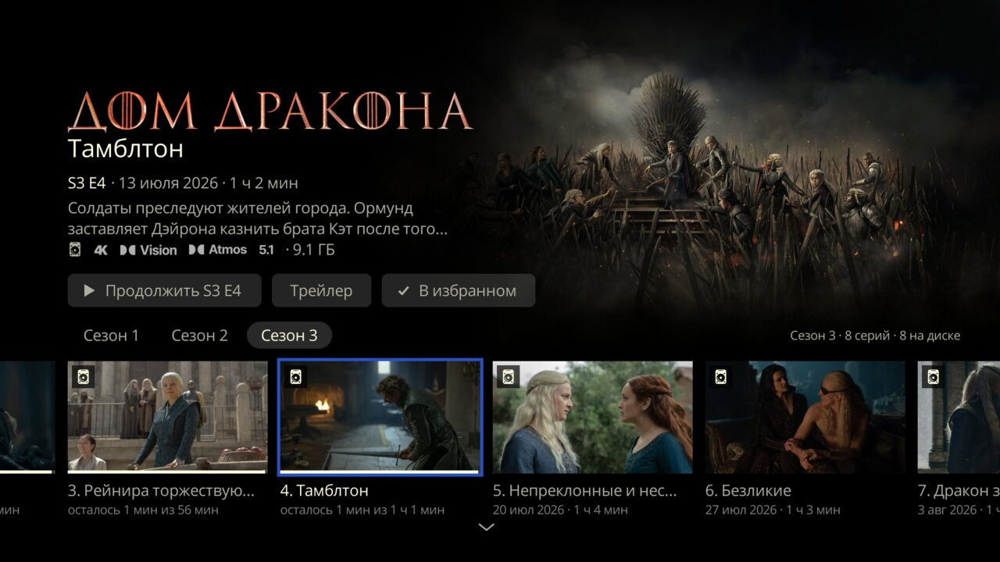
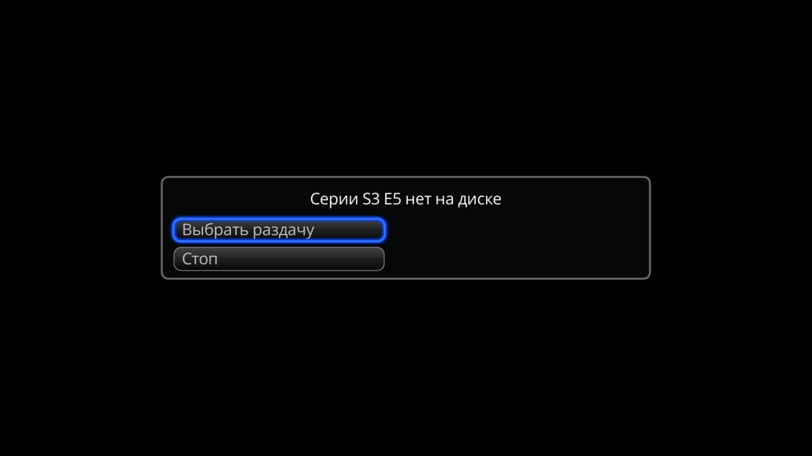

# Фильмы и сериалы с диска

Если фильм или серия есть в «Моей коллекции» Дюны, Melange включит их прямо оттуда. [← Оглавление](README.md)

## Фильм

1. Откройте карточку фильма в Melange. Если файл есть на диске, под описанием появится строка «С диска».

   

2. Нажмите «Смотреть». Фильм включится с диска, с того места, где остановились.

3. Раздачи из интернета открываются через **MENU** → «Смотреть из…».

## Сериал

1. Откройте карточку сериала. Серии с диска отмечены значком диска.

   

2. Нажмите **ENTER** на серии или «Продолжить». Серия включится с диска, следующие пойдут подряд, в том числе из папки следующего сезона.

3. Если следующей серии на диске нет, Melange спросит: «Выбрать раздачу» откроет список раздач этой серии, «Стоп» остановит просмотр.

   

## Если не получилось

- Строки «С диска» и значков нет — файла нет в «Моей коллекции» Дюны. Откройте фильм в «Фильмах» Дюны: если там файла нет, Melange его тоже не видит.
- На постере значок диска, а в карточке нет строки «С диска» — диск сейчас не подключён.
- «Диск с фильмом не отвечает» или «Диск с серией не отвечает» — NAS или диск просыпался дольше 25 секунд. Нажмите «Повторить».

Дальше: [Поиск](search.md) · [Оглавление](README.md)
