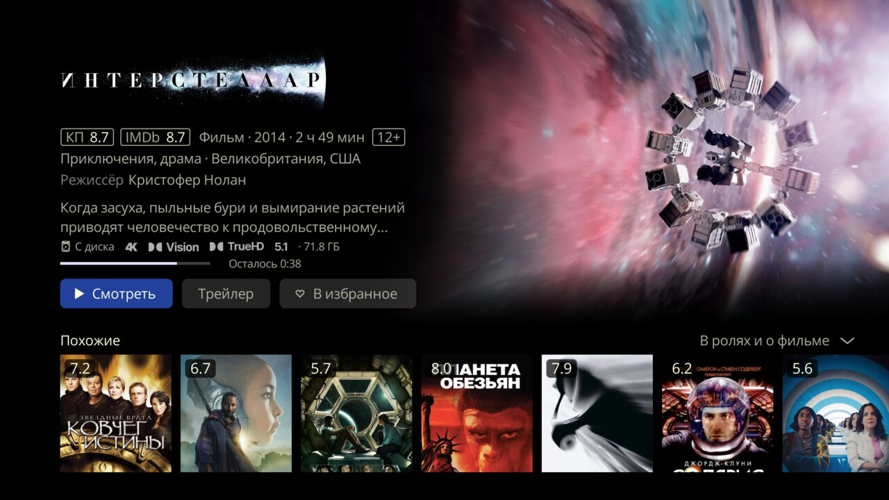

# Фильмы и сериалы с диска

Если фильм или серия есть в «Моей коллекции» Дюны, Melange включит их прямо оттуда. [← Оглавление](README.md)

Нужно заранее: медиатека Дюны с вашими папками в сети, на USB-диске или встроенном диске (главный экран → «Фильмы» или «Сериалы»: там видны ваши файлы) и «Своя карточка» в [Внешнем виде](appearance.md) (по умолчанию включена).

В каталоге у фильмов и сериалов с диска в правом верхнем углу постера значок диска. У сериала он стоит, если на диске есть хоть одна серия.

## Фильм

1. Откройте карточку фильма в Melange. Если файл есть на диске, под описанием появится строка «С диска» с качеством и размером файла. Если фильм начат, под ней — сколько осталось.

   

2. Нажмите «Смотреть». Фильм включится с диска, с того места, где остановились.

3. Раздачи из интернета открываются через **MENU** → «Смотреть из…».

## Сериал

1. Откройте карточку сериала. У серий, которые есть на диске, на кадре значок диска; справа от сезонов написано, сколько серий сезона на диске. У серии в фокусе — качество и размер файла.

   

2. Нажмите **ENTER** на серии или «Продолжить». Серия включится с диска, следующие пойдут подряд, в том числе из папки следующего сезона.

3. Если следующей серии на диске нет, Melange спросит: «Выбрать раздачу» откроет список раздач этой серии, «Стоп» остановит просмотр.

   

Серия, которую остановили на титрах, отмечается просмотренной. Начатое с диска продолжается и из ряда «Продолжить просмотр» на главном экране Дюны ([Просмотр](watch.md#продолжить)).

## Если не получилось

- Строки «С диска» и значков нет — файла нет в медиатеке Дюны. Откройте фильм в «Фильмах» Дюны: если там файла нет, Melange его тоже не видит.
- На постере значок диска, а в карточке нет строки «С диска» — диск сейчас не подключён. Значок берётся из медиатеки Дюны и не зависит от того, подключён ли диск.
- «Диск с фильмом не отвечает» или «Диск с серией не отвечает» — NAS или диск просыпался дольше 25 секунд. Нажмите «Повторить».

Дальше: [Поиск](search.md) · [Оглавление](README.md)
