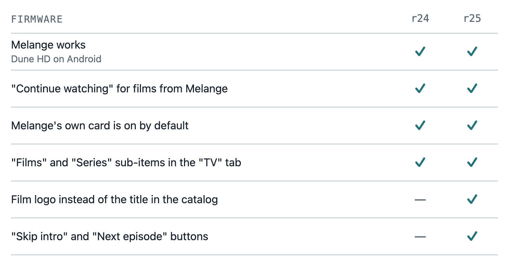

# Known limitations

What Melange cannot do, or does with caveats. [← Contents](README.en.md)

- [Devices and firmware](#devices-and-firmware)
- [Movies and the release list](#movies-and-the-release-list)
- [JacRed](#jacred)
- [Watch history](#watch-history)
- [Debrid](#debrid)
- [No torrents](#no-torrents)
- [Series](#series)
- [Skipping intros and credits](#skipping-intros-and-credits)
- [Sources](#sources)
- [Backup and two Dunes](#backup-and-two-dunes)
- [TV tab](#tv-tab)
- [Removing Melange](#removing-melange)

## Devices and firmware

- You need a Dune HD on Android with firmware r22 or newer, r24 or r25 recommended.
- **Does not work** on Sigma / Linux Dunes (Solo 4K, Duo 4K, Base 3D, TV-303D and older): they have no **Movies** catalog with **Play...** items and no Android apps.
- On models with 1 GB of memory (SmartBox 4K, SmartBox 4K Plus, Traveler, Neo 4K, 4K Neo, Neo 4K T2) it is not guaranteed to work.
- The plugin interface is in Russian and English, following the Dune's language.

## Movies and the release list

- Melange looks for releases by the IMDb ID of a movie or series, taken from the Dune card or the poster in the catalog, and by its TMDB id when there is no IMDb ID. Without an IMDb ID, the list may occasionally include releases of other movies or series with the same title. With neither ID there are no releases, but you can still watch the movie through Lampac if it is among your [sources](profiles.en.md). Lampac searches by title and year, so its list may include other movies with the same title too.
- A release whose year, title or release date on the tracker does not match the movie card goes to the "Unconfirmed" group. This happens when the TMDB year differs from the release year. The group exists only on the Melange server `aiostreams.kompotik.com` with a config Melange created; with your own config or other servers such releases are not shown.
- The screen shows at most 100 releases; the rest are not shown. A server reply over 6 MB does not open.
- The "Watch via TorrServer", "Open in an app…" and "Download to server…" items are not on every release: only on those for which the source sent a torrent hash, and not with the "No torrents" setting.
- "Open in an app…" starts a release without an episode playlist, history or **Continue Watching**.

## JacRed

- Your own JacRed at a home address is not reachable from a public AIOStreams server: releases won't be searched there, only tracks and voice-overs. To search releases, you need an internet address or your own AIOStreams server on the home network.
- The `|` character in your own JacRed key is forbidden in the whole "Torrents" mode, on any AIOStreams server, including `aiostreams.kompotik.com`.
- `jacred.stream` blocks some AIOStreams servers, for example `aiostreams.fortheweak.cloud`. The settings page warns about this: choose another JacRed.
- If JacRed didn't answer the server, there will be fewer releases, and none with the "Russian trackers only" template. How to check JacRed: see [JacRed](jacred.en.md).

## Watch history

- **Not cached** releases and releases with unknown status started via Debrid keep history only if Debrid gave the file link at once. Otherwise (for example, the stream goes through the AIOStreams proxy) they play **without history**: no percentage on the button, no **Continue Watching**. Via TorrServer, history works.
- Series from the Melange catalog without a Dune card play without history. For a movie without a Dune card, Melange creates a Dune card itself: it shows in the Dune's user data and stays after Melange is removed. If the Dune card server did not answer at that moment, the movie opens without history: try again later.
- The Melange card does not show specials (season 0).

## Debrid

- **Real-Debrid and "Not cached"** (in your own config and in the Melange config). Each start of such a release adds a torrent to your Real-Debrid account. It does not serve releases with `WEB-DL` in the name (instead of the movie, a "File was removed…" placeholder or an error), and after several new releases in a row it temporarily refuses all additions. Do not start such releases more than 1–2 times in a row; wait a few minutes.
- For releases from Comet, Melange cannot tell a copyright refusal from a server failure and shows the general "Debrid didn't return the video — pick another release".
- The Dune does not play a release packed as a single RAR or ZIP archive.

## No torrents

- With the "No torrents" setting, releases started earlier via TorrServer open the release list from **Continue Watching** instead of playing right away.
- Debrid "Not cached" releases stay: the service downloads them, not the Dune.

## Series

- The next episode plays only from the same release. If the release does not have it (for example, the season is over), Melange does not look for another release by itself: choose one in the list.
- Via Debrid, episodes play in a row only if the release is cached or Debrid gives the episode's file at once.
- The next episode plays the same way the release was started, even if another way is available.
- Via TorrServer, if the episode numbers in a release can't be recognized (continuous numbering, everything in one folder), the playlist is shorter: the current season and the first episode of the next one.
- If you switched episodes in the player via TorrServer, after Stop the list of the episode you started with opens.
- **Continue Watching** counts an episode as watched if you watched it almost to the end: then it starts the next episode, and after the last episode of the series it opens the list of the first one. The card button also counts an episode marked as watched on the Dune.

## Skipping intros and credits

- The AIOStreams server provides intro and credits times. The Melange server `aiostreams.kompotik.com` can do this; on other servers episodes play without the buttons.
- Credits times not checked against the file length are sometimes taken from another edition of the episode. If such a mark ends more than a minute before the end of the file, there is no **Next Episode** button and the episode plays to the end.
- **"Exact only"** keeps only marks checked against the file length, for the intro too. There will be fewer buttons, and if the file length is unknown, none at all.

## Sources

- At most 8 sources, and names don't repeat.
- A source that has no config on the server yet (marked "no config") is not in the POP UP menu on the Dune. To fix it, see [Troubleshooting](troubleshooting.en.md#sources).
- The choice in "Get films from…" on the Dune is not remembered. A movie started from there later continues from the same source.
- Unsaved changes are lost if you open another source.
- Each source has its own Debrid keys. The TMDB key, TorrServer, your own torrent clients and other settings are shared by all sources.
- After you change the TMDB key, open each source on the page, except your own configs and Lampac, and press "Save": the key gets into a source's config only when you save it.

## Backup and two Dunes

- Along with the settings, the file brings back links to AIOStreams configs that already exist; no new ones are created. After the transfer, both Dunes use one config: changes on one show on the other.
- "Load from a file" replaces settings and sources completely and merges config links: for the server and mode present in the file, the config from the file is taken; the rest stay from this Dune.

## TV tab

- There is one slot: after you choose Melange, the TV tab no longer shows DUNE-HD.TV channels or another IPTV app.
- Until Melange is set up, the TV tab has one tile, "Set up Melange".
- If you remove Melange while it is selected in the TV tab, the tab becomes empty. DUNE-HD.TV does not come back by itself: choose it again ([Troubleshooting](troubleshooting.en.md)).

## Removing Melange

- Removing Melange erases its settings. Before removing it, save a [backup](backup.en.md).
- Dune cards that Melange created for movies stay.

Next: [Contents](README.en.md)
