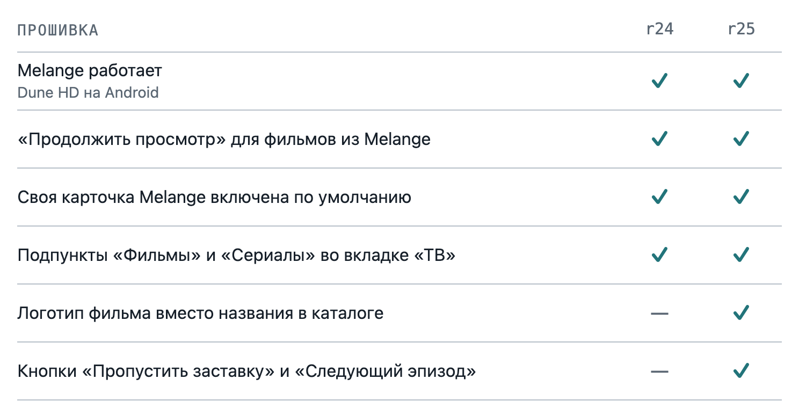

# Известные ограничения

Что Melange не умеет или умеет с оговорками. [← Оглавление](README.md)

- [Устройства и прошивки](#устройства-и-прошивки)
- [Фильмы и список раздач](#фильмы-и-список-раздач)
- [JacRed](#jacred)
- [История просмотра](#история-просмотра)
- [Debrid](#debrid)
- [Без торрентов](#без-торрентов)
- [Сериалы](#сериалы)
- [Пропуск заставки и титров](#пропуск-заставки-и-титров)
- [Источники](#источники)
- [Резервная копия и две Дюны](#резервная-копия-и-две-дюны)
- [Вкладка «ТВ»](#вкладка-тв)
- [Удаление Melange](#удаление-melange)

## Устройства и прошивки

- Нужна Dune HD на Android с прошивкой r22 или новее, рекомендуется r24 или r25.
- **Не работает** на Дюнах на Sigma / Linux (Solo 4K, Duo 4K, Base 3D, TV-303D и старше): у них нет каталога «Фильмы» с пунктами «Смотреть…» и Android-приложений.
- На моделях с 1 ГБ памяти (SmartBox 4K, SmartBox 4K Plus, Traveler, Neo 4K, 4K Neo, Neo 4K T2) работа не обещается.
- Интерфейс плагина — на русском и английском, по языку Дюны.

## Фильмы и список раздач

- Раздачи Melange ищет по IMDb-id фильма или сериала, а если его нет — по id в TMDB: в карточке Дюны или у постера в каталоге. Новые русские фильмы и сериалы, для которых в TMDB нет IMDb-id, из карточки Melange тоже ищутся по id в TMDB, а из карточки Дюны — по IMDb-id. Без IMDb-id в список иногда попадают раздачи других фильмов и сериалов с тем же названием. Если нет ни того, ни другого, раздач не будет, но фильм можно смотреть через Lampac, если он есть среди [источников](profiles.md). Lampac ищет по названию и году, поэтому и у него в списке бывают фильмы с тем же названием.
- Раздача, у которой год, название или дата выхода на трекере не совпали с карточкой фильма, попадает в группу «Не подтверждены». Так бывает, когда год в TMDB отличается от года релиза. Группа есть только на сервере Melange `aiostreams.kompotik.com` с конфигом, который создал Melange; на своём конфиге и других серверах такие раздачи не показываются.
- На экране не больше 100 раздач, остальные не показываются. Ответ сервера больше 6 МБ не открывается.
- Пункты «Смотреть через TorrServer», «Открыть в приложении…» и «Скачать на сервер…» есть не у всех раздач: только у тех, для которых источник прислал хэш торрента, и не при настройке «Без торрентов».
- «Открыть в приложении…» запускает раздачу без плейлиста серий, истории и «Продолжить просмотр».

## JacRed

- Свой JacRed с домашним адресом публичному серверу AIOStreams недоступен: раздачи в нём искаться не будут, только дорожки и озвучки. Для поиска раздач нужен адрес из интернета или свой сервер AIOStreams в домашней сети.
- Символ `|` в ключе своего JacRed запрещён во всём режиме «Торренты», на любом сервере AIOStreams, в том числе на `aiostreams.kompotik.com`.
- `jacred.stream` не пускает некоторые серверы AIOStreams, например `aiostreams.fortheweak.cloud`. Страница настроек предупреждает об этом: выберите другой JacRed.
- Если JacRed не ответил серверу, раздач будет меньше, а в шаблоне «Только русские трекеры» ни одной. Проверить JacRed — [JacRed](jacred.md).

## История просмотра

- Раздачи **не в кэше** и с неизвестным статусом, запущенные через Debrid, сохраняют историю, только если Debrid сразу отдал ссылку на файл. Иначе (например, поток идёт через прокси AIOStreams) они играют **без истории**: ни процента на кнопке, ни «Продолжить просмотр». Через TorrServer история есть.
- Сериалы из каталога Melange без карточки Дюны играют без истории. Для фильма без карточки Дюны Melange сам создаёт карточку Дюны: она видна в пользовательских данных Дюны и остаётся после удаления Melange. Если сервер карточек Дюны в этот момент не ответил, фильм откроется без истории — попробуйте позже.
- Спецвыпуски (сезон 0) своя карточка не показывает.

## Debrid

- **Real-Debrid и «Нужно скачать»** (в своём конфиге и в конфиге Melange). Каждый запуск такой раздачи добавляет торрент в ваш аккаунт Real-Debrid. Он не отдаёт раздачи с `WEB-DL` в имени (вместо фильма заглушка «File was removed…» или ошибка), а после нескольких новых раздач подряд на время отказывает во всех добавлениях. Не запускайте такие раздачи больше 1–2 раз подряд, подождите несколько минут.
- У раздач от Comet отказ из-за авторских прав Melange не отличает от сбоя сервера и покажет общее «Debrid не отдал видео — выберите другую раздачу».
- Раздачу одним архивом RAR или ZIP Дюна не проигрывает.

## Без торрентов

- При настройке «Без торрентов» раздачи, начатые раньше через TorrServer, из «Продолжить просмотр» открывают список раздач, а не включаются сразу.
- Раздачи Debrid «Нужно скачать» при этом остаются: их качает сервис, а не Дюна.

## Сериалы

- Следующая серия включается только из той же раздачи. Если в раздаче её нет (например, кончился сезон), Melange не ищет другую раздачу сам: выберите её в списке.
- Через Debrid серии идут подряд, только если раздача в кэше или Debrid сразу отдаёт файл серии.
- Следующая серия идёт тем же способом, каким включили раздачу, даже если доступен другой.
- Через TorrServer, если номера серий в раздаче не распознать (сквозная нумерация, всё в одной папке), плейлист короче: текущий сезон и первая серия следующего.
- Если в плеере через TorrServer переключали серии, после «Стоп» откроется список той серии, с которой начали.
- «Продолжить просмотр» считает серию досмотренной, если её досмотрели почти до конца: тогда он включит следующую серию, а после последней серии сериала откроет список первой. Кнопка в карточке учитывает ещё и отметку просмотренной в Дюне.

## Пропуск заставки и титров

- Время заставки и титров отдаёт сервер AIOStreams. Сервер Melange `aiostreams.kompotik.com` это умеет, на других серверах серии играют без кнопок.
- Время титров, не сверенное с длиной файла, бывает снято с другого издания серии. Если такая метка кончается больше чем за минуту до конца файла, кнопки «Следующий эпизод» не будет, серия доиграет до конца.
- **«Только точные»** оставляет только метки, сверенные с длиной файла, и для заставки тоже. Кнопок будет меньше, а если длина файла неизвестна, их не будет совсем.

## Источники

- Источников не больше 8, названия не повторяются.
- Источника, у которого на сервере ещё нет конфига (пометка «конфига нет»), нет в меню POP UP на Дюне. Как исправить — [Решение проблем](troubleshooting.md#источники).
- Выбор в «Откуда брать…» на Дюне не запоминается. Фильм, запущенный оттуда, потом продолжится из того же источника.
- Несохранённые изменения пропадут, если открыть другой источник.
- Ключи Debrid у каждого источника свои. Ключ TMDB, TorrServer, свои торрент-клиенты и остальные настройки общие для всех источников.
- Сменили ключ TMDB — откройте на странице каждый источник, кроме своих конфигов и Lampac, и нажмите «Сохранить»: ключ попадает в конфиг источника только при сохранении.

## Резервная копия и две Дюны

- Вместе с настройками из файла возвращаются привязки к уже созданным конфигам AIOStreams, новые не создаются. После переноса обе Дюны пользуются одним конфигом: правки на одной видны и на другой.
- «Загрузить из файла» заменяет настройки и источники целиком, а привязки к конфигам объединяет: на сервере и в режиме, которые есть в файле, берётся конфиг из файла, остальные остаются от этой Дюны.

## Вкладка «ТВ»

- Слот один: после выбора Melange каналов DUNE-HD.TV или другого IPTV-приложения во вкладке не будет.
- Пока Melange не настроен, в «ТВ» одна плитка «Настроить Melange».
- Если удалить Melange, пока он выбран в «ТВ», вкладка станет пустой. Прежнее приложение само не вернётся: выберите его заново ([Решение проблем](troubleshooting.md#каталог-и-вкладка-тв)).

## Удаление Melange

- Удаление Melange стирает его настройки. Перед удалением сохраните [резервную копию](backup.md).
- Карточки Дюны, которые Melange создал для фильмов, остаются.

Дальше: [Оглавление](README.md)
