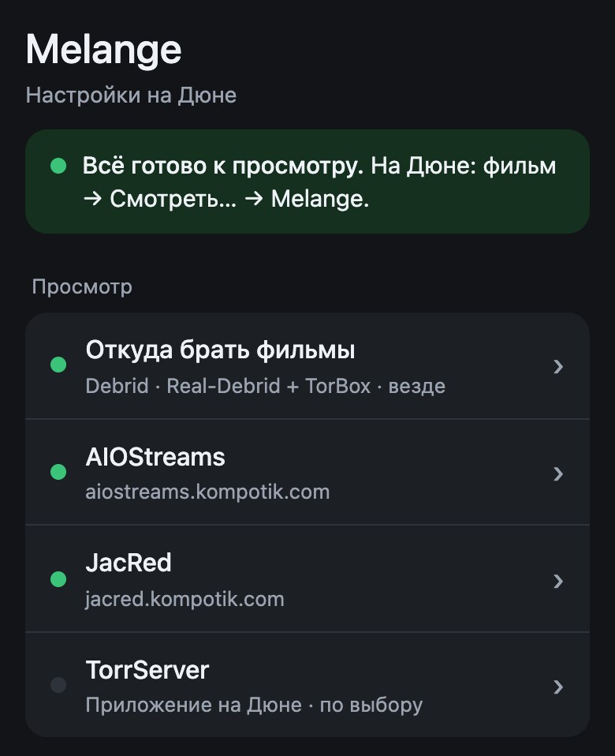
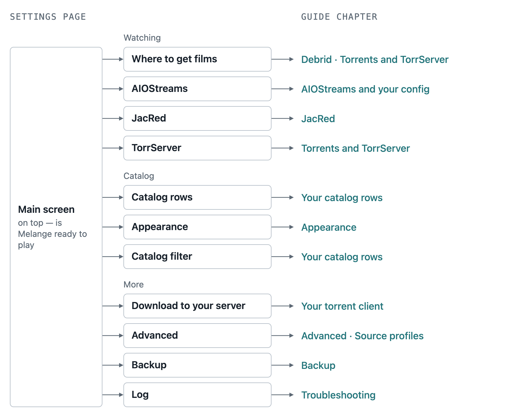
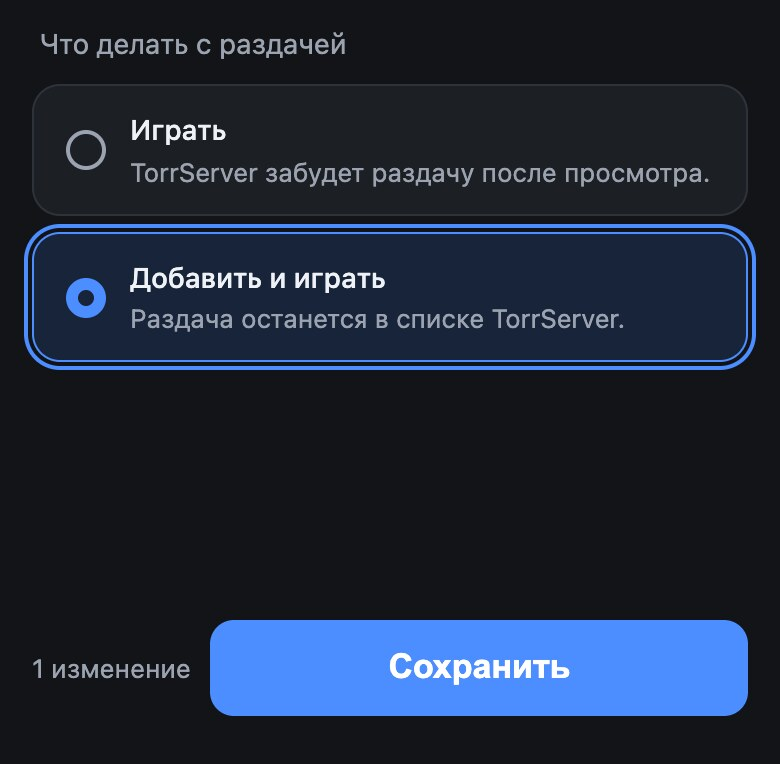

# Settings page on a phone

Open the Melange settings on a phone and save them. [← Contents](README.en.md)

You need: a phone on the same home network as the Dune.

1. In the Melange catalog, open the plugin settings (the gear on the bar at the top) and choose "Set up from a phone". Scan the QR code with your phone. The same screen is in the Dune settings: "Settings → Applications → Melange".

   

2. The home screen of the page opens on the phone. The top shows whether Melange is ready to watch; the settings sections are below.

   The green line suggests the path through the Dune **Movies** catalog. The Melange catalog in "Apps" works the same way.

   Under **More**, **About Melange** shows the plugin version, build date and Dune firmware. Include them when you report a problem.

   

   

3. Open a section and change a setting. The number of changes and a "Save" button appear at the bottom. The setting in the frame is chosen only as an example.

   

4. Press "Save". The page reloads, with the green line "Saved. The Dune picks up the settings automatically." at the top.

   

5. Bookmark the page on your phone: the link is permanent, so next time you won't need the QR code. Don't send it to anyone.

## If it didn't work

- "No connection to the Dune": check that the phone is on the same network as the Dune and try again.
- "The link is out of date": open the settings again via the QR code on the Dune.
- Someone else got the link: choose "Change the link" on the Dune settings screen; old bookmarks stop working.
- Other messages: [Troubleshooting](troubleshooting.en.md).

Next: [Debrid](debrid.en.md) · [Contents](README.en.md)
