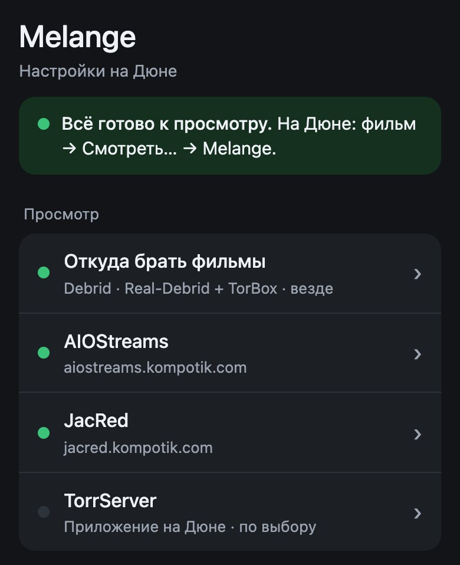
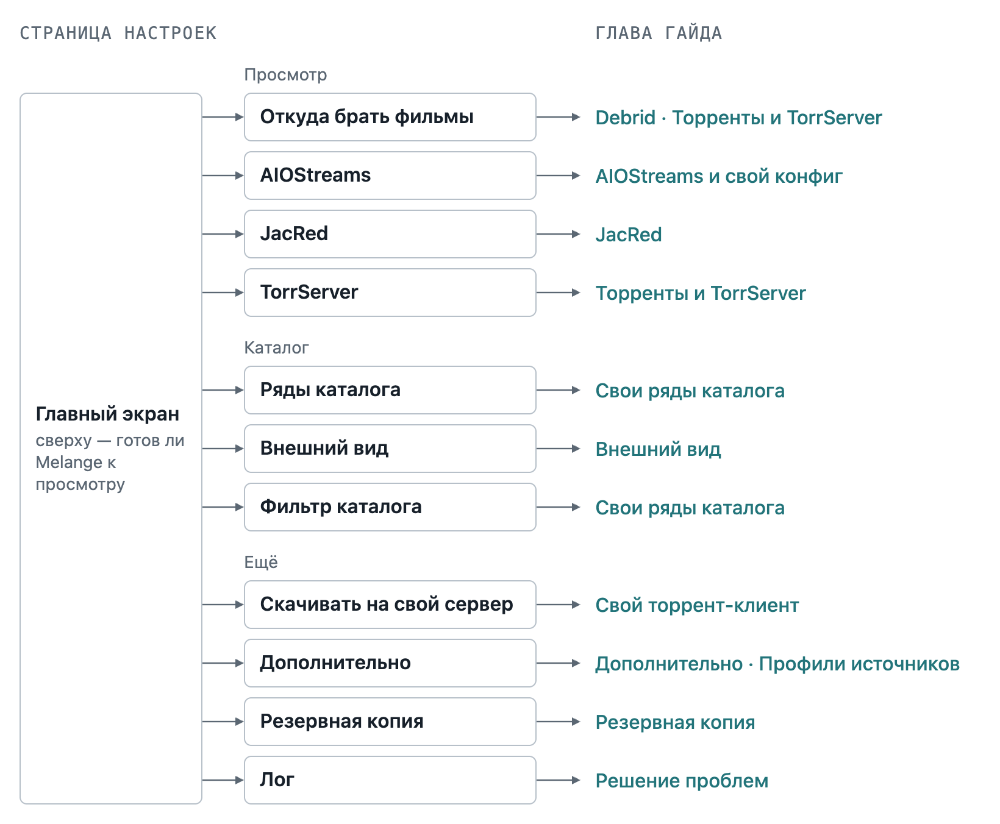
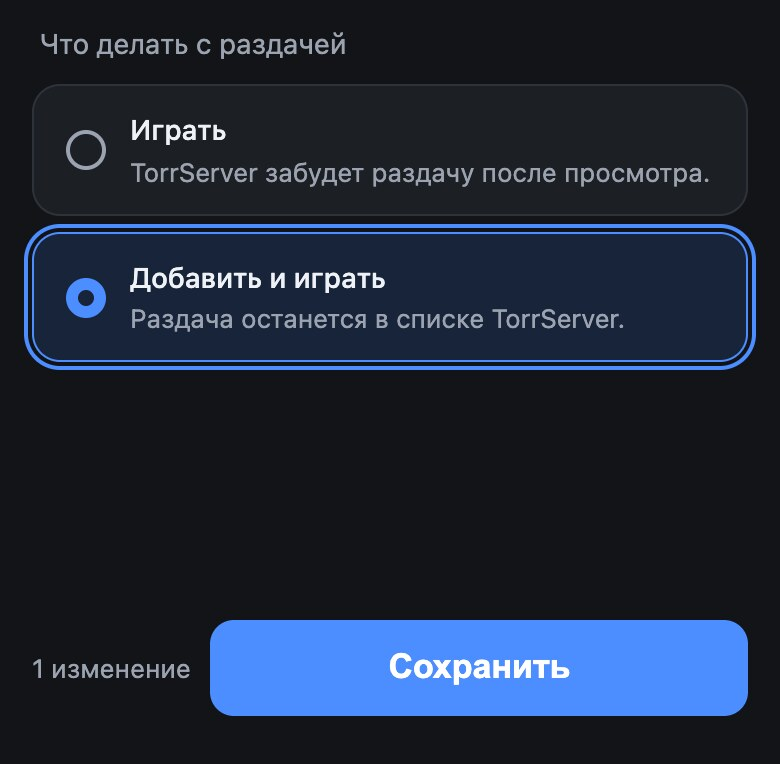

# Страница настроек с телефона

Откроем настройки Melange на телефоне и сохраним их. [← Оглавление](README.md)

Нужно заранее: телефон в той же домашней сети, что и Дюна.

1. В каталоге Melange откройте настройки плагина (шестерёнка на полосе сверху) и выберите «Настроить с телефона». Отсканируйте QR-код телефоном. Тот же экран есть в настройках Дюны: «Настройки → Приложения → Melange».

   

2. На телефоне откроется главный экран страницы. Сверху видно, готов ли Melange к просмотру, ниже — разделы настроек.

   Зелёная строка подсказывает путь через «Фильмы» Дюны. Каталог Melange в «Приложениях» работает так же.

   В самом низу, в блоке «О Melange», указаны версия плагина, дата сборки и прошивка Дюны. Назовите их, когда пишете о проблеме.

   

   

3. Откройте раздел и поменяйте настройку. Внизу появятся число изменений и кнопка «Сохранить». На кадре настройка выбрана для примера.

   

4. Нажмите «Сохранить». Страница откроется заново, сверху будет зелёная строка «Сохранено. Дюна подхватит настройки сама.»

   

5. Добавьте страницу в закладки телефона: ссылка постоянная, QR-код в следующий раз не понадобится. Никому её не пересылайте.

## Если не получилось

- «Нет связи с Дюной» — проверьте, что телефон в той же сети, что и Дюна, и нажмите ещё раз.
- «Ссылка устарела» — откройте настройки заново по QR-коду на Дюне.
- Ссылка попала к чужому — выберите на экране настроек Дюны «Сменить ссылку»: старые закладки перестанут работать.
- Другие сообщения — [Решение проблем](troubleshooting.md).

Дальше: [Debrid](debrid.md) · [Оглавление](README.md)
