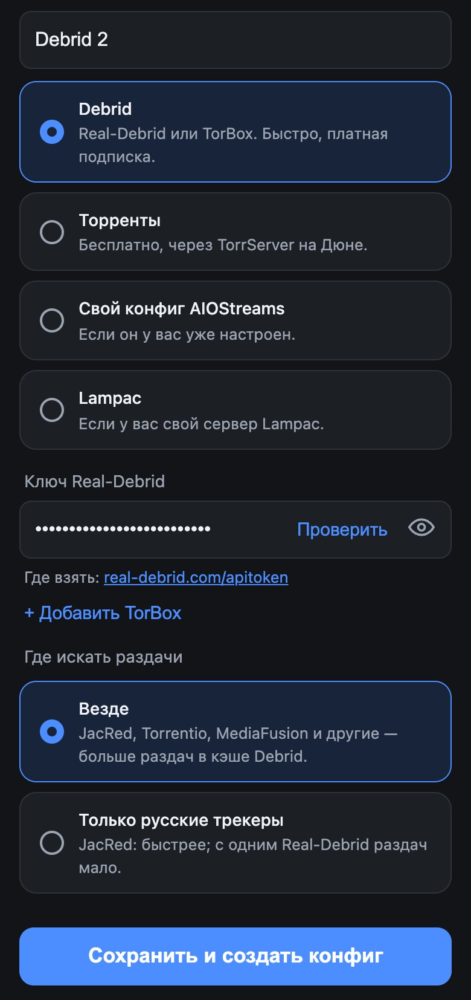
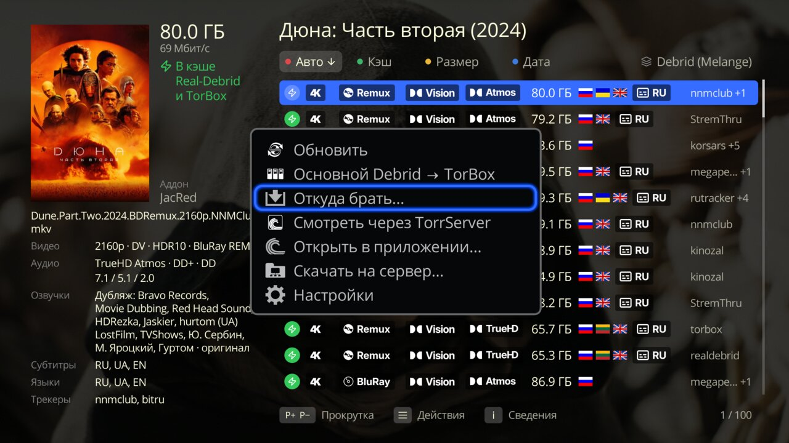
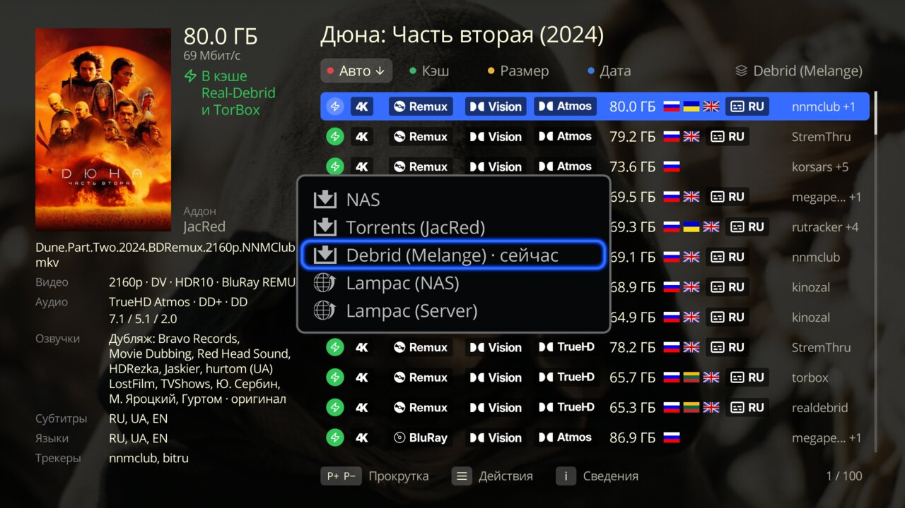

# Sources

Add several sources (Debrid, torrents, your own config) and open a movie on the Dune from any of them. [← Contents](README.en.md)

1. On the settings page ([Settings page on a phone](phone-page.en.md)), open "Where to get films" and press "+ Add source". A copy of the current source opens, with the Debrid keys already filled in.

2. Type a name, choose the kind of source and press "Save". Add the others the same way.

   

   Lampac: if you have your own server; you type its address yourself.

3. A "Sources" block now appears at the top. The Dune opens new movies from the main source (marked "main"). To change it, open another source and press "Set as main".

   

   Each source has its own Debrid keys. Press "Delete" to remove a source you don't need.

4. On the Dune, open a movie and press **POP UP** in the release list → "Get films from…".

   

5. Choose a source. The release list reloads from it. The choice applies to this screen only and is not remembered.

   

   A movie you have started continues from the source you watched it from: "Continue Watching", the next episode, the movie card.

   You can also pick the source before the release list: press **POP UP** on a movie tile or on its Melange card → "Watch from…". The list opens from that source right away.

## If it did not work

- A source is missing from the POP UP menu or is marked "no config": see [Troubleshooting](troubleshooting.en.md#sources).
- Source limit and other caveats: [Known limitations](limitations.en.md#sources).

Next: [Your own torrent client](download-server.en.md) · [Contents](README.en.md)
