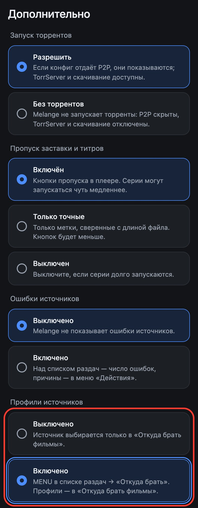
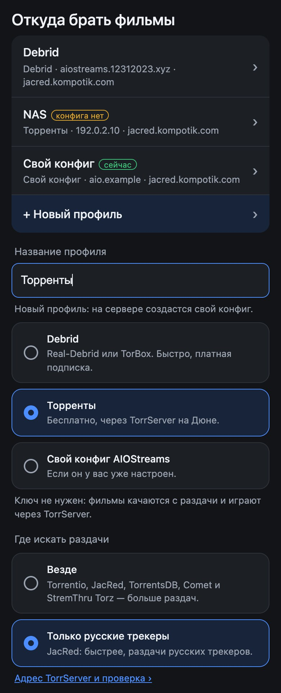

# Профили источников

Сохраним несколько источников (Debrid, торренты, свой конфиг) и будем переключать их пультом прямо из списка раздач. [← Оглавление](README.md)

1. На странице настроек ([Страница настроек с телефона](phone-page.md)) откройте «Дополнительно», в «Профили источников» выберите «Включено» и нажмите «Сохранить».

   

2. Откройте «Откуда брать фильмы». Вверху появился список профилей; у того, что сейчас на Дюне, пометка «сейчас».

   

3. Нажмите «+ Новый профиль», впишите название, выберите источник и нажмите «Сохранить». Так же добавьте остальные.

   

4. На Дюне откройте фильм, в списке раздач нажмите **MENU** → «Откуда брать…» и выберите профиль. Если других готовых профилей один, пункт сразу называется «Откуда брать → <название>». Список раздач обновится из нового источника.

   <!-- TODO скриншот: список раздач на Дюне, открыто MENU, фокус на «Откуда брать…» -->
   <!-- TODO скриншот: меню профилей на Дюне, текущий — «<название> · сейчас» -->

## Если не получилось

- Профиля нет в MENU или у него пометка «конфига нет» — см. [Решение проблем](troubleshooting.md).
- Лимит профилей и другие оговорки — [Известные ограничения](limitations.md).

Дальше: [Свой торрент-клиент](download-server.md) · [Оглавление](README.md)
