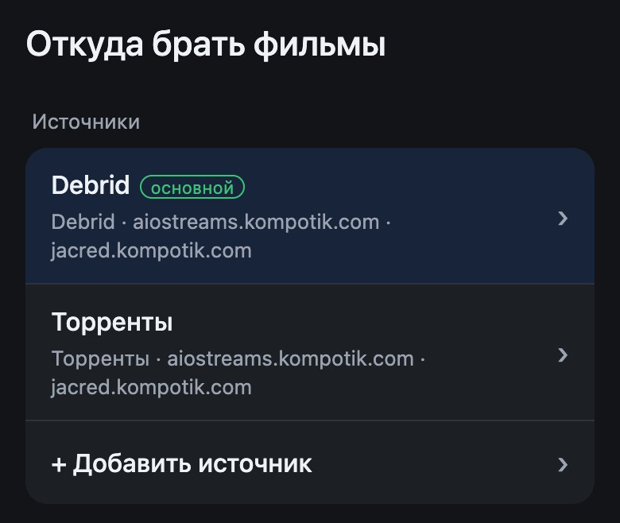
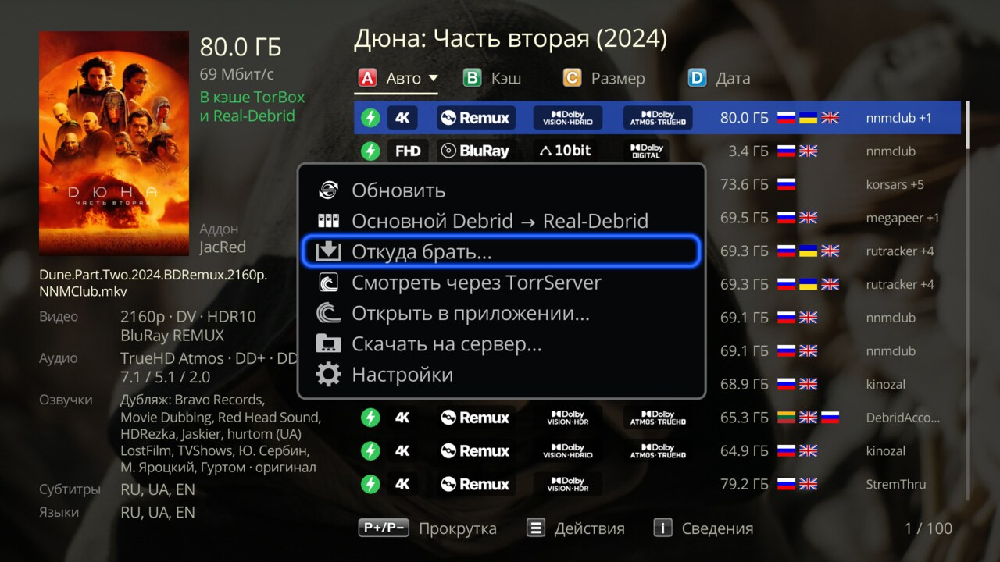
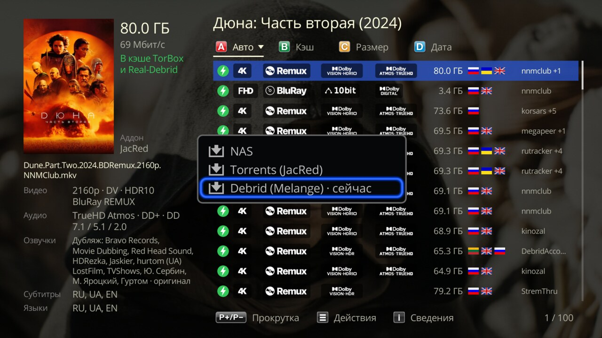

# Источники

Добавим несколько источников (Debrid, торренты, свой конфиг) и на Дюне откроем фильм из любого. [← Оглавление](README.md)

1. На странице настроек ([Страница настроек с телефона](phone-page.md)) откройте «Откуда брать фильмы» и нажмите «+ Добавить источник». Откроется копия текущего источника, ключи Debrid уже вписаны.

2. Впишите название, выберите вид источника и нажмите «Сохранить». Так же добавьте остальные.

   

   Lampac — если у вас свой сервер; адрес вписываете сами.

3. Вверху появился блок «Источники». Новые фильмы Дюна открывает из основного (пометка «основной»). Чтобы сменить его, откройте другой источник и нажмите «Сделать основным».

   

   У каждого источника свои ключи Debrid. Ненужный источник удалите кнопкой «Удалить».

4. На Дюне откройте фильм, в списке раздач нажмите **POP UP** → «Откуда брать…».

   

5. Выберите источник. Список раздач обновится из него. Выбор действует только на этом экране и не запоминается.

   

   Начатый фильм продолжится из того источника, где вы его смотрели: «Продолжить», следующая серия, карточка фильма.

   Источник можно выбрать и до списка раздач: **POP UP** на плитке фильма или на своей карточке Melange → «Смотреть из…». Список откроется сразу из выбранного источника.

## Если не получилось

- Источника нет в меню POP UP или у него пометка «конфига нет» — см. [Решение проблем](troubleshooting.md#источники).
- Лимит источников и другие оговорки — [Известные ограничения](limitations.md#источники).

Дальше: [Свой торрент-клиент](download-server.md) · [Оглавление](README.md)
