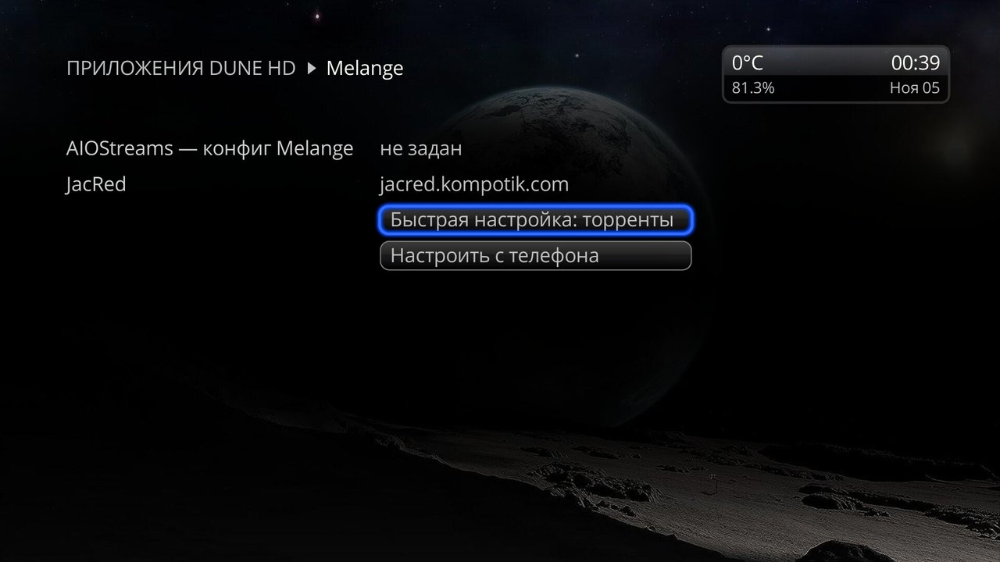
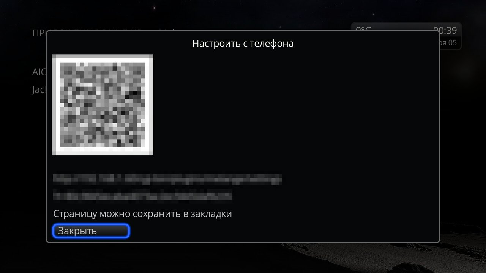
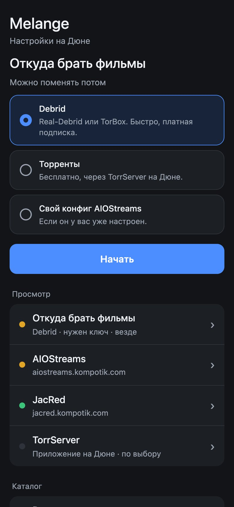
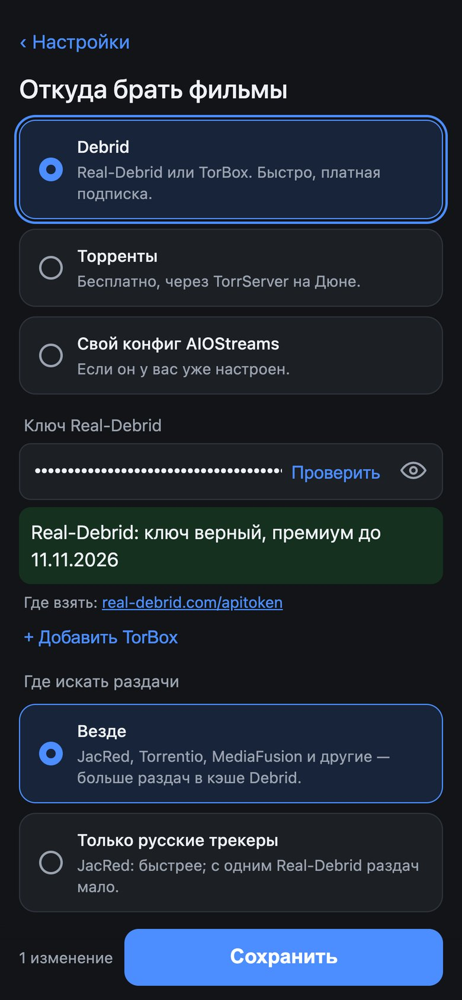
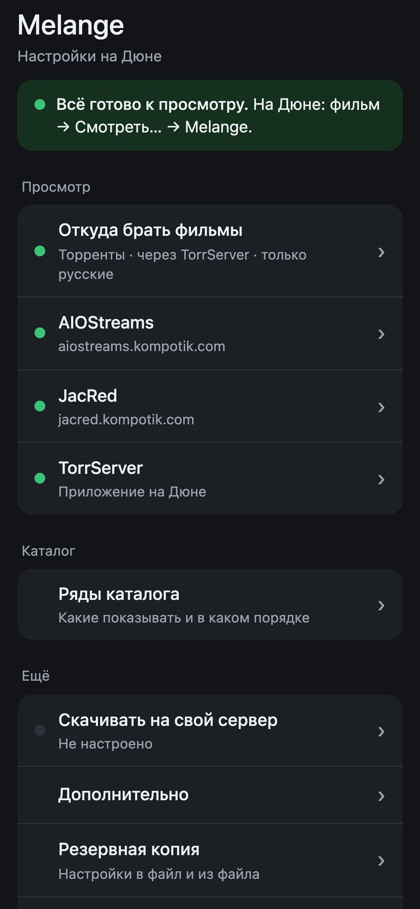
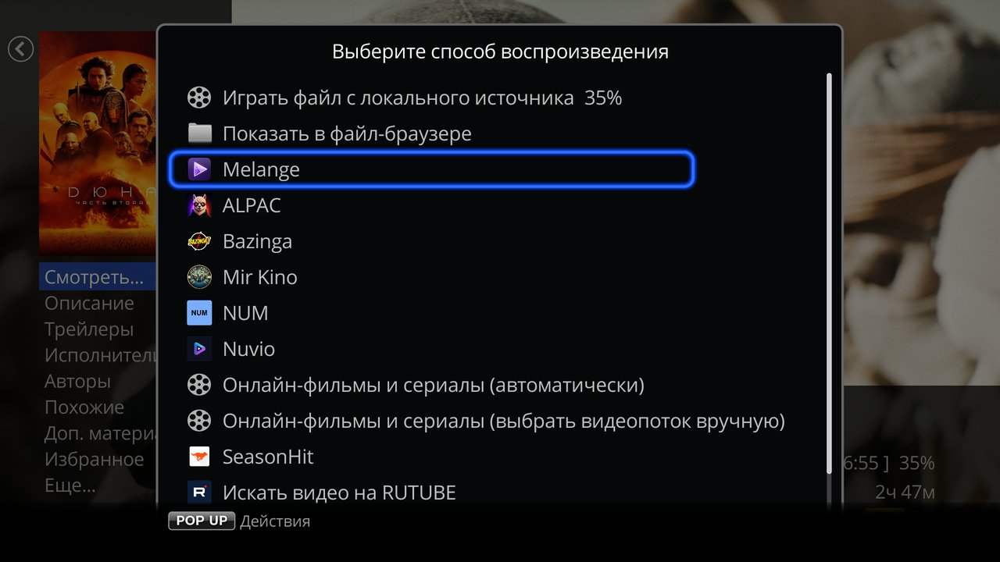

# Getting started

Melange turns your Dune into an online cinema. Movie and series collections like on a streaming service: trending, new digital releases, Kinopoisk top, genres, plus search. Pick a movie, and Melange finds releases, shows their quality and voice-overs, and plays it in the Dune's built-in player. Series play episode after episode; stop, and later you pick up where you left off.

The catalog opens from **Apps → Melange**. Follow the steps below and you will be watching in about ten minutes. [← README](../README.en.md)

## What you need

- **A Dune HD on Android** with firmware **r22 or newer**. Solo 4K, Duo 4K and other Linux Dunes will not do.
- One of two ways:
  - **Torrents, free.** You need the TorrServe app on the Dune. Setup is one button on the remote, no phone needed.
  - **Debrid, paid.** You need a Real-Debrid or TorBox subscription; releases start at once. Setup is from a phone on the same home network.

Not sure which to choose? Start with torrents; you can add Debrid later.

## 1. Install TorrServe (torrents only)

1. Download the **TorrServe** app, `TorrServe_MatriX.<version>.Client.apk` from https://github.com/YouROK/TorrServe/releases/latest (Assets), and install it on the Dune.
2. Open TorrServe. If it asks to install the server, install it.
3. In the TorrServe settings, turn on **Start Server on Boot**.

Nothing else needs setting up.

## 2. Install Melange

1. Download `dune_plugin_melange_<version>.zip` of the latest release: https://github.com/a1d4r/dune-hd-melange/releases (under Assets).
2. Copy it to a USB stick or to the Dune's internal storage.
3. On the Dune, open **Sources**, find the zip and press **ENTER**. The install takes about half a minute.

## 3. Open Melange

**Apps → Melange**. The first time, the settings screen opens:

## 4a. Torrents: one button

Press **Quick setup: torrents**: Melange sets everything up and opens the catalog. Go to step 5.

## 4b. Debrid: from your phone

1. Press **Set up from a phone** and scan the QR code with your phone.

2. On the page, choose **Debrid** and press **Start**.

3. Choose the service and paste the key: Real-Debrid at [real-debrid.com/apitoken](https://real-debrid.com/apitoken), TorBox at [torbox.app/settings](https://torbox.app/settings).
4. Save with the button at the bottom of the page. **All set to watch** appears, and the QR window on the TV closes by itself.

 

You can bookmark the page, but do not share the link with anyone.

## 5. Watch

1. Pick a movie:
   - **in the Melange catalog** (**Apps → Melange**): browse the rows of collections or search with the **Search** field above the rows (UP from the first row) or via MENU → **Search**. A poster → **ENTER** opens the movie card;
   - **or in the Dune Movies catalog**: open the movie card.
2. On the card, press **Play...** → **Melange**.

3. Pick a release and press **ENTER**. With Debrid, take releases with a lightning bolt: they are cached; play the ones without it via MENU → **Watch via TorrServer** (needs TorrServe). With torrents, take releases with many seeders in the first column; before the player starts, a TorrServer window with seeders and speed shows for up to a minute.

**A series:** on the card, open **Seasons**, choose an episode, then **Play...** → **Melange**. The next episodes play in a row.

What you started shows up in the Dune's **Continue Watching** row.

## Remote keys in the release list

- **ENTER**: play.
- **← / →**: neighboring episode.
- **Colored buttons**: order: **Auto**, seeders (cache with Debrid), size, date.
- **MENU**: actions, including **Watch via TorrServer**.

## If it doesn't work

- **"No AIOStreams config"**: with torrents, press **Quick setup: torrents** in the window; with Debrid, save the settings on the page once more.
- **"AIOStreams found no streams"**: the movie has no releases. If this happens with every movie, see [Troubleshooting](troubleshooting.en.md#common-situations).
- **Does not open via TorrServer**: TorrServe is not running or the release has few seeders: choose another one.
- **Still stuck**: on the settings page, press **Download the log** (before the Dune reboots) and attach it to an issue: https://github.com/a1d4r/dune-hd-melange/issues

## What's next

- [Watching](watching.en.md): the release list, series, TorrServer, downloading to your server, history.
- [Catalog](catalog.en.md): rows of collections and search.
- [Settings](setup.en.md): every section of the settings page, backup and moving to another Dune.
- [Release sources](sources.en.md): Debrid, torrents, your own AIOStreams config, tuning the config yourself.
- [Troubleshooting and the log](troubleshooting.en.md): every message and what to do.
- [Known limitations](limitations.en.md): what does not fully work.
