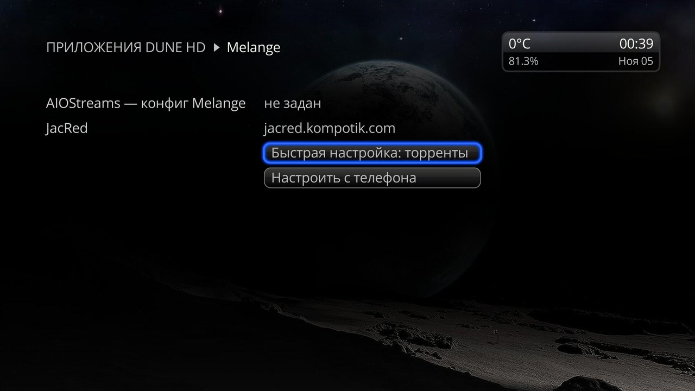
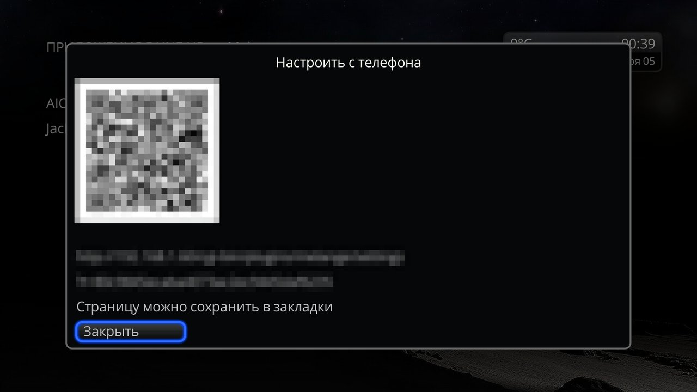
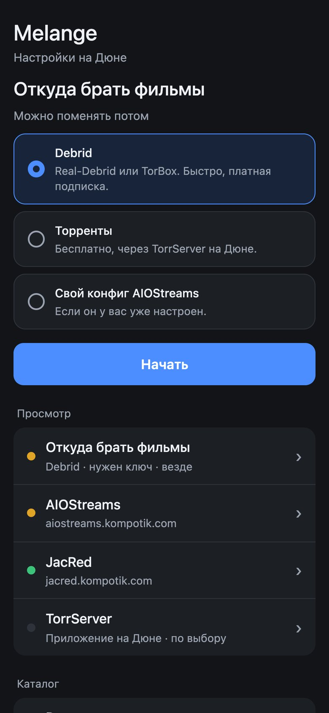
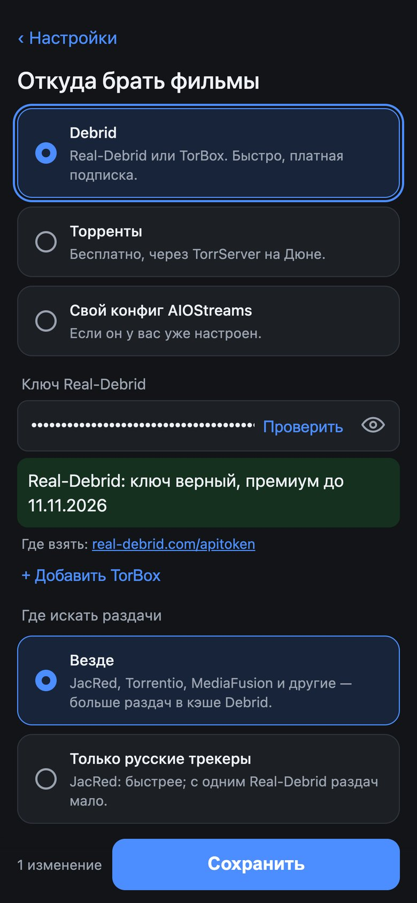
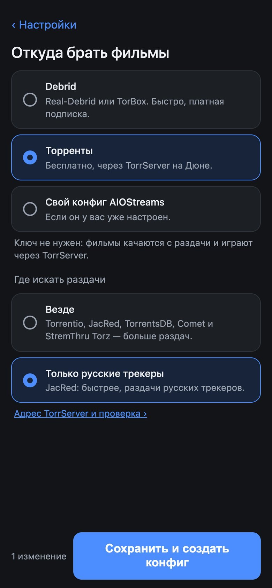
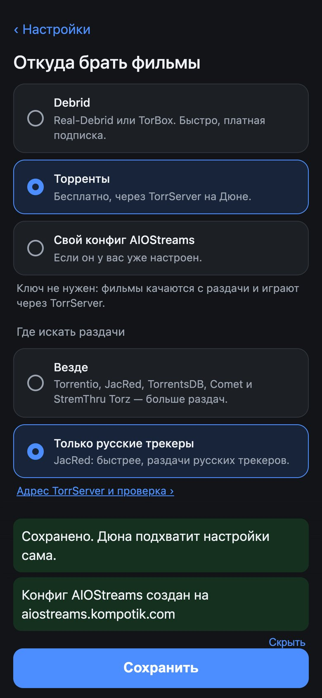
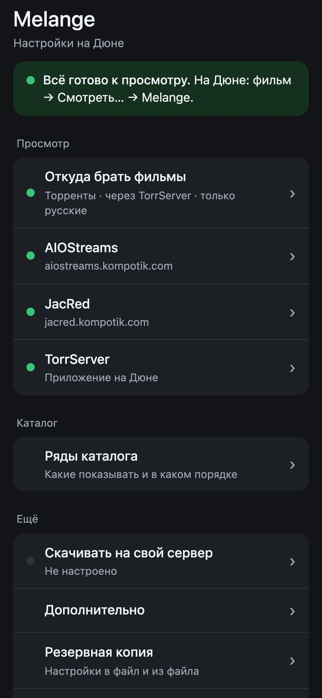
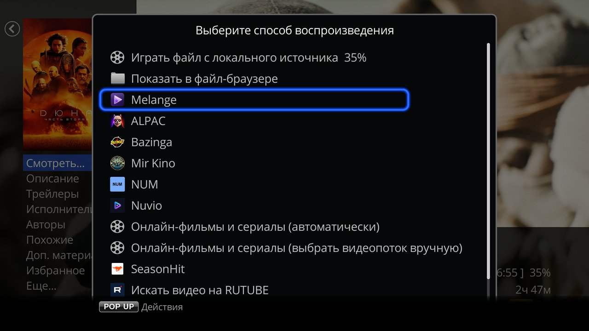

# Пошаговая настройка

От установки Melange до первого фильма, по шагам. [← README](../README.md)

## 1. Выберите, откуда брать фильмы

Решите заранее — от этого зависит, что понадобится дальше.

| Вариант | Что подготовить |
|---|---|
| **Debrid** — быстрый старт, много раздач, платно | ключ Real-Debrid ([real-debrid.com/apitoken](https://real-debrid.com/apitoken)) или TorBox ([torbox.app/settings](https://torbox.app/settings)) |
| **Торренты** — бесплатно, старт зависит от сидов | приложение TorrServe на Дюне (шаг 2) |
| **Свой конфиг AIOStreams** — если он у вас уже настроен | ссылка на конфиг (`…/manifest.json`) |

Сравнение подробнее — в [README](../README.md#что-нужно), о каждом варианте — в [Источниках раздач](sources.md).

## 2. Поставьте TorrServer (для торрентов)

Нужен для «Торрентов» и для своего конфига без Debrid. С Debrid — по желанию: через него можно смотреть раздачи, которых нет в кэше.

1. Установите на Дюну Android-приложение TorrServe (TorrServer MatriX).
2. Включите в нём запуск при включении Дюны.

Melange по умолчанию ищет TorrServer на самой Дюне, адрес вводить не нужно.

## 3. Установите Melange

1. Скачайте `dune_plugin_melange_<версия>.zip` последнего релиза: https://github.com/a1d4r/dune-hd-melange/releases (раздел Assets).
2. Скопируйте zip на флешку или во внутреннюю память Дюны.
3. На Дюне откройте «Источники», найдите zip и нажмите ENTER.
4. Подождите около полминуты — пункт «Melange» появится в меню «Смотреть…» карточек.

## 4. Откройте экран настроек на Дюне

Откройте **«Приложения» → «Melange»**: пока ничего не настроено, вместо каталога откроется экран настроек.

Дальше — один из двух путей.

**Только торренты, без телефона.** Нажмите **«Быстрая настройка: торренты»**: Melange сам создаст конфиг AIOStreams, ключи не нужны. Для просмотра нужен запущенный TorrServe. Переходите к шагу 7.

**Всё остальное — с телефона.** Нажмите **«Настроить с телефона»** — на экране появится QR-код страницы настроек.

## 5. Откройте страницу настроек на телефоне

1. Подключите телефон к той же домашней сети, что и Дюна.
2. Отсканируйте QR-код — откроется страница «Melange — настройки».
3. Сохраните её в закладки и никому не пересылайте ([почему](setup.md#ссылка-на-страницу)).

При первом открытии страница сразу спрашивает, **откуда брать фильмы**.

## 6. Выберите источник и сохраните

Выберите вариант и нажмите «Начать».

**Debrid**
1. Вставьте ключ Real-Debrid или TorBox (можно оба). **«Проверить»** в поле покажет, принят ли ключ и до какого числа премиум.
2. В «Где искать раздачи» оставьте **«Везде»** — так больше раздач в кэше.
3. Нажмите **«Сохранить и создать конфиг»** («Сохранить», если конфиг уже создан).

**Торренты**
1. В «Где искать раздачи» выберите **«Только русские трекеры»** (быстрее) или **«Везде»** (больше раздач).
2. По ссылке «Адрес TorrServer и проверка ›» можно проверить, отвечает ли TorrServer.
3. Нажмите **«Сохранить и создать конфиг»**.

 

**Свой конфиг AIOStreams**
1. Скопируйте ссылку на конфиг: на странице конфига AIOStreams — раздел «Save & Install», блок Stremio, поле «Direct Manifest URL».
2. Вставьте её в поле «Ссылка на конфиг». «Проверить» покажет, тот ли это манифест.
3. Нажмите **«Сохранить»**.

Дюна подхватит настройки сама. Если на главном экране страницы написано **«Всё готово к просмотру»** — можно смотреть; иначе там сказано, что ещё сделать.

Остальные разделы страницы (JacRed, TorrServer, ряды каталога и другие) необязательны — их описание в [Настройках](setup.md).

## 7. Посмотрите фильм

1. Откройте фильм в каталоге Melange («Приложения» → «Melange») или в каталоге «Фильмы» Дюны.
2. Нажмите **«Смотреть…»** и в списке способов воспроизведения выберите **«Melange»**.

3. Откроется список раздач. Выберите раздачу — лучше с пометкой «В кэше …» и молнией в строке (Debrid) или с большим числом сидов (торренты) — и нажмите ENTER.

Как устроен список, сериалы и история — в [Просмотре](watching.md). Что-то не вышло — [Решение проблем](troubleshooting.md).
