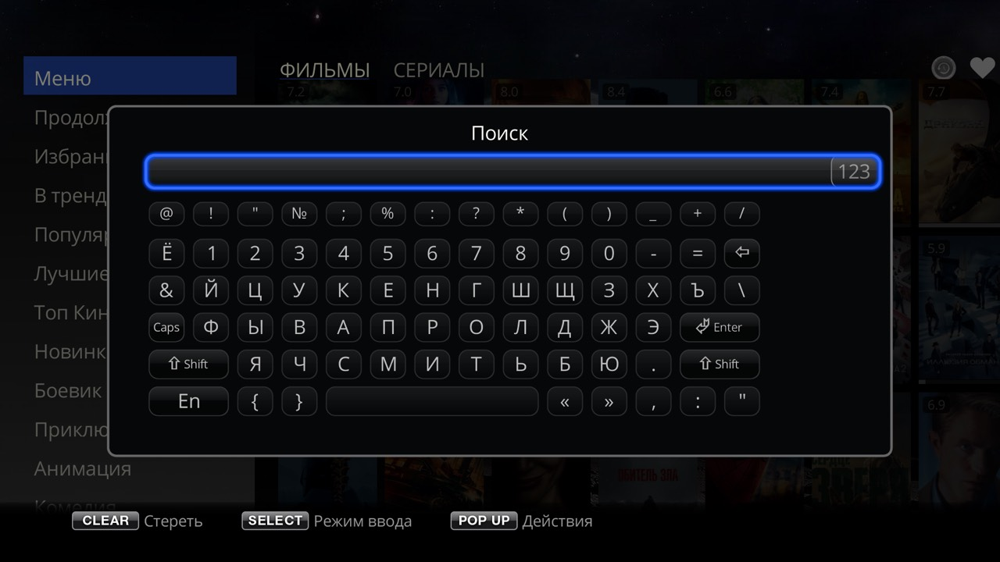
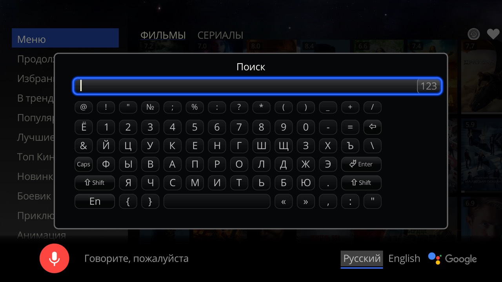
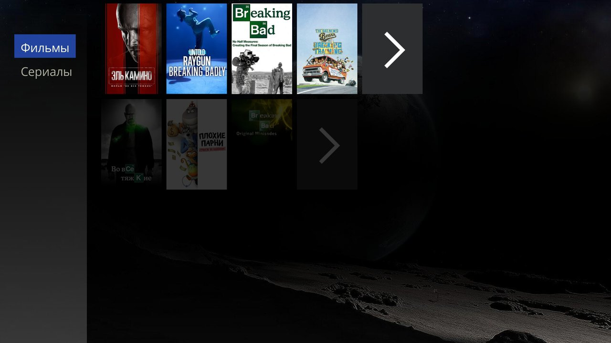

# Search

Find a movie or series by title, typed or spoken. [← Contents](README.en.md)

1. In the Melange catalog, open search: the magnifier on the bar at the top, the microphone button on the remote, or **POP UP** → "Search".

   

2. Type the title, or, while the cursor is in the input field, press the microphone again and say it.

   

3. Confirm. The results appear in the "Movies" and "Series" rows.

   

4. Press **ENTER** on the poster and choose "Watch" on the card, then go on as in [Watching](watch.en.md#movie).

You can also search in the Dune **Movies** catalog and choose **Play...** → "Melange" on the card ([From the Dune Movies catalog](watch.en.md#from-the-dune-movies-catalog)).

## If it did not work

- The microphone button starts Google Assistant: open search with the magnifier or via **POP UP** ([Troubleshooting](troubleshooting.en.md#catalog-and-the-tv-tab)).

Next: [Continue Watching and Favorites](favorites.en.md) · [Contents](README.en.md)
