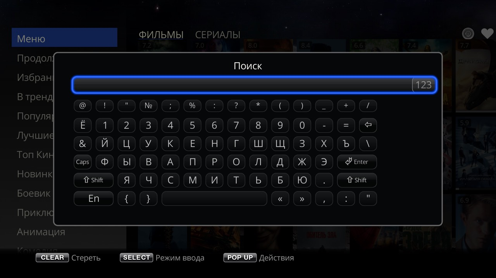
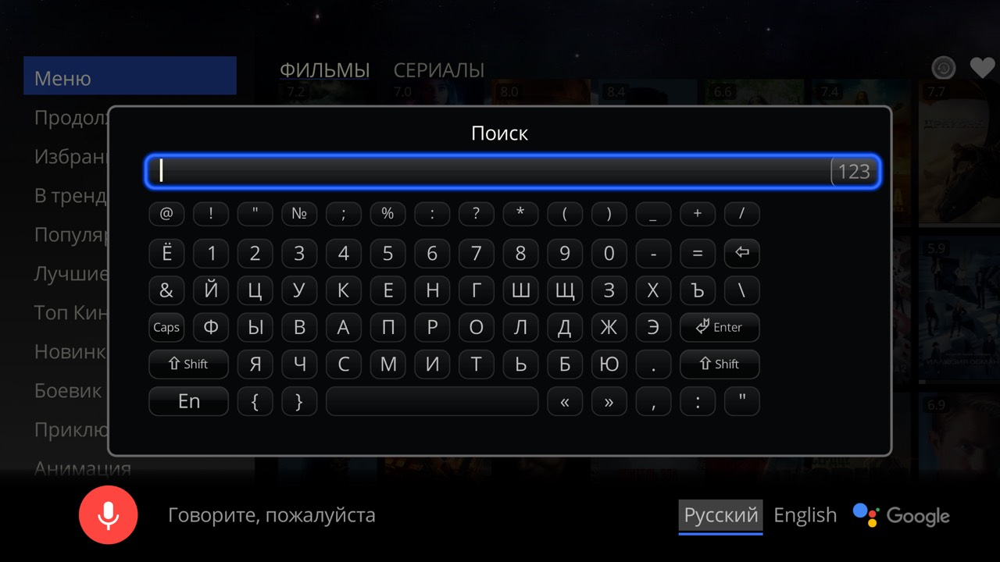
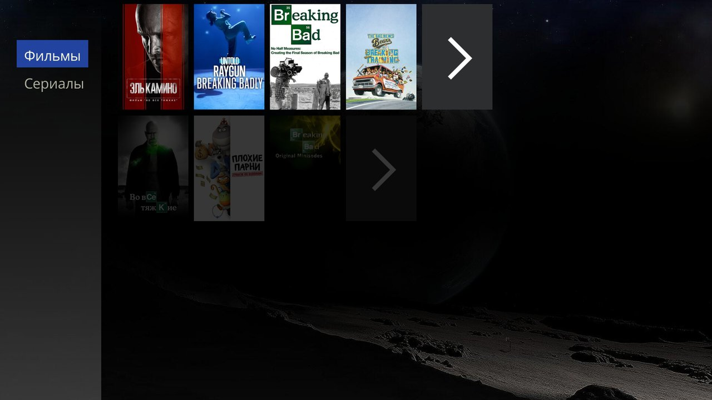

# Поиск

Найдём фильм или сериал по названию: набрать или продиктовать. [← Оглавление](README.md)

1. В каталоге Melange откройте поиск: лупа на полосе сверху, кнопка с микрофоном на пульте или **POP UP** → «Поиск».

   

2. Наберите название или, пока курсор в поле ввода, нажмите микрофон ещё раз и скажите название.

   

3. Подтвердите. Найденное появится в рядах «Фильмы» и «Сериалы».

   

4. Нажмите **ENTER** на постере и в карточке выберите «Смотреть», дальше как в [Просмотре](watch.md#фильм).

Искать можно и в каталоге «Фильмы» Дюны, а в карточке выбрать «Смотреть…» → «Melange — смотреть» ([Из «Фильмов» Дюны](watch.md#из-фильмов-дюны)).

## Если не получилось

- Кнопка микрофона запускает Google Ассистента — откройте поиск лупой или через **POP UP** ([Решение проблем](troubleshooting.md#каталог-и-вкладка-тв)).

Дальше: [«Продолжить» и «Избранное»](favorites.md) · [Оглавление](README.md)
