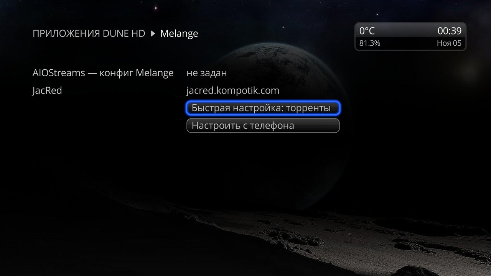
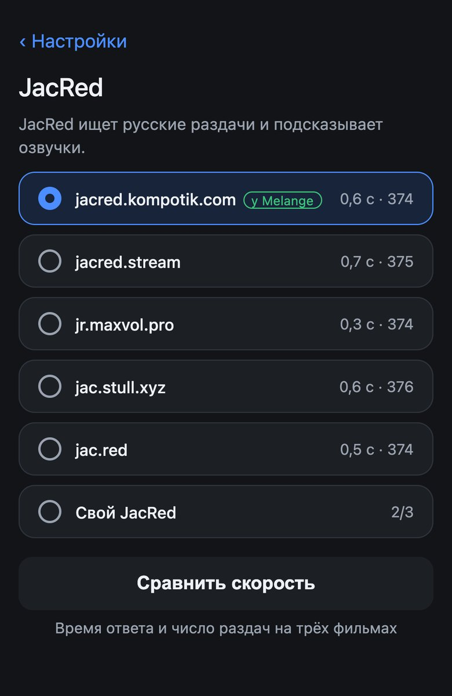

# Settings

The Melange settings screen on the Dune and the sections of the settings page on your phone. First-time setup step by step is in [Getting started](quick-start.en.md). [← README](../README.en.md)

- [Settings screen on the Dune](#settings-screen-on-the-dune)
- [Settings page on your phone](#settings-page-on-your-phone)
- [Where to get films and AIOStreams](#where-to-get-films-and-aiostreams)
- [JacRed](#jacred)
- [TorrServer](#torrserver)
- [Catalog rows](#catalog-rows)
- [Download to your server](#download-to-your-server)
- [Advanced](#advanced)
- [Backup](#backup)
- [Saving](#saving)
- [Page link](#page-link)

## Settings screen on the Dune

How to open it:
- **Setup → Apps → Melange**;
- the gear on the strip on top of the Melange catalog, MENU → **Settings** in the catalog or in the release list;
- while AIOStreams is not set up: **Apps → Melange**, or **Set up** in the **No AIOStreams config** window on a card (it also has **Quick setup: torrents**).

The screen has **Set up from a phone** (the QR code of the page), **Change the link** ([Page link](#page-link)) and, while AIOStreams is not set up, **Quick setup: torrents**.

### Quick setup from the remote

When you need it: you want to watch torrents and have no phone at hand. Melange creates the **Torrents** config itself, no keys needed; to watch, TorrServe must be running. If the AIOStreams server does not answer, the settings stay unchanged: try again later. Debrid, your own config and everything else are set up only from a phone.

## Settings page on your phone

It opens via the QR code (**Set up from a phone**) or from a bookmark, only from your home network. Its language follows the Dune's.

The top of the main screen says whether everything is ready to watch or what is left to do. **Check** buttons never save anything.

## Where to get films and AIOStreams

**Where to get films** is Debrid, **Torrents** or your own AIOStreams config; **AIOStreams** is the server Melange creates the config on, plus access to the config for fine-tuning. Both sections are covered in [Release sources](sources.en.md).

## JacRed

When you need it: there are few releases or JacRed does not answer. The default is `jacred.kompotik.com`, Melange's JacRed. With Debrid and **Torrents**, releases are searched in JacRed, and with any source Melange takes tracks and voice-overs from it; if the selected one does not answer, Melange asks `jacred.kompotik.com` for tracks and voice-overs.

You can pick another built-in one (`jacred.stream`, `jr.maxvol.pro`, `jac.stull.xyz`, `jac.red`) or **Own JacRed**: an address `http://host:port` or `https://host`, and a key if your JacRed requires one.

**Compare speed** shows each JacRed's average reply time and the number of releases found: choose a fast one with many releases. **Check** in the address field tests your own JacRed.

**Limitations:**
- a public AIOStreams server cannot reach your own JacRed at a home network address: releases will not be searched in it, only tracks and voice-overs. To search releases, you need an internet address or your own AIOStreams server on the home network;
- `jacred.stream` does not answer the `aiostreams.fortheweak.cloud` server: choose another JacRed;
- with **Torrents**, the key of your own JacRed must not contain the `|` character.

## TorrServer

When you need it: always with **Torrents** and for P2P releases of your own config; with Debrid, to watch releases that are not cached (MENU → **Watch via TorrServer**).

- **TorrServer address**: empty means TorrServer on the Dune itself (the TorrServe app, see [Getting started](quick-start.en.md#1-install-torrserve-torrents-only)). Anything else is `http://host:port` reachable from the Dune.
- **Login** and **Password**: if TorrServer asks you to log in (in TorrServe, **Local TorrServer with Authorization**). You can also put them in the address: `login:password@host:port`.
- **What to do with a release**: **Play** (default): TorrServer forgets the release after watching; **Add & Play**: the release stays in the TorrServer list.

**Check** shows whether TorrServer answers, and if not, why: TorrServe is not installed or not running, another program is at the address (check the port), or the login and password are missing or wrong.

## Catalog rows

Which rows the Melange catalog shows and in what order: see [Catalog](catalog.en.md#rows).

## Download to your server

When you need it: to send releases from the list to your own torrent client (MENU → **Download to server…**). Optional. How to send them: [Watching](watching.en.md#download-to-server).

Up to 5 servers: qBittorrent, rdt-client or Transmission. Each has a client, a name, the web UI address (`http://host:port`), a login and password (empty login means no login), and optional category and tags. **For the cache of** (TorBox, Real-Debrid or **Not from a cache**) sets which server is offered first for releases cached in TorBox, in Real-Debrid, or not cached.

**Transmission:** the address is `http://host:9091`; the address from your browser works too. Instead of a category there is a download folder, instead of tags there are labels (Transmission 4.0 and newer).

**Duplicate** copies a server into a new block, handy for a second server with the same address and another category. To delete a server, clear its fields.

**Check** on each server logs in to the client and shows whether all is well. qBittorrent creates missing categories and tags itself. Transmission may refuse the Dune: add its address to `rpc-whitelist`, and the server name from the address to `rpc-host-whitelist` (or use an IP).

> **Careful:** after several wrong passwords in a row (5 by default), qBittorrent bans the Dune for an hour, and downloads from it too.

## Advanced

**Running torrents** (with Debrid and your own config). When you need it: you do not want the Dune to download torrents itself. **No torrents** hides P2P releases and the menu items that start a torrent on the Dune or hand it to another app or server; releases started via TorrServer open the list from **Continue Watching**. Debrid **Not cached** releases stay: the service downloads them.

**Skip intro and credits.** On by default: the **Skip Intro** and **Next Episode** buttons in the player (see [Watching](watching.en.md#skip-intro-and-next-episode)). Turn it off if episodes take long to start: there will be no buttons, and episodes will start faster.

**Source errors.** When you need it: there are fewer releases than you expected and you want to know why. When on, the release list shows how many sources did not answer and why (MENU → **Source errors**).

## Backup

When you need it: before removing or reinstalling Melange, or to move the settings to another Dune.

**Save to a file** downloads all settings as one file. **Load from a file** replaces the current settings entirely.

Together with the settings come back the links to the AIOStreams configs already created (no new ones are created) and the settings page link: after loading, the page opens at the link from the file, so update your bookmark. When you move the settings, both Dunes use one AIOStreams config: edits to the config on one show on the other too.

> **The file holds Debrid keys, passwords and the settings page link**: keep it to yourself and do not share it with anyone.

## Saving

There is one save button for the whole page, at the bottom; you can switch between sections before saving. The Dune picks up the settings by itself.

Debrid and TMDB keys are checked with the services themselves: if a key is not accepted, nothing is saved, and the reason shows above the button and next to the field. Server addresses are not checked on save; the **Check** buttons are for that. Common format errors: the link to your own config must end with `manifest.json` (copy it from AIOStreams in full), and the address of your own JacRed must have no path or parameters: the key goes in its own field.

With Debrid and **Torrents**, saving creates or updates the config on the AIOStreams server. If that fails (server request limit, no connection), the settings are still saved: save again in a minute. Changed rows show the next time the catalog opens.

## Page link

- The link is permanent: you can bookmark it on your phone.
- Anyone who knows the link can see and change the settings, so do not share it with anyone.
- **Change the link** on the Dune settings screen issues a new link, and old bookmarks stop working; use it if the link got where it shouldn't.
- If the Dune's address on the network changed, the bookmark will not open: open the QR code again.
