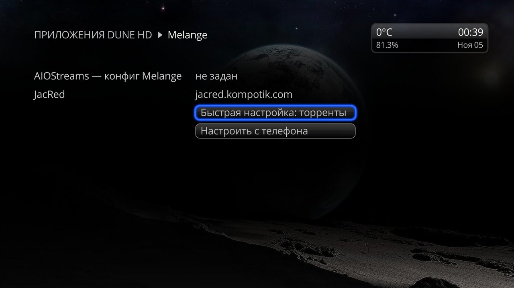
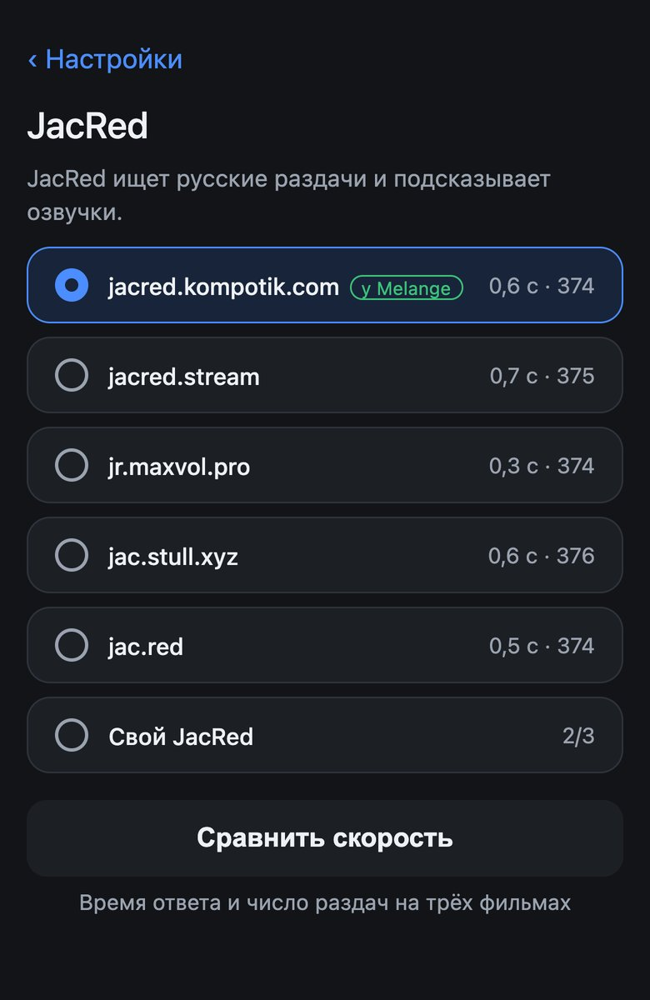

# Настройки

Экран настроек Melange на Дюне и разделы страницы настроек с телефона. Первая настройка по шагам — в разделе [Как начать смотреть](quick-start.md). [← README](../README.md)

- [Экран настроек на Дюне](#экран-настроек-на-дюне)
- [Страница настроек на телефоне](#страница-настроек-на-телефоне)
- [Откуда брать фильмы и AIOStreams](#откуда-брать-фильмы-и-aiostreams)
- [JacRed](#jacred)
- [TorrServer](#torrserver)
- [Ряды каталога](#ряды-каталога)
- [Скачивать на свой сервер](#скачивать-на-свой-сервер)
- [Дополнительно](#дополнительно)
- [Резервная копия](#резервная-копия)
- [Сохранение](#сохранение)
- [Ссылка на страницу](#ссылка-на-страницу)

## Экран настроек на Дюне

Как открыть:
- «Настройки» → «Приложения» → «Melange»;
- шестерёнка на полосе сверху каталога Melange, MENU → «Настройки» в каталоге или в списке раздач;
- пока AIOStreams не настроен — «Приложения» → «Melange» или «Настроить» в окне «Нет конфига AIOStreams» в карточке (там же есть «Быстрая настройка: торренты»).

На экране — **«Настроить с телефона»** (QR-код страницы), **«Сменить ссылку»** ([Ссылка на страницу](#ссылка-на-страницу)) и, пока AIOStreams не настроен, **«Быстрая настройка: торренты»**.

### Быстрая настройка с пульта

Когда нужно: смотреть торренты, а телефона под рукой нет. Melange сам создаёт конфиг «Торренты», ключи не нужны; для просмотра нужен запущенный TorrServe. Если сервер AIOStreams не ответил, настройки не меняются — попробуйте позже. Debrid, свой конфиг и остальное настраиваются только с телефона.

## Страница настроек на телефоне

Открывается по QR-коду («Настроить с телефона») или по закладке, только из домашней сети. Язык — как у Дюны.

Вверху главного экрана сказано, готово ли всё к просмотру или что ещё сделать. Кнопки «Проверить» ничего не сохраняют.

## Откуда брать фильмы и AIOStreams

«Откуда брать фильмы» — Debrid, «Торренты» или свой конфиг AIOStreams; «AIOStreams» — сервер, на котором Melange создаёт конфиг, и доступ к конфигу для тонкой настройки. Оба раздела — в [Источниках раздач](sources.md).

## JacRed

Когда нужно: раздач мало или JacRed не отвечает. По умолчанию выбран `jacred.kompotik.com` — JacRed Melange. При Debrid и «Торрентах» в JacRed ищутся раздачи, а при любом источнике Melange берёт из него дорожки и озвучки; не ответил выбранный — дорожки и озвучки Melange спросит у `jacred.kompotik.com`.

Можно выбрать другой встроенный (`jacred.stream`, `jr.maxvol.pro`, `jac.stull.xyz`, `jac.red`) или **«Свой JacRed»** — адрес `http://хост:порт` или `https://хост` и ключ, если ваш JacRed его требует.

**«Сравнить скорость»** покажет у каждого JacRed среднее время ответа и число найденных раздач — выберите быстрый и с большим числом раздач. Свой JacRed проверяет «Проверить» в поле адреса.

**Ограничения:**
- свой JacRed с адресом домашней сети публичному серверу AIOStreams недоступен: раздачи в нём искаться не будут, только дорожки и озвучки. Для поиска раздач нужен адрес из интернета или свой сервер AIOStreams в домашней сети;
- с сервера `aiostreams.fortheweak.cloud` не отвечает `jacred.stream` — выберите другой JacRed;
- при «Торрентах» ключ своего JacRed не должен содержать символ `|`.

## TorrServer

Когда нужно: при «Торрентах» и для раздач P2P своего конфига — всегда; при Debrid — чтобы смотреть раздачи не из кэша (MENU → «Смотреть через TorrServer»).

- **«Адрес TorrServer»** — пусто значит TorrServer на самой Дюне (приложение TorrServe, см. [Как начать смотреть](quick-start.md#1-поставьте-torrserve-только-для-торрентов)). Другой — `http://хост:порт`, доступный Дюне.
- **«Логин» и «Пароль»** — если TorrServer просит вход (в TorrServe — «Локальный TorrServer с авторизацией»). Можно вписать их в адрес: `логин:пароль@хост:порт`.
- **«Что делать с раздачей»** — **«Играть»** (по умолчанию): TorrServer забудет раздачу после просмотра; **«Добавить и играть»**: раздача останется в списке TorrServer.

**«Проверить»** покажет, отвечает ли TorrServer, а если нет — почему: не установлен или не запущен TorrServe, по адресу другая программа (проверьте порт), нужны или неверны логин и пароль.

## Ряды каталога

Какие ряды показывать в каталоге Melange и в каком порядке — см. [Каталог](catalog.md#ряды).

## Скачивать на свой сервер

Когда нужно: отправлять раздачи из списка в свой торрент-клиент (MENU → «Скачать на сервер…»). Необязательно. Как отправлять — в [Просмотре](watching.md#скачать-на-сервер).

До 5 серверов qBittorrent, rdt-client или Transmission. У каждого — клиент, название, адрес веб-интерфейса (`http://хост:порт`), логин и пароль (пустой логин — без входа), необязательные категория и теги. **«Для кэша»** (TorBox, Real-Debrid или «Не из кэша») — какой сервер предлагать первым для раздач из кэша TorBox, Real-Debrid или не из кэша.

**Transmission:** адрес — `http://хост:9091`, адрес из браузера тоже подойдёт. Вместо категории — папка загрузки, вместо тегов — метки (Transmission 4.0 и новее).

**«Дублировать»** копирует сервер в новый блок — удобно для второго сервера с тем же адресом и другой категорией. Чтобы удалить сервер, очистите его поля.

**«Проверить»** у каждого сервера войдёт в клиент и покажет, всё ли в порядке. Недостающие категории и теги qBittorrent создаст сам. Transmission может не пускать Дюну: добавьте её адрес в `rpc-whitelist`, а имя сервера из адреса — в `rpc-host-whitelist` (или укажите IP).

> **Осторожно:** после нескольких неверных паролей подряд (по умолчанию 5) qBittorrent блокирует Дюну на час — и закачки с неё тоже.

## Дополнительно

**Запуск торрентов** (при Debrid и своём конфиге). Когда нужно: не хотите, чтобы Дюна качала торренты сама. **«Без торрентов»** скрывает раздачи P2P и пункты меню, которые запускают торрент на Дюне или отдают его наружу; раздачи, начатые через TorrServer, из «Продолжить просмотр» открывают список. Раздачи Debrid «Нужно скачать» остаются: их качает сервис.

**Пропуск заставки и титров.** Включён по умолчанию: в плеере кнопки «Пропустить заставку» и «Следующий эпизод» (см. [Просмотр](watching.md#пропустить-заставку-и-следующий-эпизод)). Выключите, если серии долго запускаются, — кнопок не будет, серии станут запускаться быстрее.

**Ошибки источников.** Когда нужно: раздач меньше, чем ожидали, и хочется понять почему. Если включить, в списке раздач будет видно, сколько источников не ответили и почему (MENU → «Ошибки источников»).

## Резервная копия

Когда нужно: перед удалением или переустановкой Melange или чтобы перенести настройки на другую Дюну.

**«Сохранить в файл»** скачивает все настройки одним файлом. **«Загрузить из файла»** заменяет текущие настройки целиком.

Вместе с настройками возвращаются привязки к уже созданным конфигам AIOStreams (новые не создаются) и ссылка на страницу настроек: после загрузки страница откроется по ссылке из файла — обновите закладку. При переносе обе Дюны пользуются одним конфигом AIOStreams: правки конфига на одной видны и на другой.

> **В файле ключи Debrid, пароли и ссылка на страницу настроек** — храните его у себя и никому не пересылайте.

## Сохранение

Кнопка сохранения одна на всю страницу, внизу; между разделами до сохранения переходить можно. Дюна подхватит настройки сама.

Ключи Debrid и TMDB проверяются у самих сервисов: ключ не принят — ничего не сохраняется, а над кнопкой и у поля — причина. Адреса серверов при сохранении не проверяются — для этого кнопки «Проверить». Частые ошибки формата: ссылка на свой конфиг должна кончаться на `manifest.json` (скопируйте её из AIOStreams целиком), а в адресе своего JacRed не должно быть пути и параметров — ключ вводится в своё поле.

При Debrid и «Торрентах» после сохранения создаётся или обновляется конфиг на сервере AIOStreams. Не вышло (лимит запросов сервера, нет связи) — настройки всё равно сохранены, сохраните ещё раз через минуту. Изменённые ряды появятся при следующем открытии каталога.

## Ссылка на страницу

- Ссылка постоянная — её можно сохранить в закладки телефона.
- Кто знает ссылку, тот видит и меняет настройки, поэтому никому её не пересылайте.
- **«Сменить ссылку»** на экране настроек Дюны выдаёт новую ссылку, старые закладки перестают работать — если ссылка попала не туда.
- Если у Дюны в сети сменился адрес, закладка не откроется — откройте QR заново.
