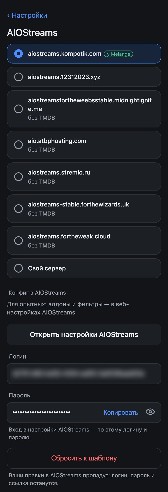

# Release sources and the AIOStreams config

Where Melange gets releases from: Debrid, torrents or your own config, choosing the AIOStreams server, and what Melange does with the config. The options compared: [README](../README.en.md#requirements). [← README](../README.en.md)

- [How it works](#how-it-works)
- [Debrid](#debrid)
- [Torrents](#torrents)
- [Own AIOStreams config](#own-aiostreams-config)
- [Switching between options](#switching-between-options)
- [Source profiles](#source-profiles)
- [AIOStreams server](#aiostreams-server)
- [Tuning the config in AIOStreams](#tuning-the-config-in-aiostreams)
- [What Melange changes in the config](#what-melange-changes-in-the-config)

## How it works

Releases come from [AIOStreams](../README.en.md); its config sets which search addons to query and how to filter and sort.

- With **Debrid** and **Torrents**, Melange itself creates and updates the config on the selected [AIOStreams server](#aiostreams-server).
- With **your own config**, Melange only reads the release list from your link.

The option is chosen on the settings page, in the **Where to get films** section.

## Debrid

When to choose it: you have a Real-Debrid or TorBox subscription. Releases cached in Debrid start at once.

**Keys** for Real-Debrid or TorBox, or both: the second one is added with the link under the first. Where to get them: [Getting started](quick-start.en.md#4b-debrid-from-your-phone).

**Main Debrid** shows up once both keys are in. If a release is cached in both services, the copy of the main one plays; with none chosen, the one that came first. You can also change it in the release list: MENU → [**Main Debrid → …**](watching.en.md#the-actions-menu).

**Where to look for releases** is the config template:

| Template | Addons | When |
|---|---|---|
| **Everywhere** (default) | JacRed, Torrentio, MediaFusion, Comet, StremThru Torz | more cached releases, especially with Real-Debrid |
| **Russian trackers only** | JacRed | faster replies, but few releases with Real-Debrid alone |

Choosing a template and saving means [resetting the config](#reset-to-the-template) to it (even if you changed the addons in the web settings). Other saves, for example of a new key or JacRed, [leave](#what-melange-changes-in-the-config) your edits alone.

**What is in the Melange config:**
- releases that are not cached show as **Not cached** (MediaFusion returns only cached ones);
- 144p–576p, CAM / SCR / TS / TC, 3D and XviD / DivX are filtered out;
- releases in Russian rank higher;
- with both keys, a release cached in both services comes from each, and the list shows it as one row;
- if the next episode has no cached releases, AIOStreams may add its release to Debrid in advance.

## Torrents

When to choose it: you have no Debrid subscription. No key needed; releases play via [TorrServer](setup.en.md#torrserver).

**Where to look for releases** is a separate choice from Debrid:

| Template | Addons | When |
|---|---|---|
| **Russian trackers only** (default) | JacRed | faster replies |
| **Everywhere** | Torrentio, JacRed, TorrentsDB, Comet, StremThru Torz | more releases |

Releases with more seeders rank higher; a heavy release (high bit rate) needs more of them. Releases with no seeder data go last.

On AIOStreams servers other than `aiostreams.kompotik.com`, the JacRed search goes through the third-party Magnetio addon (`magnetio.peterdsp.dev`), which receives the address and key of the selected JacRed.

## Own AIOStreams config

When to choose it: you already have a tuned AIOStreams config (services, filters, limits).

**Config link**: `https://<instance>/…/manifest.json`; `stremio://…` works too. Where to get it: on the AIOStreams config page, the **Save & Install** section, the Stremio block, the **Direct Manifest URL** field.

- Melange does not edit this config, and no Debrid keys are needed for it.
- P2P releases (without Debrid) play via [TorrServer](setup.en.md#torrserver).
- JacRed is needed only for tracks and voice-overs: if it does not answer, there are no tracks, everything else works.
- If you change the config password in AIOStreams, the link changes too: enter the new one.

## Switching between options

- Keys and configs of all three options are kept whatever you choose: switch away and back, and everything is in place.
- Each server has one config for Debrid and one for **Torrents**. When you switch, Melange moves to the config of the new option (creating it if there is none), and the config of the previous one stays with all its edits.
- If the config of the new option could not be created (server unavailable, limit), go back to the previous option: its config is intact.
- To switch from the remote without opening the page, use [source profiles](#source-profiles).

## Source profiles

When you need it: you have both Debrid and torrents, or several AIOStreams servers (for example, your own on a NAS), and want to change the source from the remote, right in the release list. A profile is a set of source settings under a name you choose: Debrid, **Torrents** or your own config, the AIOStreams server, the template and JacRed.

Off by default: turn it on in **Advanced** → [**Source profiles**](setup.en.md#advanced). Then the **Where to get films** section becomes the profile editor.

**The editor.** At the top is the list of profiles, the current one marked "now". Tap a profile to open it. Its source, template, AIOStreams server and JacRed are on this screen and on the **AIOStreams** and **JacRed** screens, which also say which profile is open. Debrid and TMDB keys, TorrServer, download servers and the other settings are shared by all profiles.
- **Save** saves the open profile. If it is the current one, the changes take effect at once, as without profiles. If not, only the profile changes and the Dune keeps getting films from the current one; Melange creates or updates the profile's config on the server right away.
- **Make it current** does the same as choosing the profile in the menu on the Dune.
- **Delete** removes the profile; its config on the server stays.
- **A new profile:** **+ New profile**, a name, the settings, **Save**. A new profile starts with the settings of the current source and gets a config of its own on the server, so one server and mode can have several profiles, for example with different JacRed. Two profiles can't have the same settings: change at least one.
- If the current source is not saved as a profile (for example, you have just turned the setting on), the editor shows it. Type a name and press **Save**, and it becomes a profile. With no name, **Save** saves the settings as usual.
- You can have up to 8 profiles, and the names must differ. While the page has unsaved changes, another profile won't open: save them first or reload the page.
- "No config" on a profile means its config on the server has not been created yet, for example because the server did not answer. Open the profile and press **Save**. Without a config, the profile is not in the Dune menu.

**On the Dune.** In the release list, MENU → [**Get films from → …**](watching.en.md#the-actions-menu) with the name of the profile when there is only one to switch to, or **Get films from…** with the list of profiles, the current one marked "· now". Melange first asks the new source for the releases of this film or episode. If the source answers, it becomes the source everywhere at once, as a change on the page would, and the list shows its releases; with none, the list is empty. If it does not answer or does not accept the link, the previous one stays, and a window says why. The JacRed of the profile comes along with the source, so it is the one that suggests voice-overs and tracks.

**Keep in mind:**
- A source that is not saved as a profile cannot be brought back from the menu: save it as a profile before you switch.
- After changing a Debrid key, open each profile on the page, except your own configs, and press **Save**: this way the new key gets into the config of every profile.
- A page opened on your phone does not see switches made on the Dune: reload it after them. If you save a profile on an old page after the Dune switched away from it, Melange saves the changes to the profile, keeps the source chosen on the Dune and says so.
- [**Load from a file**](setup.en.md#backup) replaces the profiles entirely, like the other settings.
- If you turn the setting off, the page is as it was without profiles. The profiles are kept and come back when you turn it on.

## AIOStreams server

The **AIOStreams** section of the settings page (for Debrid and **Torrents**) is the server where Melange creates the config.

The default is `aiostreams.kompotik.com`, Melange's server. It also provides intro and credits times for the [Skip Intro and Next Episode](watching.en.md#skip-intro-and-next-episode) buttons; on other servers, episodes play without them.

**TMDB key.** Servers marked **no TMDB** have no key of their own, and without one AIOStreams finds fewer series releases. For such a server, set your own key: [themoviedb.org](https://www.themoviedb.org/settings/api) → Settings → API, the v3 key.

**Own server** is your own AIOStreams, for example on a NAS: an address `http://host:port` or `https://host`, no path. Melange creates the config there; if the server requires a password to create configs, saving shows its error.

**Each server has its own config.** Choose another server and a new config is created there; come back and the previous one is picked up. Old configs are not deleted from the servers.

## Tuning the config in AIOStreams

For experienced users who want to change the filters or sorting, or add other addons. Once the config is created, the **AIOStreams** section has a **Config in AIOStreams** block: the **Open the AIOStreams settings** link and the config's login and password. Open the link, enter the password and tune the config.

> Do not change the config password in AIOStreams: Melange will not learn it, will forget the config and create a new one on the next save.

### Reset to the template

**Reset to the template** replaces the config on the server with the selected template, with the keys and JacRed from Melange. The login, password and link stay, but all edits made in the AIOStreams web settings are lost, including keys entered there. The same happens if you choose another template in **Where to look for releases** and save.

## What Melange changes in the config

On every save, Melange updates only its own parts of its config: the Debrid keys, the selected JacRed (removed, it comes back; turned off, it stays off), the TMDB key and a copy of a cached release from each service (Deduplicator → Cached: `per_service`, unless you changed it by hand). Your keys and other edits from the web settings stay; only a [reset to the template](#reset-to-the-template) erases them.

If JacRed does not answer the AIOStreams server, there are fewer releases, and with the **Russian trackers only** template there are none.
