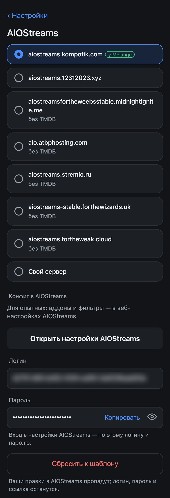

# Источники раздач и конфиг AIOStreams

Откуда Melange берёт раздачи: Debrid, торренты или свой конфиг, выбор сервера AIOStreams и что Melange делает с конфигом. Сравнение вариантов — в [README](../README.md#что-нужно). [← README](../README.md)

- [Как это устроено](#как-это-устроено)
- [Debrid](#debrid)
- [Торренты](#торренты)
- [Свой конфиг AIOStreams](#свой-конфиг-aiostreams)
- [Переключение между вариантами](#переключение-между-вариантами)
- [Сервер AIOStreams](#сервер-aiostreams)
- [Конфиг в AIOStreams: настройка под себя](#конфиг-в-aiostreams-настройка-под-себя)
- [Что Melange меняет в конфиге](#что-melange-меняет-в-конфиге)

## Как это устроено

Раздачи присылает [AIOStreams](../README.md); какие аддоны поиска спрашивать, как фильтровать и сортировать, задаёт его конфиг.

- При **Debrid** и **«Торрентах»** конфиг создаёт и обновляет сам Melange на выбранном [сервере AIOStreams](#сервер-aiostreams).
- При **своём конфиге** Melange только читает список раздач по вашей ссылке.

Вариант выбирается на странице настроек, в разделе «Откуда брать фильмы».

## Debrid

Когда выбирать: есть подписка Real-Debrid или TorBox. Раздачи из кэша Debrid стартуют сразу.

**Ключи** Real-Debrid или TorBox, можно оба, — где взять, в [Пошаговой настройке](quick-start.md#1-выберите-откуда-брать-фильмы).

**Где искать раздачи** — шаблон конфига:

| Шаблон | Аддоны | Когда |
|---|---|---|
| **«Везде»** (по умолчанию) | JacRed, Torrentio, MediaFusion, Comet, StremThru Torz | больше раздач в кэше, особенно у Real-Debrid |
| **«Только русские трекеры»** | JacRed | ответ быстрее, но с одним Real-Debrid раздач мало |

Выбрать шаблон и сохранить — значит [сбросить конфиг](#сброс-к-шаблону) к нему (в том числе если вы меняли аддоны в веб-настройках).

**Что в конфиге Melange:**
- раздачи не из кэша видны как «Нужно скачать» (у MediaFusion — только раздачи в кэше);
- отфильтрованы 144p–576p, CAM / SCR / TS / TC, 3D, XviD / DivX;
- раздачи на русском — выше;
- если у следующей серии нет раздач в кэше, AIOStreams может заранее добавить её раздачу в Debrid.

## Торренты

Когда выбирать: подписки Debrid нет. Ключ не нужен, раздачи играют через [TorrServer](setup.md#torrserver).

**Где искать раздачи** — свой выбор, отдельно от Debrid:

| Шаблон | Аддоны | Когда |
|---|---|---|
| **«Только русские трекеры»** (по умолчанию) | JacRed | ответ быстрее |
| **«Везде»** | Torrentio, JacRed, TorrentsDB, Comet, StremThru Torz | больше раздач |

Выше в списке — раздачи с большим числом сидов; тяжёлой раздаче (высокий битрейт) их нужно больше. Раздачи без данных о сидах — в конце.

На серверах AIOStreams, кроме `aiostreams.kompotik.com`, поиск в JacRed идёт через сторонний аддон Magnetio (`magnetio.peterdsp.dev`) — ему передаются адрес и ключ выбранного JacRed.

## Свой конфиг AIOStreams

Когда выбирать: у вас уже есть настроенный конфиг AIOStreams (сервисы, фильтры, лимиты).

**«Ссылка на конфиг»** — `https://<инстанс>/…/manifest.json`, подойдёт и `stremio://…`; где взять — в [Пошаговой настройке](quick-start.md#6-выберите-источник-и-сохраните).

- Melange этот конфиг не правит, ключи Debrid для него не нужны.
- Раздачи P2P (без Debrid) играют через [TorrServer](setup.md#torrserver).
- JacRed нужен только для дорожек и озвучек: не ответил — дорожек не будет, остальное работает.
- Сменили пароль конфига в AIOStreams — ссылка тоже сменилась, введите новую.

## Переключение между вариантами

- Ключи и конфиги всех трёх вариантов хранятся при любом выборе: переключились и вернулись — всё на месте.
- У каждого сервера по конфигу на Debrid и на «Торренты». При переключении Melange переходит на конфиг нового варианта (если его нет — создаёт), конфиг прежнего остаётся со всеми правками.
- Не удалось создать конфиг нового варианта (сервер недоступен, лимит) — вернитесь к прежнему: его конфиг цел.

## Сервер AIOStreams

Раздел «AIOStreams» страницы настроек (для Debrid и «Торрентов») — сервер, где Melange создаёт конфиг.

По умолчанию — `aiostreams.kompotik.com`, сервер Melange. Он же отдаёт время заставки и титров для кнопок [«Пропустить заставку» и «Следующий эпизод»](watching.md#пропустить-заставку-и-следующий-эпизод); на других серверах серии играют без них.

**Ключ TMDB.** У серверов с пометкой «без TMDB» своего ключа нет, и без него AIOStreams находит меньше раздач сериалов. Для такого сервера задайте свой ключ: [themoviedb.org](https://www.themoviedb.org/settings/api) → Settings → API, ключ v3.

**Свой сервер** — ваш AIOStreams, например на NAS: адрес `http://хост:порт` или `https://хост`, без пути. Melange создаёт конфиг там же; если сервер требует пароль на создание конфигов, при сохранении будет его ошибка.

**Конфиг у каждого сервера свой.** Выбрали другой сервер — на нём создастся новый, вернулись — подхватится прежний. Старые конфиги на серверах не удаляются.

## Конфиг в AIOStreams: настройка под себя

Для опытных: если хотите поменять фильтры, сортировку или добавить другие аддоны. Когда конфиг создан, в разделе «AIOStreams» есть блок «Конфиг в AIOStreams» — ссылка «Открыть настройки AIOStreams», логин и пароль конфига. Откройте ссылку, введите пароль и настройте конфиг.

> Пароль конфига в AIOStreams не меняйте: Melange его не узнает, забудет конфиг и при следующем сохранении создаст новый.

### Сброс к шаблону

**«Сбросить к шаблону»** заменяет конфиг на сервере выбранным шаблоном с ключами и JacRed из Melange. Логин, пароль и ссылка остаются, а все правки в веб-настройках AIOStreams пропадают — в том числе вписанные там ключи. То же происходит, если выбрать в «Где искать раздачи» другой шаблон и сохранить.

## Что Melange меняет в конфиге

При каждом сохранении Melange обновляет в своём конфиге только своё: ключи Debrid, выбранный JacRed (удалили — вернётся, выключили — останется выключенным), ключ TMDB. Ваши ключи и другие правки из веб-настроек остаются; стирает их только [сброс к шаблону](#сброс-к-шаблону).

Если JacRed не ответил серверу AIOStreams, раздач будет меньше, а в шаблоне «Только русские трекеры» — ни одной.
