# Quick start

Melange is a movie and series catalog for Dune HD. Pick a movie, and Melange finds it in torrents and plays it in the Dune player right away, without downloading. [← Contents](README.en.md)

We will install Melange and TorrServe (the Dune plays torrents through it) and open the catalog. TorrServe is an app, and TorrServer runs inside it: Melange messages use both names.

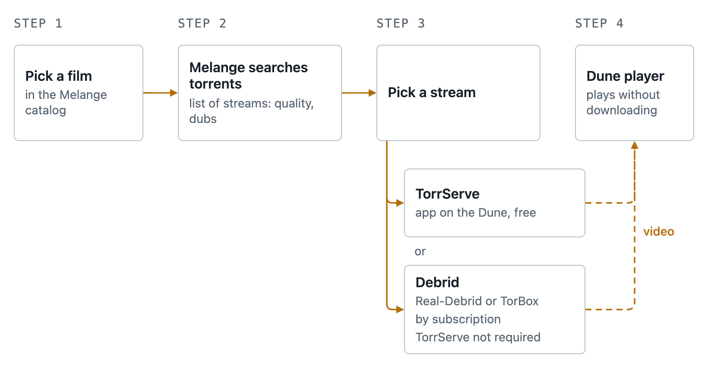

You need: a Dune HD on Android with firmware r22 or newer, r24 or r25 recommended. How firmware versions differ: [Known limitations](limitations.en.md#devices-and-firmware).

If you have a Real-Debrid or TorBox subscription, go to the [Debrid](debrid.en.md) chapter after installing Melange: you don't need TorrServe then.

You can install with the remote [via Dune BackUp](#via-dune-backup) or [manually](#manually), with files from GitHub.

## Via Dune BackUp

1. If Dune BackUp is not installed yet, install it: Dune Store → "Apps" → "Community apps" → "Ignore and continue", move to "Dune BackUp", press **ENTER** and install the app.

   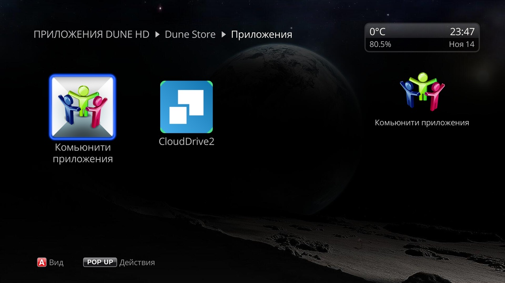

   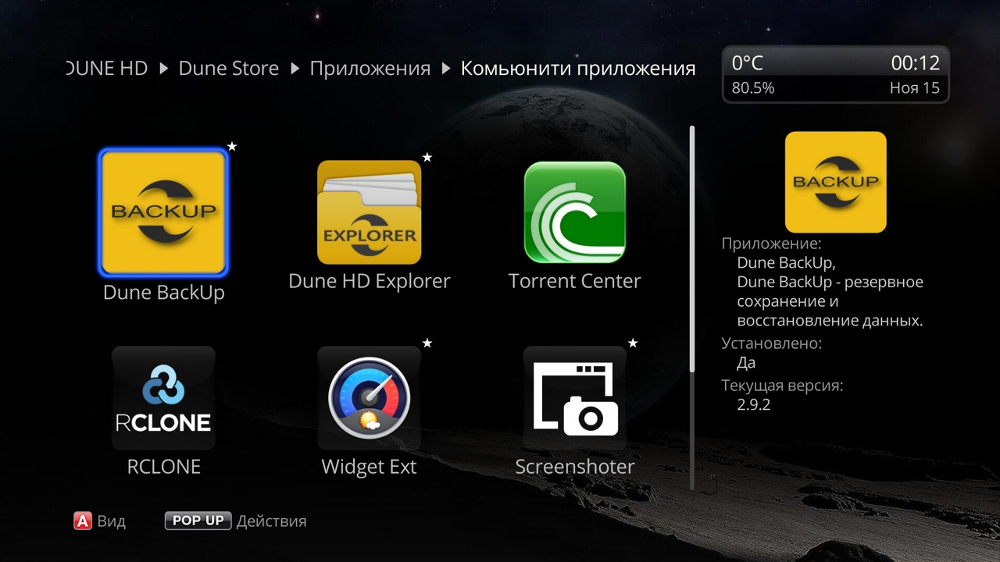

2. Open Dune BackUp → "Plugin collection for Dune HD".

   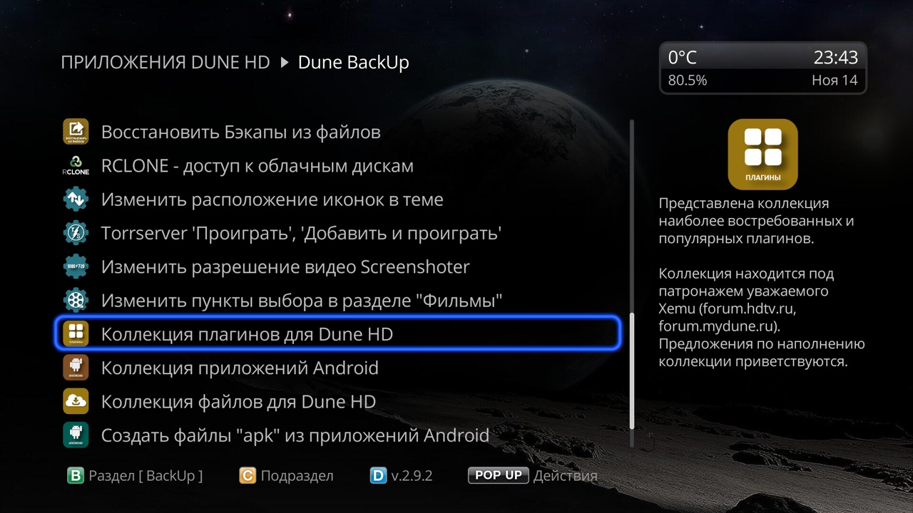

3. Move to the "Plugin" field and press **ENTER**: a list opens. In the Movies section, choose "Melange" and press "Install plugin". If Melange is already installed, answer "Yes" to "Replace the app?".

   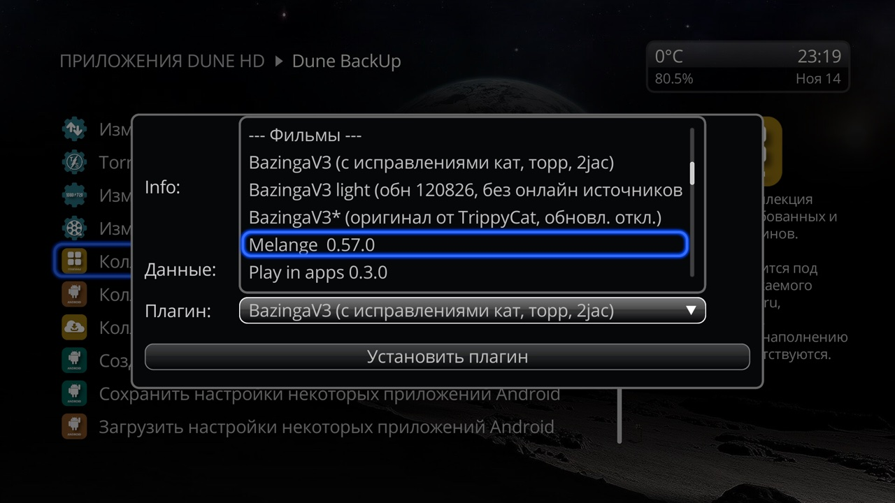

4. Open Melange in "Apps". The Dune offers a new version: press "Update".

   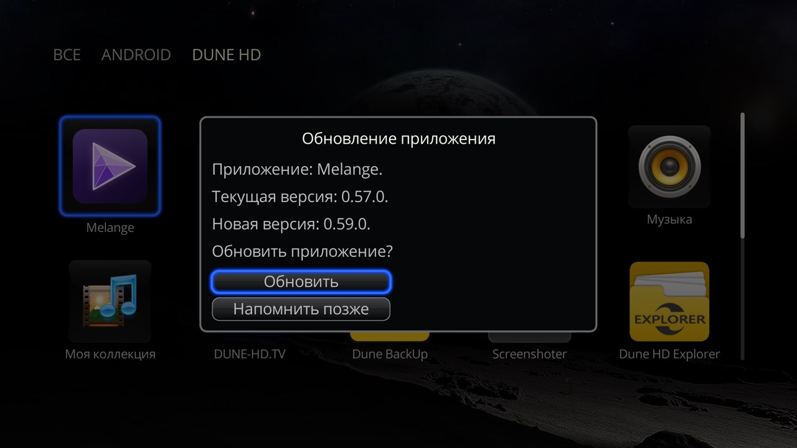

5. TorrServe is installed in the same place: Dune BackUp → "Android app collection" → "App" → the top "TorrServe MatriX" in the For torrents section → "Install app". Any MatriX version will do.

   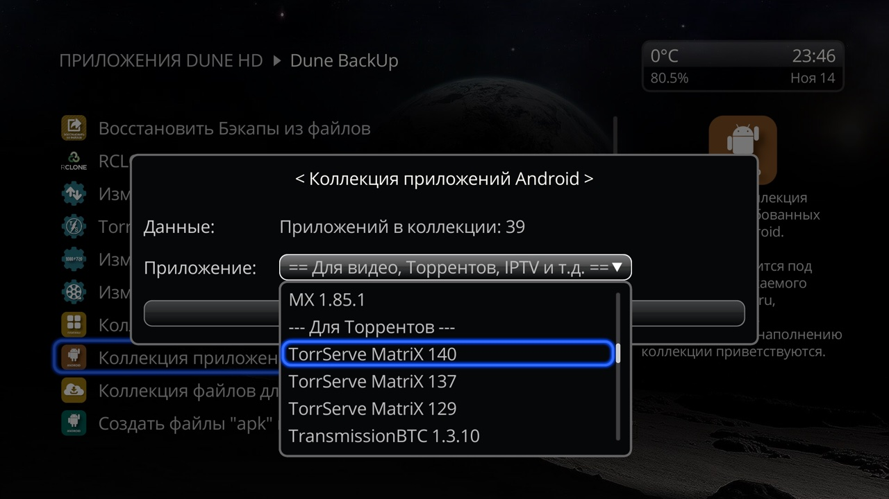

Next: [first setup](#first-setup).

## Manually

1. Download `dune_plugin_melange_<version>.zip` from the latest release (Assets section): https://github.com/a1d4r/dune-hd-melange/releases. For TorrServe, download `TorrServe_MatriX.145.Client.apk` (Assets section): https://github.com/YouROK/TorrServe/releases/tag/MatriX.145.Client. Any MatriX version will do.

2. Copy both files to the Dune any way you like: from a phone via Send Files, over the network or on a USB stick. Don't unpack the zip.

3. On the Dune, open **"Files"**, find the zip in the folder you copied it to, move to it and press **ENTER**.

   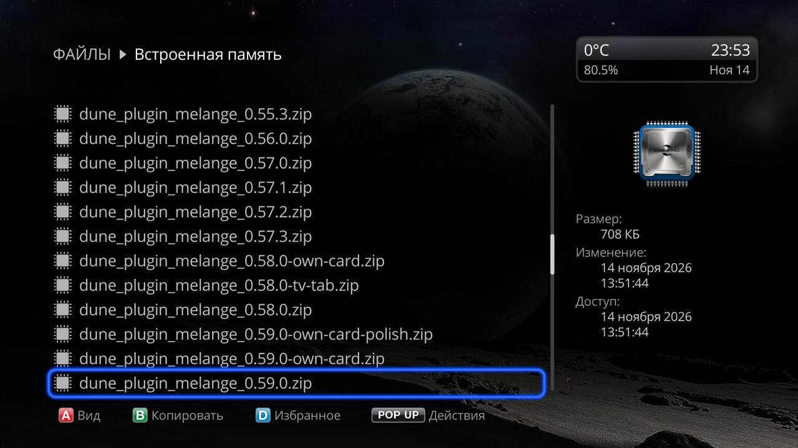

4. Wait for "Installed successfully" and press "OK".

   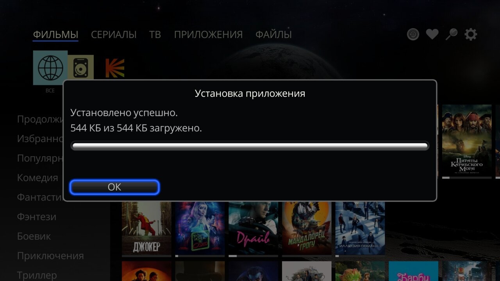

5. Install the TorrServe apk the same way, via **"Files"**.

## First setup

1. Open TorrServe: "Apps" → ANDROID tab → TorrServe. If it asks to install the server, install it. In TorrServe settings, turn on **"Start server on boot"** and, below it, **"Run server as root"**.

   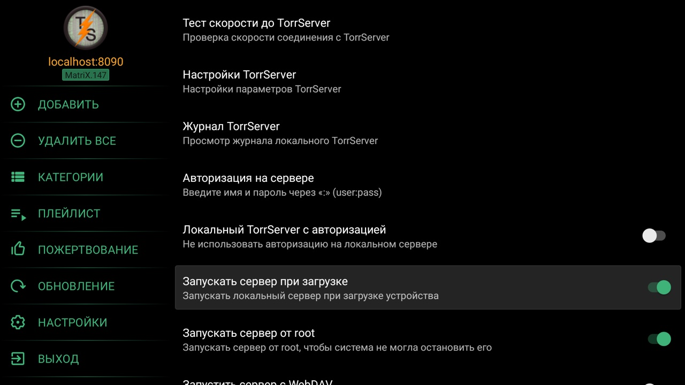

2. Open **"Apps"** → **"Melange"**.

   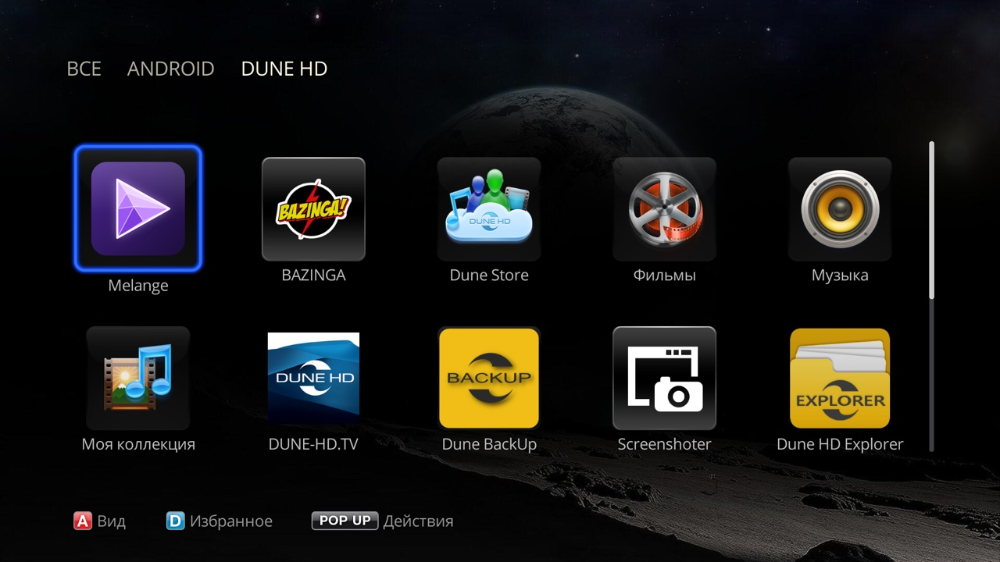

3. Press **"Quick setup: torrents"**.

   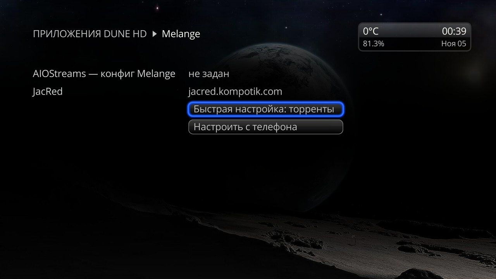

   "AIOStreams - Melange config: not set" is expected. AIOStreams is the server that searches for releases, and the config is your settings on it. Melange creates it by itself.

4. The Melange catalog opens: you can pick a movie.

   

   If you see "TorrServer does not answer", open TorrServe (it starts the server), then Melange again. If that does not help, check step 1.

The Dune offers new Melange versions by itself.

Next: [Watching](watch.en.md) · [Contents](README.en.md)

Bugs: Issues at https://github.com/a1d4r/dune-hd-melange/issues
