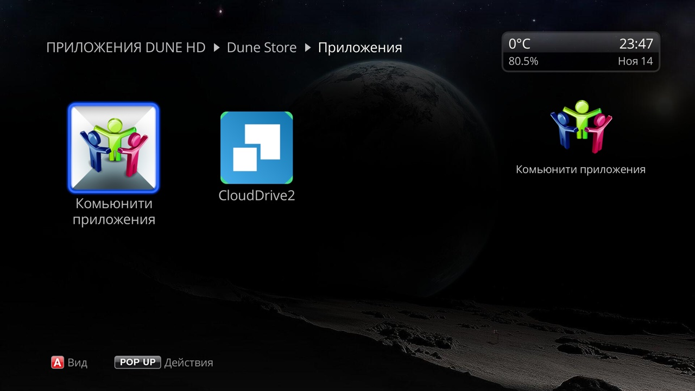
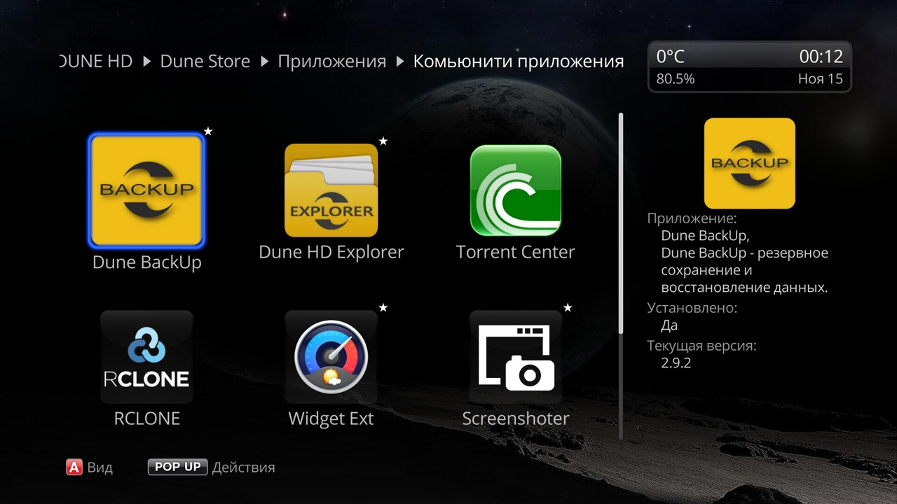
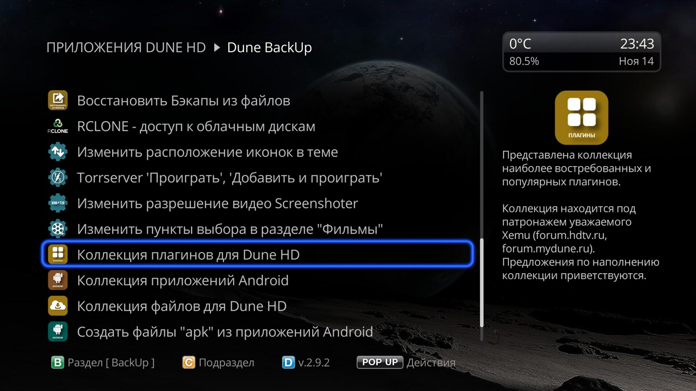
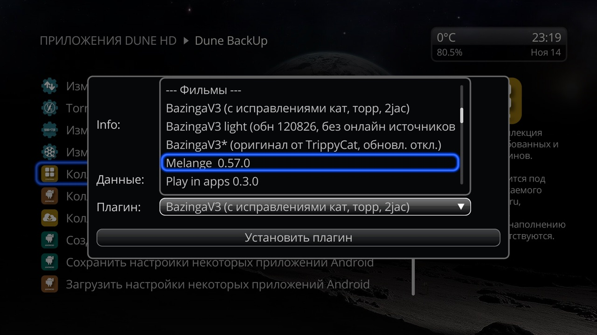
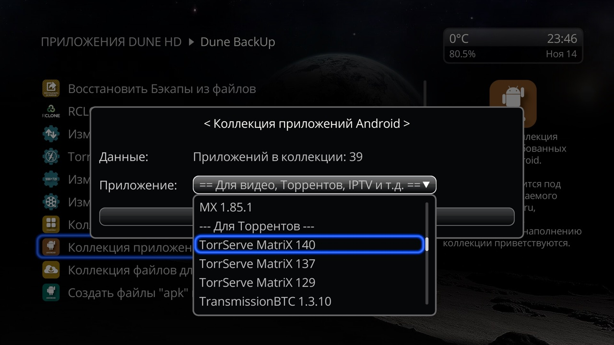
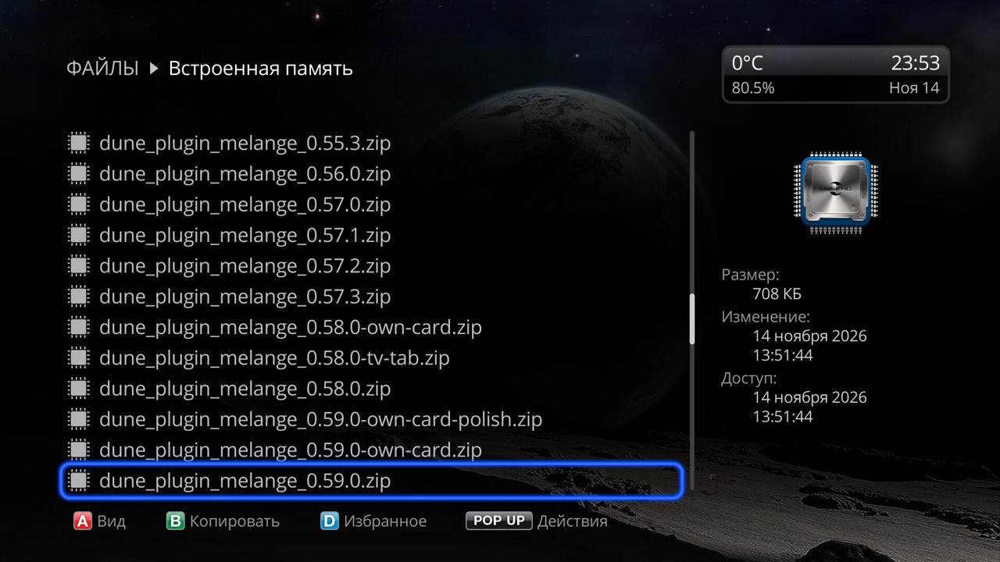
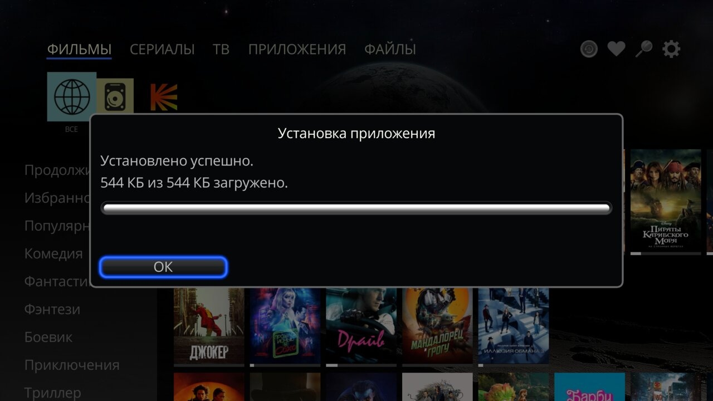
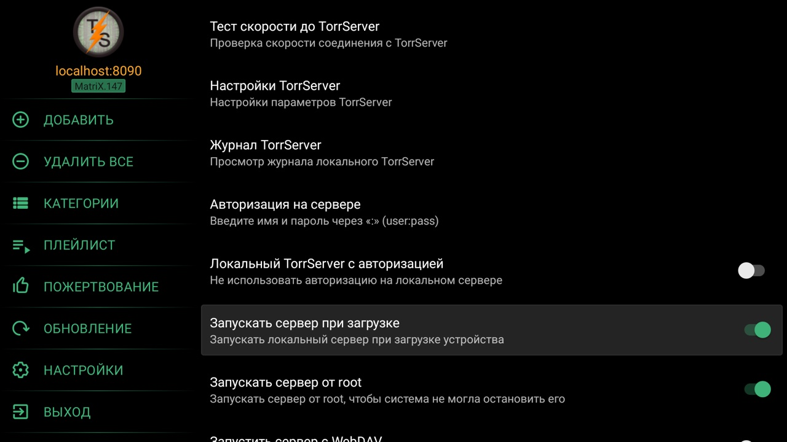
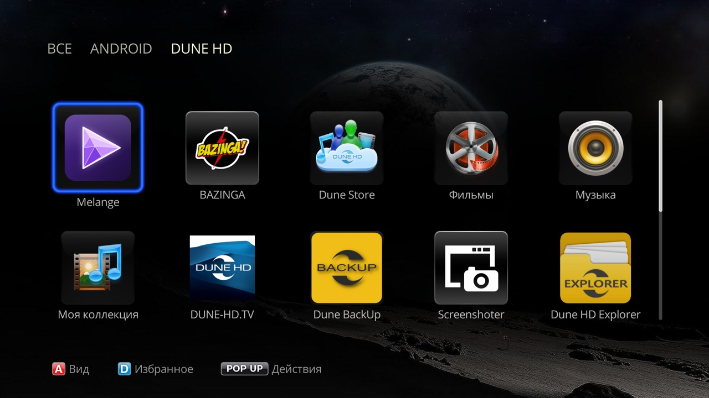
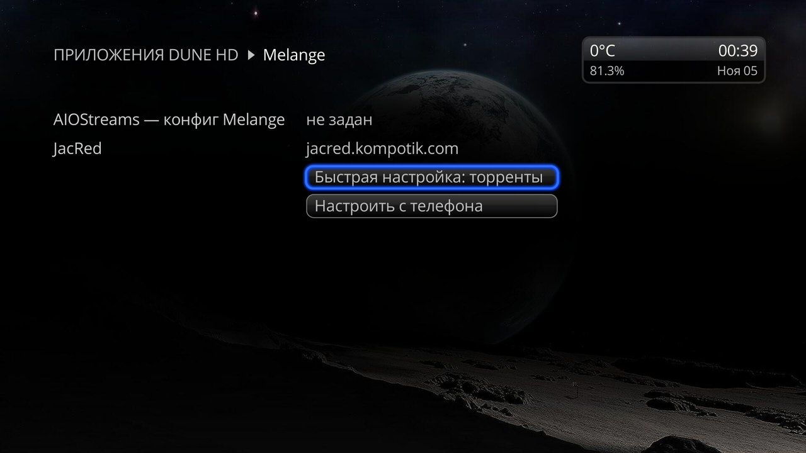

# Быстрый старт

Melange — каталог фильмов и сериалов для Dune HD. Выберите фильм — Melange найдёт его в торрентах и сразу включит в плеере Дюны, без скачивания. [← Оглавление](README.md)

Поставим Melange и TorrServe (через него Дюна играет торренты) и откроем каталог.

Нужно заранее: Dune HD на Android с прошивкой r22 или новее. Рекомендуется r25 (если доступна) или r24.

Если у вас есть подписка Real-Debrid или TorBox, после установки Melange переходите к главе [Debrid](debrid.md): TorrServe тогда не обязателен.

Ставить можно пультом [через Dune BackUp](#через-dune-backup) или [вручную](#вручную), файлами с GitHub.

## Через Dune BackUp

1. Если Dune BackUp ещё не установлен, поставьте его: Dune Store → «Приложения» → «Комьюнити приложения» → «Игнорировать и продолжить» → «Dune BackUp».

   

   

2. Откройте Dune BackUp → «Коллекция плагинов для Dune HD».

   

3. В списке «Плагин», в разделе «--- Фильмы ---», выберите «Melange» и нажмите «Установить плагин».

   

4. Когда Дюна предложит обновить Melange до последней версии, согласитесь.

   <!-- TODO скриншот: предложение обновить Melange, фокус на согласии -->

5. TorrServe ставится там же: Dune BackUp → «Коллекция приложений Android» → «Приложение» → верхний «TorrServe MatriX» в разделе «--- Для Торрентов ---» → «Установить приложение».

   

Дальше: [первая настройка](#первая-настройка).

## Вручную

1. Скачайте `dune_plugin_melange_<версия>.zip` последнего релиза (раздел Assets): https://github.com/a1d4r/dune-hd-melange/releases. Для TorrServe скачайте `TorrServe_MatriX.145.Client.apk` (раздел Assets): https://github.com/YouROK/TorrServe/releases/tag/MatriX.145.Client.

2. Скопируйте оба файла на Дюну любым способом: с телефона через Send Files, по сети или флешкой. Zip не распаковывайте.

3. На Дюне откройте **«Файлы»**, встаньте на zip и нажмите **ENTER**.

   

4. Дождитесь «Установлено успешно» и нажмите «OK».

   

5. Так же, через **«Файлы»**, установите apk TorrServe.

## Первая настройка

1. Откройте TorrServe. Если он попросит установить сервер — установите. В настройках TorrServe включите **«Запускать сервер при загрузке»**.

   

2. Откройте **«Приложения»** → **«Melange»**.

   

3. Нажмите **«Быстрая настройка: торренты»**.

   

4. Откроется каталог Melange: можно выбирать фильм.

   

   Если появилось «TorrServer не отвечает», откройте TorrServe и проверьте шаг 1.

Новые версии Melange Дюна предложит сама.

Дальше: [Свои ряды каталога](catalog-rows.md) · [Оглавление](README.md)

Вопросы и обсуждение — в Telegram-канале https://t.me/arrakis_vibecode, ошибки — в Issues: https://github.com/a1d4r/dune-hd-melange/issues
